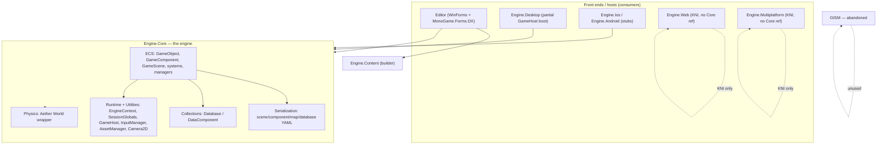

# 01 — Architecture

The intended architecture is a **standalone engine class library** consumed by interchangeable front ends. This document describes that design, the actual repository layout, the current boundary violations, and the vocabulary you need to read the code.

**Status:** Working (core design) · Partial (separation goal not fully realized) · Experimental (alternative hosts)

## 1. Design philosophy

The project's own manifest (`Engine/Engine_Manifest.txt`) states the intent:

> "The engine is built strictly as a standalone library to build games (`Engine.Core`). **The engine knows nothing about the editor and never will.**" (`:4`)
>
> "The editor (`engine.editor`) and platform targets (`engine.desktop`, `engine.web`, `engine.android`, etc.) are simply distinct wrapper build targets that consume the engine library." (`:5`)

Two consequences follow:

1. **All reusable behaviour belongs in `Engine.Core`** — ECS, rendering, physics, serialization, data, input, utilities.
2. **Front ends are consumers** — the WinForms editor today, a React-based editor tomorrow, and platform hosts for distribution. They should own only presentation and host lifecycle.

The API style deliberately borrows Unity's *ergonomics* without using Unity: rich `GameObject` helper methods, `AddComponent<T>()`, `Start`/`Update`, and query-driven systems, while remaining a custom engine (`Engine_Manifest.txt:6-7`).

> **Reality check:** The separation is incomplete. See §4.

## 2. Repository map

| Path | Role | Status |
|---|---|---|
| `Engine/` (`Engine.Core`) | The engine: ECS, systems, serializers, physics, UI, utilities | The real codebase |
| `Engine.Content/` | Standalone content builder executable + editor-facing `DynamicBuilder` | Partial |
| `Editor/` | WinForms editor, MonoGame.Forms viewport, inspector, script compiler | Partial but most complete front end |
| `Engine.Gameplay/` | Placeholder for a game project | Stub |
| `Engine.Desktop/` | DesktopGL host booting the shared `GameHost` | Partial |
| `Engine.Ios/`, `Engine.Android/` | Mobile hosts | Stub |
| `Engine.Web/` | KNI/nkast BlazorGL web host | Experimental |
| `Engine.Multiplatform/` | Separate KNI solution with shared game + platform hosts | Experimental |
| `GISM/` | Abandoned custom markup language | Unused — ignore |
| `SavedGameProjectData/` | Hardcoded development sandbox (`Engine/Utilities/AssetPathProvider.cs:20-38`) | Dev-only |
| `docs/` | This documentation | — |

`Tesseract2D.sln` contains nine projects: `Engine.Editor`, `Engine.Core`, `Engine.Content`, `Engine.Desktop`, `Engine.Web`, `Engine.Ios`, `Engine.Android`, `Engine.Gameplay`, and `Engine.Tests` (`Tesseract2D.sln:6-23`). Multiplatform and GISM are deliberately outside it. See [09-build-and-content.md](09-build-and-content.md).

## 3. Dependency picture



Arrows that are dashed indicate the experimental stacks do not currently reference `Engine.Core` at all. `Engine.Core` itself references MonoGame DesktopGL (`Engine/Engine.Core.csproj:12-13`), so even the "standalone" library is desktop-coupled at the package level.

## 4. The engine/editor boundary today

### Intended direction

```text
Editor  ──calls──▶  Engine.Core  ──reads/writes──▶  project files (YAML)
```

### Current contract

The concrete `EditorContextManager` now lives in `Editor/Services/EditorContextManager.cs:10-17` and forwards to the core `EngineContext.Current` bridge (`Engine/Runtime/EngineContext.cs:46-63`). Core code takes dependencies explicitly:

| Core contract | Usage |
|---|---|
| `IEngineContext` | Project root/path helpers and `PlayState` injected into scenes and services (`Engine/Runtime/EngineContext.cs:13-20`; `Engine/ECS/GameScene.cs:74-83`) |
| `DatabaseManager` | Injected into `GameScene`; `Map.ResolveDatabase` reads only `activeScene.Database` (`Engine/ECS/GameScene.cs:62-83`; `Engine/Gameplay/Map.cs:328-344`) |
| `SessionGlobals` | Per-session `InputManager`, `EditorCamera`, and `Viewport` (`Engine/Runtime/SessionGlobals.cs:11-41`) |
| `IInputSource` / `IFrameRenderer` | Platform input and drawing boundaries (`Engine/Runtime/IInputSource.cs`, `Engine/Runtime/IFrameRenderer.cs`) |

Static `EngineContext.Current`, `SessionGlobals.Current`, and `Globals.Current` remain compatibility shims for frozen WinForms call sites; new engine code should use injection. The newer engine APIs still accept optional ambient defaults (`GameHost`, `GameScene`, `SessionGlobals`, `SystemsManager`), and both real hosts inject explicitly (`Engine.Desktop/Game1.cs:39-48`; `Editor/MGWindowControl.cs:54-64`); this is an accepted transitional tradeoff, not a new engine→editor dependency. Architecture is pinned by `Engine.Tests/ArchitectureTests.cs:9-24`: core declares no `EditorContextManager` and references no `Editor*` assembly. See [08-react-editor-boundary.md](08-react-editor-boundary.md) for the next host boundary work.

## 5. Unity-flavoured conventions

| Term in code | Meaning here |
|---|---|
| `GameObject` | Entity: name, tags, active flag, component dictionary, parent/children, `Id` |
| `gameObject` (lowercase) | Component's back-reference to its owning `GameObject` (`Engine/ECS/GameComponent.cs:18-22`) |
| `AddComponent<T>()`, `GetComponent<T>()`, `HasComponent<T>()`, `RemoveComponent<T>()` | Component API (`Engine/ECS/GameObject.cs:213-337`) |
| `isActive` | GameObject-level enable; toggles script `OnEnable/OnDisable` and `hasStarted` (`GameObject.cs:20-35`) |
| `isEnabled` | Component-local flag; calls `GameComponent.OnEnabled/OnDisabled` on change; class default is `false`, but both add paths set it to `true` (`GameComponent.cs:46-64`; `GameObject.cs:213-250`) |
| `Start`, `Update`, `OnEnable`, `OnDisable` | `ScriptComponent` lifecycle (`Engine/ECS/Components/ScriptComponent.cs`) |
| `Destroy()` | Full unregister/unlink (`GameObject.cs:370-401`) |
| `ContextScene` | Injected owner-scene reference on entities, systems, managers |
| `GameSystem` | Query-driven iteration over matched entities |
| `UsedInEditor` | Unity ExecuteInEditMode equivalent (`Engine/ECS/GameSystem.cs:19-24`) |
| `Manager` | Service registry (`EntityManager`, `SystemsManager`, `PhysicsManager`, `ManagersManager`, `DatabaseManager`) |

Do not import or emulate Unity APIs unless the engine already provides them (manifest `:7`).

## 6. Glossary of overloaded names

| Name | Meaning |
|---|---|
| `GameSpace` | Project metadata DTO only — title, version, settings, scene list (`Engine/ECS/GameSpace.cs:9-30`). `ActiveScene` is never assigned. |
| `PhysicsManager.PhysicsSpace` | The actual Aether Physics2D `World` (`Engine/ECS/Managers/PhysicsManager.cs:31`, created at `:89`). |
| `UISpace` | Enum `Screen` vs `World` for UI rendering. |
| `GameScene` | The runtime scene graph + managers + tilemaps. **This** is the active scene. |
| `SceneManager` | Static global scene registry; activation/next-scene methods are implemented (`Engine/Runtime/SceneManager.cs:34-102`, `:123-131`), while serialized `LoadScene`/`PreLoadScene` are TODOs (`:104-121`) and no host wires the activation API. `GameHost` loads/attaches one scene directly (`Engine/Runtime/GameHost.cs:69-99`). |
| `EntityManager` | Per-scene registry of GameObjects and component buckets. |
| `isEnabled` vs `IsActive` | Component flag vs script flag — different methods fire. |
| `OnEnabled/OnDisabled` vs `OnEnable/OnDisable` | Base component hooks vs script hooks (the scripts omit the `d`). |

See [10-known-issues.md](10-known-issues.md) for the full list of traps these create.

## 7. Layer responsibilities

| Layer | Owns | Does not own |
|---|---|---|
| `Engine.Core` | Simulation, ECS, rendering primitives, physics, serialization, data assets, injectable context/session and shared host loop | Windows UI, project browsing, script compilation, file dialogs, concrete editor state (§4) |
| `Editor` | Project/scene/hierarchy/inspector UI, script build + hot reload, content build trigger, gizmo input, play-in-editor | Serialization formats, component behaviour, physics; delegates the common frame loop to `GameHost` |
| Platform hosts | MonoGame host lifecycle, graphics device, renderer/input adapters, game loop entry | Scene graph; DesktopGL is partial, other hosts are stubs |
| `Engine.Content` | Transforming source assets into MonoGame content output | Game logic |

## See also

- [00-status-and-scope.md](00-status-and-scope.md) — what is implemented
- [02-ecs.md](02-ecs.md) — the core object model in detail
- [07-editor-internals.md](07-editor-internals.md) — the current front end
- [08-react-editor-boundary.md](08-react-editor-boundary.md) — the intended future boundary
- [14-alpha-todo.md](14-alpha-todo.md) — active Alpha v1 work queue
- [11-health-todo.md](11-health-todo.md) — archived hardening pass, especially P2 decoupling
- [12-future-roadmap.md](12-future-roadmap.md) — feature scope and deferred work
