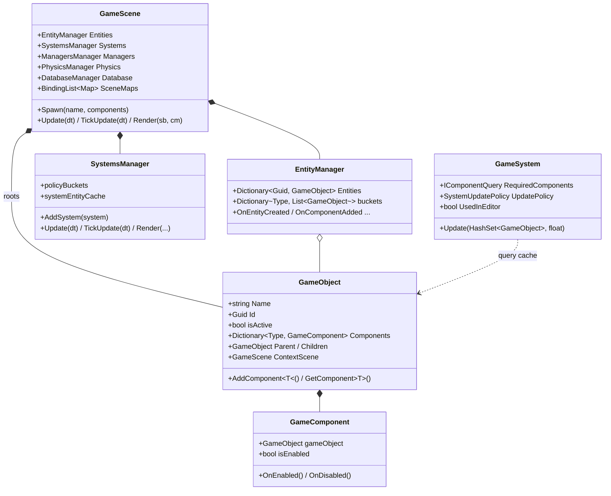
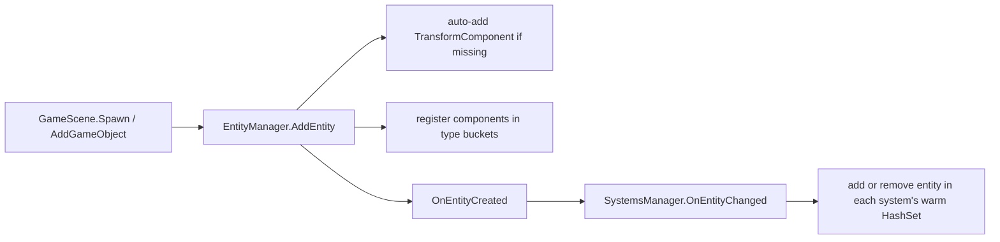
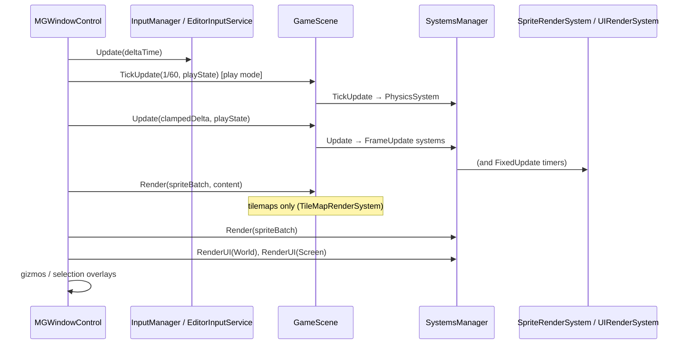

# 02 — ECS Core

This is the central reference for Tesseract2D's Entity Component System: the object model, registration and lifecycle, the fluent query API, systems and managers, the Aether physics wrapper, and the frame call order. The design is Unity-flavoured but implemented from scratch.

**Status:** Working (object model, queries, built-in systems, cache reconciliation, scene readiness finalization, late-spawn/multi-collider physics init, PPM transform↔body sync) · Partial (lifecycle edge cases, collision callback API)

## 1. Object model



### Ownership hierarchy

```text
GameScene                              (owns managers; Unity-"Scene" equivalent)
 ├─ EntityManager Entities              (GameObject registry + component buckets)
 ├─ SystemsManager Systems              (system registry + per-system warm entity caches)
 ├─ ManagersManager Managers            (scene-local GameManager services)
 ├─ PhysicsManager Physics              (Aether World wrapper)
 ├─ DatabaseManager Database            (data assets — see 04-databases.md)
 ├─ BindingList<Map> SceneMaps          (tilemaps)
 └─ GameObject (root entities)
     ├─ Components: Dictionary<Type, GameComponent>
     ├─ Parent / Children
     └─ GameComponent subclasses (Script, Transform, Sprite, UI, Physics, Collider, Data...)
```

Definitions: `Engine/ECS/GameObject.cs:12`, `GameComponent.cs:13`, `GameScene.cs:21`, `GameSystem.cs:14`, `Engine/ECS/GameSpace.cs:9`.

Every `GameObject` has a `ContextScene` back-reference (`GameObject.cs:45`). `GameSpace` is **not** the active scene — it is a project metadata DTO whose `ActiveScene` is never assigned (`GameSpace.cs:23-27`). The runtime active scene is `EditorContextManager.ActiveLoadedScene` / the editor host's local reference.

## 2. Scene construction and registration cascade

`GameScene()` (`GameScene.cs:69-78`) initializes managers and ensures at least one `Map(25, 19)` exists (`:73-77`). `InitializeManagers()` is idempotent: managers, event subscriptions, and database loading happen once, then `FinalizeInitialization()` runs on every call (`:93-113`).

```csharp
// Engine/ECS/GameScene.cs:95-112 (abridged)
if(Entities == null)
{
    Entities  = new EntityManager()  { ContextScene = this };
    Systems   = new SystemsManager() { ContextScene = this };
    Physics   = new PhysicsManager() { ContextScene = this };
    Managers  = new ManagersManager(){ ContextScene = this };
    Database  = new DatabaseManager(){ ContextScene = this };
}

InitializeManagerEvents();
// database load guarded by _databasesLoaded
FinalizeInitialization();
```

`FinalizeInitialization()` is the canonical engine-only "scene is ready" step: it rebinds every manager's `ContextScene`, calls `SystemsManager.SetContextScene(this)`, and rebuilds all warm caches (`GameScene.cs:126-137`, `Engine/ECS/Managers/SystemsManager.cs:122-150`). `SceneSerializer.LoadScene` calls it before returning (`Engine/Serialization/SceneSerializer.cs:337`), and `resetContextSceneInManagers()` is now an alias (`GameScene.cs:286-289`). No WinForms call-site change is needed.

`InitializeManagerEvents()` (`GameScene.cs:80-91`) is the bridge from entity mutations to system cache reconciliation and guards against duplicate subscriptions with `_managerEventsInitialized`:

```csharp
Entities.OnEntityCreated       += entity => Systems.OnEntityChanged(entity);
Entities.OnComponentAdded      += (entity, comp) => Systems.OnEntityChanged(entity);
Entities.OnComponentRemoved    += (entity, comp) => Systems.OnEntityChanged(entity);
Entities.OnEntityRemoved       += entity => Systems.OnEntityDestroyed(entity);
Entities.OnEntityActiveChanged += entity => Systems.OnEntityChanged(entity);
```

`EntityManager` republishes `GameObject.ActiveEvent` as `OnEntityActiveChanged` (`EntityManager.cs:27`, `:45`, `:95`, `:149-155`).



- Spawn overloads: `GameScene.cs:154-206`; all end in `Entities.AddEntity`.
- `EntityManager.AddEntity` (`EntityManager.cs:35-61`) subscribes to component and activation events, auto-adds `TransformComponent` if missing (`:49-53`), registers components into buckets (`:57-60`), then fires `OnEntityCreated`.
- **Hierarchy and registration are unified.** `GameObject.AddChild` (`GameObject.cs:99-110`) delegates to `SetParent` (`:170-206`), so it writes `ParentId`, fires `ParentChangedEvent`, and registers an unregistered child via `ContextScene.AddGameObject`. `GameScene.Spawn(name, parent)` (`GameScene.cs:186-206`) still works and ends in `Entities.AddEntity`.
- Destruction (`GameObject.Destroy()`, `GameObject.cs:370-401`): removes from system caches, resets script `hasStarted`, unlinks hierarchy, and unregisters from `EntityManager`. There is no `OnDestroy` hook.

## 3. Component lifecycle

`GameComponent` (`Engine/ECS/GameComponent.cs:13-77`):

- `isEnabled` defaults to **false** on the class (`Engine/ECS/GameComponent.cs:16`), but both add paths register the component and then set it to true (`GameObject.cs:213-250`). The setter now ignores unchanged assignments (`GameComponent.cs:46-64`).
- Setting true calls virtual `OnEnabled()`; setting false calls `OnDisabled()` (`GameComponent.cs:55-62`).
- `entity.isActive` remains the system cache gate; `isEnabled` is component-local and is not consulted by system caches (`SystemsManager.cs:291`).
- `RemoveComponent<T>()` sets `gameObject = null`, disables, removes the actual stored key, and fires `OnComponentRemoved` (`GameObject.cs:305-324`); the non-generic overload (`:326-337`) does not disable.

`GameObject.isActive` (`GameObject.cs:20-35`) calls script `OnEnable`/`OnDisable` and resets `hasStarted` on disable (`:341-353`).

### Script lifecycle

`ScriptComponent` (`Engine/ECS/Components/ScriptComponent.cs:11`) declares:

```csharp
public virtual void Start()    { }  // first active frame
public virtual void Update()   { }  // every active frame
public virtual void OnEnable() { }  // note: no "d"
public virtual void OnDisable(){ }
```

Driven by `ScriptComponentSystem.Update` (`Engine/ECS/Systems/ScriptComponentSystem.cs:45-56`):

```csharp
if(!comp.hasStarted && gameObject.isActive)
{
    comp.Start();
    comp.hasStarted = true;
}
if(gameObject.isActive && comp.IsActive)
{
    comp.Update();
}
```

> **By design:** `ScriptComponent.OnEnable/OnDisable` (no `d`) are different methods from `GameComponent.OnEnabled/OnDisabled`. `ScriptComponent.IsActive` (`ScriptComponent.cs:19-33`) calls the script versions and is driven by `ScriptComponentSystem`; `GameComponent.isEnabled` calls the base versions. Do not merge the two lifecycles.

## 4. The fluent query API

This is the mechanism every system uses to find entities. It is the API to learn first.

`IComponentQuery` has one member (`Engine/ECS/IComponentQuery.cs:9-12`):

```csharp
bool IsMatched(GameObject entity);
```

Entry points (`Engine/ECS/Query.cs:9-18`):

```csharp
Query.Has<T>()                         // component type (polymorphic)
Query.Not<T>()                         // negation of Has<T>
Query.Or(params IComponentQuery[])     // any-of
Query.And(params IComponentQuery[])    // all-of
```

Fluent extensions (`Query.cs:20-44`): `left.And<T>()`, `left.And(IComponentQuery)`, `left.Not<T>()`, `left.Or<T>()`.

### Matching semantics

- `Has<T>` (`Query.cs:46-55`) uses `_type.IsAssignableFrom(c.GetType())` — **polymorphic**. `Query.Has<ColliderComponent>()` matches a `BoxColliderComponent`.
- `Or` (`:85-111`) is inclusive any-of; `And` (`:57-83`) requires all children; `Not` (`:113-118`) negates one nested query.
- There is no `Any<T>()` or `Exclude<T>()` — use `Or` and `Not`.
- `GameObject.HasComponent<T>()` (`GameObject.cs:272-281`) is an **exact key** helper, so it behaves differently from polymorphic `Query.Has<T>()` by design. See [10-known-issues.md](10-known-issues.md).

### Real examples

```csharp
// Engine/ECS/Systems/SpriteRenderSystem.cs:32-39
RequiredComponents = Query.Has<SpriteComponent>()
                          .And<TransformComponent>()
                          .Not<UIElementComponent>();
```

```csharp
// Engine/ECS/Systems/PhysicsSystem.cs:36-44
RequiredComponents = Query
    .Has<PhysicsBodyComponent>()
    .And<TransformComponent>()
    .And(Query.Or(Query.Has<BoxColliderComponent>(),
                  Query.Has<CircleColliderComponent>(),
                  Query.Has<PolygonColliderComponent>()));
```

### Evaluation and caching

- `EntityManager.GetQuery(IComponentQuery)` (`EntityManager.cs:214-228`) scans all entities, filters `isActive && query.IsMatched(entity)`, and returns a fresh `List<GameObject>`. It does **not** use the component-type buckets (those serve `GetEntitiesWithComponent(Type)`, `:186-193`).
- `SystemsManager.AddSystem` (`SystemsManager.cs:92-120`) builds a per-system warm `HashSet<GameObject>` once at registration via `GetQuery`.
- `SystemsManager.OnEntityChanged` (`SystemsManager.cs:283-317`) now reconciles membership from `entity.isActive && system.RequiredComponents.IsMatched(entity)`: matches are added, non-matches are evicted, and `EntityUpdate` fires only on a non-match → match transition.

Cache membership deliberately ignores `GameComponent.isEnabled`; after P1-4 that flag is component-local and both add paths enable it. `entity.isActive` is the gate at `SystemsManager.cs:291`, so systems rely on the cache rather than re-checking component flags at update time.

## 5. Systems and update policies

`GameSystem` base (`Engine/ECS/GameSystem.cs:14-43`):

```csharp
public bool IsEnabled { get; set; } = true;
public bool UsedInEditor { get; set; } = false;
public SystemUpdatePolicy UpdatePolicy = SystemUpdatePolicy.FrameUpdate;
public float UpdateInterval = 0.0f;
public abstract IComponentQuery RequiredComponents { get; set; }
public abstract void Update(HashSet<GameObject> gameObjects, float deltaTime);
public virtual void Render(HashSet<GameObject> gameObjects, SpriteBatch spriteBatch) { }
```

| Policy | Driven from | Notes |
|---|---|---|
| `FrameUpdate` | `SystemsManager.Update` | Default; variable frame delta |
| `TickUpdate` | `SystemsManager.TickUpdate` | Fixed host tick (editor uses 1/60 s) |
| `FixedUpdate` | `SystemsManager.Update` | Custom `UpdateInterval` accumulator; subtracts the interval, passes the fixed interval, caps catch-up at 8 ticks while preserving the sub-interval remainder, and guards non-positive intervals (`SystemsManager.cs:171-193`) |
| `EntityUpdate` | `SystemsManager.OnEntityChanged` only | Reactive on non-match → match transitions; a rematch after component removal/re-add fires again (`SystemsManager.cs:303-315`) |
| `Manual` | `TriggerManualSystem<T>()` | Explicit call only (`SystemsManager.cs:252-260`) |

Defined in `Engine/ECS/SystemUpdatePolicy.cs:9-18`.

### Built-in systems and order

`SystemsManager`'s constructor (`SystemsManager.cs:43-89`) creates them in this order:

1. `TransformSystem` — `Has<TransformComponent>`, `UsedInEditor = true` (`TransformSystem.cs:20-26`)
2. `SpriteRenderSystem` — sprite+transform, not UI, `UsedInEditor = true` (`SpriteRenderSystem.cs:32-39`)
3. `PhysicsSystem` — `TickUpdate`, not used in editor (`PhysicsSystem.cs:30-47`)
4. `ScriptComponentSystem` — `FrameUpdate`
5. `UIRenderSystem` — `UsedInEditor = true`
6. `UILayoutSystem` — `UsedInEditor = true`
7. `UIInputSystem` — needs `InputManager`, `Camera2D`, `Viewport` via constructor (`UIInputSystem.cs:30-39`)

Order is **registration order only** — there is no priority field. `AddSystem` rejects duplicate concrete types (`SystemsManager.cs:92-120`). `ExecuteSystemBucket` skips disabled systems and, outside play mode, systems with `UsedInEditor == false` (`SystemsManager.cs:263-278`).

## 6. Managers

| Manager | Responsibility | Key source |
|---|---|---|
| `EntityManager` | GameObject registry, component buckets, mutation events, lookups | `Engine/ECS/Managers/EntityManager.cs:11-229` |
| `SystemsManager` | System registry, update policies, warm caches, render dispatch, scene context rebinding (`SetContextScene`/`RebuildCaches`) | `SystemsManager.cs:15-343` |
| `ManagersManager` | Scene-local `GameManager` service registry; rejects duplicate types | `ManagersManager.cs:10-65` |
| `PhysicsManager` | Aether `World`, gravity, pixels-per-meter (`64`) | `PhysicsManager.cs:17-94` |
| `DatabaseManager` | Load/save/lookup data databases | `Engine/Runtime/DatabaseManager.cs:12-71`, see [04-databases.md](04-databases.md) |

`GameManager.Initialize/Update/Shutdown` (`Engine/Runtime/GameManager.cs:11-37`) are now driven by `GameHost`: active managers initialize once, update per frame, and shut down on scene swap or host shutdown (`Engine/Runtime/GameHost.cs:141-155`, `:207-230`). `ManagersManager.GetManager<T>()` uses `OfType<T>()` (polymorphic, `ManagersManager.cs:42-46`).

## 7. Physics (Aether Physics2D)

`PhysicsManager.PhysicsSpace` is the Aether `World` (`PhysicsManager.cs:31`, constructed `:89`). `PixelsPerMeter` defaults to `64` (`:45`). Gravity is configured via `DirectionOfGravity` (`:50-76`).

### Components

- `PhysicsBodyComponent` wraps a `Body` and editor-facing backing fields (`Engine/ECS/Components/PhysicsBodyComponent.cs:13-95`); `Initialize(World, Vector2, float)` creates the body (`:81-93`).
- `ColliderComponent` wraps `Fixture`/`Shape`/`Body` and exposes category, mask, sensor, friction, restitution, density (`Engine/ECS/ColliderComponent.cs:12-161`). Subclasses implement `CreateShape(float pixelsPerMeter)`:
  - `BoxColliderComponent.cs:19-28`, `CircleColliderComponent.cs:15-21`, `PolygonColliderComponent.cs:18-32`.
- Collider events delegate `Action<GameObject>`: `OnCollisionEnterEvent`, `OnCollisionExitEvent`, `BeforeCollisionEvent`, `AfterCollisionEvent` (`ColliderComponent.cs:98-101`, fired `:138-159`). They still receive the owner only; changing that API is deferred.

`TransformComponent` remains separate from `PhysicsBodyComponent`/`ColliderComponent` by design: the author split Aether physics into components and keeps its metre-based poses distinct from the engine's pixel-based transform. P1-10 only converts between them using `PhysicsManager.PixelsPerMeter`; it does not merge the types.

### PhysicsSystem

`Engine/ECS/Systems/PhysicsSystem.cs`:

- Query: body + transform + any of the three concrete colliders (`:34-42`).
- `InitializeEntity` creates a body once at `transform.WorldPosition / PPM` and initializes each `ColliderComponent` once, including colliders attached after the first tick (`:75-109`). `Update` calls it for the current cache on every tick, so late spawns join the next step (`:133-137`).
- Before `physicsSpace.Step`, a changed transform is pushed to the body with `SetTransform(transform.WorldPosition / PPM, transform.Rotation)`; position uses squared-distance epsilon `1e-6` and rotation `1e-4` to avoid feedback from the post-step write (`:139-155`). After the step, dynamic/kinematic bodies write pose back to the transform (`:159-172`).
- `ResetPhysicsTransforms()` uses the same PPM conversion (`:50-68`) and is called by the editor when simulation starts (`Editor/MGWindowControl.cs:182`).
- Acceptance tests: `Engine.Tests/PhysicsSyncTests.cs:12-105`.

> **Limitations:** `ColliderComponent.Offset` is unused, and collision callbacks pass the owning object, not the other collider, with no contact payload. The callback signature change is tracked in [13-refactor-todo.md](13-refactor-todo.md); see also [10-known-issues.md](10-known-issues.md).

## 8. Full frame call order

The only complete loop is the editor host (`Editor/MGWindowControl.cs`):



- Host update: `MGWindowControl.cs:74-118` (input, clamp 0.25 s, 60 Hz physics accumulator, scene update).
- Host draw: `MGWindowControl.cs:120-169`.
- `GameScene.Update/TickUpdate/Render`: `GameScene.cs:253-266`. `Render` only draws tilemaps; entity rendering happens in `SystemsManager.Render` (`SystemsManager.cs:200-220`).
- Simulation start/stop: `MGWindowControl.cs:171-216`; stop resets script `hasStarted` via `SystemsManager.ResetSimulationStates()` and destroys runtime-created entities.

Custom component/system discovery in the editor uses reflection over core and gameplay assemblies (`Editor/Form1.cs:1353-1561`, `:2063-2125`). See [06-authoring-guide.md](06-authoring-guide.md).

## 9. Component conventions

- Derive from `GameComponent`; provide a public parameterless constructor (needed by `AddComponent<T>() where T : GameComponent, new()`, editor `Activator.CreateInstance`, and deserialization).
- Public instance fields and read/write properties are serialized; `gameObject`/`Parent` are skipped by name (`ComponentSerializer.cs:34-70`).
- `[Ignore]` hides from the custom serializer via attribute **name string** (`ComponentSerializer.cs:17-27`). `[Browsable(false)]` hides from the WinForms inspector only. `[DatabaseIgnore]` hides from `DatabaseViewer` only.
- Useful bases: `ColliderComponent`, `DataComponent` (see [04-databases.md](04-databases.md)), `UIElementComponent`, `ScriptComponent`.
- `SpriteComponent` demonstrates the intended pattern: serialize `TexturePath`, ignore the volatile `Texture2D`, reload via `LoadSprite(ContentManager)` (`SpriteComponent.cs:31-55`, `:105-116`).

## Gotchas / Known Limitations

- `GameComponent.isEnabled` defaults to false on the class, but both `AddComponent<T>()` and `AddComponent(GameComponent)` register the component and then set it true (`GameObject.cs:213-250`).
- `GetComponent<T>()` is polymorphic but `HasComponent<T>()` and `EntityManager` buckets are exact-type (`GameObject.cs:253-281`, `EntityManager.cs:184-195`); this split is intentional.
- `Query.Has<T>` is assignable-from; `HasComponent<T>` is exact — same name, different semantics, pinned by `Engine.Tests/QueryTests.cs:9`.
- System warm caches reconcile on component add/remove and `isActive` changes, but do not consult `GameComponent.isEnabled` (`SystemsManager.cs:283-317`, `GameScene.cs:85-90`).
- `SystemsManager.OnEntityChanged` defaults `deltaTime = 0` and `playModeActive = true` (`SystemsManager.cs:283`), so `EntityUpdate` systems get zero delta.
- `GameComponent.Parent` has a no-op setter (`GameComponent.cs:39-41`); `TransformComponent` cannot be removed (`GameObject.cs:307-308`, `:328-329`).
- `GameScene.resetContextSceneInManagers()` is now an alias for `FinalizeInitialization()` (`GameScene.cs:286-289`), which rebinds contexts and rebuilds caches; the sandbox path's double `InitializeManagers()` is harmless (`Editor/Form1.SceneHierarchy.cs:420-443`).
- `FixedUpdate` preserves the sub-interval accumulator remainder even when the 8-tick catch-up cap drops whole-interval backlog, passes the fixed interval to the system, and runs once per frame for a non-positive `UpdateInterval` (`SystemsManager.cs:171-193`).
- Tilemap rendering is not a `GameSystem` — it lives in `Engine/Gameplay/TileMapRenderSystem.cs` and is called by `GameScene.Render`.
- See the full catalogue in [10-known-issues.md](10-known-issues.md).

## See also

- [01-architecture.md](01-architecture.md) — conventions and glossary
- [04-databases.md](04-databases.md) — data components and databases
- [05-runtime.md](05-runtime.md) — services around the ECS
- [06-authoring-guide.md](06-authoring-guide.md) — writing your own components/systems
- [14-alpha-todo.md](14-alpha-todo.md) — active Alpha v1 work queue
- [11-health-todo.md](11-health-todo.md) — archived hardening pass
- [12-future-roadmap.md](12-future-roadmap.md) — feature scope and deferred work
