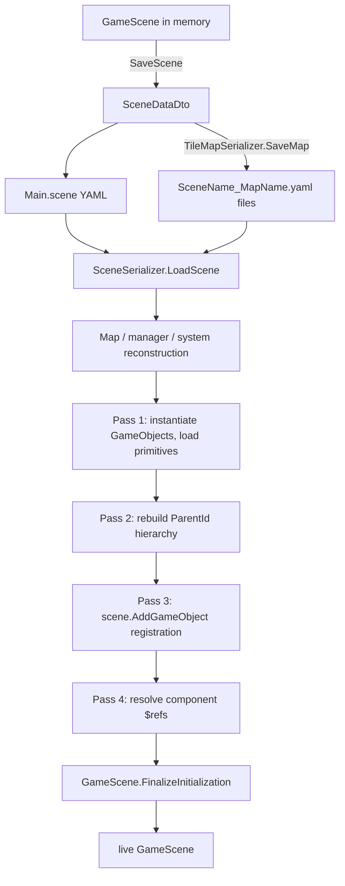

# Projects, Scenes, and Serialization

This is a reference for the on-disk project layout and the YAML formats actually emitted by the serializers in `Engine/Serialization/`. The engine stamps out a Unity-shaped folder tree, but the manifest inside it is a placeholder, scene/map/database files are hand-rolled YamlDotNet DTOs with a minimal schema version, and type resolution depends on what assemblies happen to be loaded. Read [02-ecs.md](02-ecs.md) for the object model these files reconstruct and [04-databases.md](04-databases.md) for the database runtime semantics.

**Status:** Partial

## Project folder layout

**Status:** Partial — directories and files are created and new projects get a populated manifest; older saved projects still contain a literal `{}` placeholder.

`ProjectDirectoryFactory.CreateNewProject` creates the project root, three top-level folders, seven asset subfolders, a JSON config, a "manifest" file, and a starter scene (`Engine/Serialization/ProjectDirectoryFactory.cs:22-79`):

```text
<ProjectName>/
  Content/
    Assets/
      Scripts/  Textures/  Fonts/  Audio/
      Scenes/   Prefabs/   Databases/
    ProjectManifest.db          # JSON manifest written by CreateInitialManifest
  ProjectSettings/
    ProjectConfig.json          # ProjectName, AssetDirectory, ScriptDirectory, TargetPlatform
  Temp/
```

A `globalSystemsGo` object is also created here but is never added to the scene, so it is not serialized (`Engine/Serialization/ProjectDirectoryFactory.cs:103-106`).

Source: `Engine/Serialization/ProjectDirectoryFactory.cs:33-55`, `Engine/Serialization/ProjectDirectoryFactory.cs:58-68`, `Engine/Serialization/ProjectDirectoryFactory.cs:72-74`.

The config is a one-off anonymous object serialized with `System.Text.Json`; there is no config-reading API in the serializer namespace. `Content/ProjectManifest.db` is written by `ProjectManifest.CreateInitialManifest` despite the `.db` extension (`Engine/Serialization/ProjectDirectoryFactory.cs:72-74`).

The default `Main.scene` is produced by constructing a `GameScene` and calling `SceneSerializer.SaveScene` (`Engine/Serialization/ProjectDirectoryFactory.cs:90-110`). A `globalSystemsGo` is created as an anchor object at `Engine/Serialization/ProjectDirectoryFactory.cs:103-106` but is never added to the scene — the saved scene contains no entities from it.

The launcher wraps this with solution generation, history recording, and editor launch (`Editor/Tesseract2DLauncher.cs:29-67`). The active project's paths are exposed by `IEngineContext`; WinForms reaches them through `EditorContextManager`, which now forwards to `EngineContext.Current` (`Engine/Runtime/EngineContext.cs:13-41`, `:65-76`; `Editor/Services/EditorContextManager.cs:10-27`). See [07-editor-internals.md](07-editor-internals.md) for that context's editor-side role.

## Manifest reality

**Status:** Working for newly created projects; older saved projects still use the `{}` placeholder.

`ProjectManifest` is a plain JSON-serializable class (`Engine/Serialization/ProjectManifest.cs:10-26`):

| Field | Type | Default | Notes |
| --- | --- | --- | --- |
| `EngineVersion` | `string` | `"1.0.0"` | Written by `CreateInitialManifest` via its default and asserted by fixture tests. |
| `ProjectName` | `string` | `"New Project"` | Launcher prefers this for history, falling back to the folder name. |
| `LastUsedScene` | `string` | `""` | Fixture manifest and tests read a populated value; no editor writer found. |
| `TargetPlatforms` | `List<string>` | `["Desktop"]` | Launcher uses this, falling back when manifest read fails. |
| `AssetRegistry` | `Dictionary<string, string>` | empty | GUID → relative path; fixture manifest and tests read it, but no editor writer/consumer found. |

`CreateInitialManifest` writes an indented manifest with `ProjectName`, `TargetPlatforms`, and the default `EngineVersion`/`LastUsedScene`/`AssetRegistry` values (`Engine/Serialization/ProjectManifest.cs:27-38`) and is called from `ProjectDirectoryFactory.CreateNewProject` (`Engine/Serialization/ProjectDirectoryFactory.cs:72-74`). Projects created before this fix still have `{}`, which deserializes to the defaults above.

Launcher behavior is defensive: an existing project must merely have the file present; otherwise the user is offered removal from history (`Editor/Tesseract2DLauncher.cs:91-119`). When adding an existing folder, name and platforms come from the manifest with hard-coded fallbacks (`Editor/Tesseract2DLauncher.cs:315-338`). `LoadManifest` takes a full manifest path and is a try/catch JSON deserializer that returns `null` on any failure (`Editor/Tesseract2DLauncher.cs:347-361`).

Recent projects are not stored in the project at all: `ProjectHistoryStore` writes `%AppData%\Tesseract2D\recent_projects.json` (`Engine/Serialization/ProjectManager.cs:21-27`, `Engine/Serialization/ProjectManager.cs:44-70`).

## Asset root resolution

`AssetPathProvider` is a development-only path shim. Its static constructor climbs four levels from `AppDomain.CurrentDomain.BaseDirectory` and hardcodes a `SavedGameProjectData` sandbox at the repo root (`Engine/Utilities/AssetPathProvider.cs:20-38`):

```csharp
string repoRoot = Path.GetFullPath(Path.Combine(baseDir, @"..\..\..\..\"));
ProjectRootPath = Path.Combine(repoRoot, "SavedGameProjectData");
```

It also exposes `ResolveProjectPath` and an engine-content path helper (`Engine/Utilities/AssetPathProvider.cs:44-56`). **Status:** Unused/WIP — no call sites were found outside the class itself. Live editor code resolves paths through `EditorContextManager`, not this provider; runtime asset path conventions are covered in [05-runtime.md](05-runtime.md).

## YAML conventions and schemas

**Status:** Partial — stable versioned DTOs, permissive readers by default, opt-in strict readers.

All serializers use YamlDotNet with `NullNamingConvention`, so DTO member names are written verbatim. Every deserializer calls `IgnoreUnmatchedProperties()` (`Engine/Serialization/SceneSerializer.cs:69-72`, `Engine/Serialization/DatabaseSerializer.cs:40-43`, `Engine/Serialization/TileMapSerializer.cs:52-55`). The tile-map serializer additionally uses `IgnoreFields()` on write.

| DTO | File | Fields |
| --- | --- | --- |
| `SceneDataDto` | `Engine/Serialization/SceneSerializer.cs:18-38` | `Version`, `SceneName`, `Id`, `TileMapFiles`, `ActiveMapIndex`, `Managers`, `Systems`, `Entities` |
| `EntityDataDto` | `Engine/Serialization/SceneSerializer.cs:41-61` | `Version`, `Name`, `Id`, `ParentId`, `Tags`, `Components` |
| `MapDataDto` | `Engine/Serialization/TileMapSerializer.cs:13-43` | `Version`, `MapName`, `Width`, `Height`, `TileSize`, `LayerOrder`, `TilesetPath`, `IsEnabled`, `TileDatabaseName`, `GridFlattened`, `TileProperties`, `TileIndexDataDictionary` |
| `DatabaseDataDTO` | `Engine/Serialization/DatabaseSerializer.cs:14-32` | `Version`, `ID`, `DataType`, `Name`, `DataEntries` |

Real source snippet (the entity DTO, `Engine/Serialization/SceneSerializer.cs:41-61`):

```csharp
public class EntityDataDto
{
    public int Version { get; set; } = SerializationVersion.Current;

    public string Name
    {
        get; set;
    }
    public string Id
    {
        get; set;
    }
    public string ParentId
    {
        get; set;
    }
    public List<string> Tags { get; set; } = new List<string>();
    // Key: Component Type Name (e.g., "TransformComponent"), Value: Field/Property key-value state
    public Dictionary<string, Dictionary<string, object>> Components { get; set; } = new Dictionary<string, Dictionary<string, object>>();
}
```

The compact snippet below illustrates the DTO shape rather than quoting a real file. A real current-format scene is now checked in at `Engine.Tests/TestContent/Fonts/Content/Assets/Scenes/Main.scene`; the map, database, script, and sanitized manifest live alongside it (`Engine.Tests/TestContent/Fonts/README.md:7-18`). The sample values below are schematic.

```yaml
# schematic: fields and casing from SceneDataDto / EntityDataDto
# Version may be omitted in legacy files; it then defaults to 1.
Version: 1
SceneName: Main
Id: 00000000-0000-0000-0000-000000000000
TileMapFiles:
- Main_UntitledMap.yaml
ActiveMapIndex: 0
Managers: []
Systems: []
Entities:
- Version: 1
  Name: DefaultObject
  Id: 11111111-1111-1111-1111-111111111111
  ParentId: 00000000-0000-0000-0000-000000000000
  Tags: []
  Components:
    TransformComponent:
      X: 0
      Y: 0
```

All four DTOs declare `Version` with a default of `1` (`Engine/Serialization/SceneSerializer.cs:20`, `:43`; `Engine/Serialization/TileMapSerializer.cs:15`; `Engine/Serialization/DatabaseSerializer.cs:16`). `SerializationVersion.Validate` throws `SerializationVersionException` (including the file path) for future versions and warns for stale versions before applying current rules (`Engine/Serialization/SerializationVersion.cs:12-22`, `Engine/Serialization/SerializationVersionException.cs:9`). A missing `Version` deserializes as `1`, so the author's checked-in and saved legacy files still load without edits. There is **no migration hook**: version 0 is tolerated, not transformed. Unknown YAML fields are still silently discarded by `IgnoreUnmatchedProperties()`.

Strict failure is opt-in: `SceneSerializer.LoadScene(path, strict: true)`, `TileMapSerializer.LoadMap(path, scene, strict: true)`, and `DatabaseSerializer.LoadDatabase(path, strict: true)` throw on malformed IDs, unknown serialized types, missing tilemaps, invalid database `AssetID`s, and map tile rows whose database component cannot be resolved. Default loads keep the older recovery-and-warn behavior (`Engine/Serialization/SceneSerializer.cs:143-162`, `:186-199`, `:215-279`; `Engine/Serialization/GameObjectSerializer.cs:26-54`, `:85-93`; `Engine/Serialization/TileMapSerializer.cs:106-204`, `:205-212`; `Engine/Serialization/DatabaseSerializer.cs:87-110`, `:125-162`). `SerializationVersionException` and loader-thrown `InvalidOperationException`s are rethrown by the map loader's broad catch so strict failures cannot be converted into a `null` map.

## Type resolution

There is one resolver: `Utilities.TypeResolver.FindType` (`Engine/Utilities/TypeResolver.cs:12-77`). It is cached by `(typeName, requiredBaseType)`, applies `IsAssignableFrom`, and tries, in order: `Type.GetType` for assembly-qualified names, exact/full name across loaded assemblies, then a case-insensitive short-name scan. Multiple distinct matches at either fallback stage are treated as ambiguous and rejected with a warning (`:62`, `:71`). `ClearCache()` drops cached `Type` references (`:79-85`); the editor calls it after gameplay assembly load, reload, and unload (`Editor/Utilities/ScriptAssenblyManager.cs:43`, `:88`, `:97`).

It is used for every serialized type name:

| Serialized field | Resolver call |
| --- | --- |
| Component dictionary keys | `TypeResolver.FindType(name, typeof(GameComponent))` (`Engine/Serialization/GameObjectSerializer.cs:55-74`) |
| Database `DataType` | `TypeResolver.FindType(name, typeof(DataComponent))` (`Engine/Serialization/DatabaseSerializer.cs:113-121`) |
| Scene `Managers` | `TypeResolver.FindType(name, typeof(GameManager))` (`Engine/Serialization/SceneSerializer.cs:215`) |
| Scene `Systems` | `TypeResolver.FindType(name, typeof(GameSystem))` (`Engine/Serialization/SceneSerializer.cs:252`) |

The former private `SceneSerializer.ResolveType` has been retired. Unknown, wrong-base, or ambiguous manager/system names produce a warning and are skipped rather than failing the whole scene load (`Engine/Serialization/SceneSerializer.cs:215-279`).

Scene save still writes manager and custom-system type names as `AssemblyQualifiedName ?? FullName` (`Engine/Serialization/SceneSerializer.cs:103`, `:120`). Seven built-in systems are explicitly excluded from `Systems` so they are recreated by `SystemsManager` (`Engine/Serialization/SceneSerializer.cs:112-121`). Unknown, wrong-base, and ambiguous names are covered by `Engine.Tests/TypeResolverTests.cs:10` and `Engine.Tests/SceneSerializerResolverTests.cs:9`.

Component keys are **short type names** (`kvp.Key.Name`) on export (`Engine/Serialization/GameObjectSerializer.cs:18-21`). Import looks them up with the cached resolver constrained to `GameComponent`; unknown types are skipped with a warning rather than failing the scene load (`Engine/Serialization/GameObjectSerializer.cs:55-74`).

## Reference encoding

**Status:** Partial — $ref payloads round-trip, but unsupported values are dropped on export.

`ComponentSerializer.ExportComponent` reflects public instance fields and read/write properties, skipping `gameObject` and `Parent` and honoring any attribute whose **type name** is `"IgnoreAttribute"` (`Engine/Serialization/ComponentSerializer.cs:15-27`, `Engine/Serialization/ComponentSerializer.cs:34-70`). `ExportValue` handles primitives, enums (as strings), `Vector2` (`{X, Y}`), lists, and three reference shapes (`Engine/Serialization/ComponentSerializer.cs:72-139`):

```yaml
# a GameObject-valued member (Engine/Serialization/ComponentSerializer.cs:91-98)
TargetObject:
  $ref: GameObject
  Id: 11111111-1111-1111-1111-111111111111

# a GameComponent-valued member (Engine/Serialization/ComponentSerializer.cs:101-110)
LinkedComponent:
  $ref: Component
  GameObjectId: 11111111-1111-1111-1111-111111111111
  ComponentType: TransformComponent

# a GameEvent member (Engine/Serialization/ComponentSerializer.cs:113-123)
OnActivate:
  $ref: GameEvent
  TargetGameObjectId: 11111111-1111-1111-1111-111111111111
  TargetComponentTypeName: SomeComponent
  MethodName: Activate
```

The member key names above are illustrative; the `$ref` blocks and their inner keys are copied from the dictionaries built in source. `ResolveValue` rehydrates these against the scene's `Guid → GameObject` map; component references are matched by short type name, case-insensitively (`Engine/Serialization/ComponentSerializer.cs:241-321`, `Engine/Serialization/ComponentSerializer.cs:266`). Import pass 1 tries primitive conversion and swallows all exceptions for reference dictionaries (`Engine/Serialization/ComponentSerializer.cs:146-200`); pass 2 resolves references (`Engine/Serialization/ComponentSerializer.cs:206-239`).

Editor-side assignment of these references goes through property converters selected in `Editor/FilteredPropertyWrapper.cs:93-130` — notably `GameObjectReferenceConverter` (`Editor/PropertyWrappers/GameObjectReferenceConverter.cs:20-40`) and `ComponentReferenceConverter` (`Editor/PropertyWrappers/ComponentReferenceConverter.cs:20-50`). Changing `DatabaseReference` clears `DataReference` (`Editor/FilteredPropertyWrapper.cs:174-179`). See [07-editor-internals.md](07-editor-internals.md) for the inspector itself.

## Scene save/load flow

Save writes one scene YAML plus one YAML per map. Map filenames are `<SceneName>_<MapName with spaces replaced by underscores>.yaml`, falling back to `UntitledMap` (`Engine/Serialization/SceneSerializer.cs:86-94`). Active map index is clamped on save (`Engine/Serialization/SceneSerializer.cs:97`).

Load is four-pass after maps, managers, and systems are restored (`Engine/Serialization/SceneSerializer.cs:160-292`). Pass 4 pairs DTO and imported entities by index so component references still resolve when an entity ID was recovered:



The editor drives this through `Form1`: `Main.scene` under `EditorContextManager.ScenesPath` is loaded at project open (`Editor/Form1.cs:338-357`), and saves are written to `Content/Assets/Scenes/<SceneName>.scene` (`Editor/Form1.cs:631-662`).

## Map and database persistence

**Status:** Partial — tile-data round-trip works; other asymmetries remain.

`SaveMap` now exports `TileIndexDataDictionary`: each tile-data component is reflected with `ComponentSerializer.ExportComponent` and stamped with its explicit `AssetID` string, then assigned to the DTO (`Engine/Serialization/TileMapSerializer.cs:57-86`). `LoadMap` rebinds entries by `AssetID` or `DisplayName` against the map's resolved database, assigns `GridFlattened`, and then explicitly rebuilds the derived per-tile grid (`Engine/Serialization/TileMapSerializer.cs:145-200`). `Engine.Tests/MapRoundTripTests.cs:11-152` pins the save/load identity, strict unbound-row failure, and final-grid rebuild.

Database files use `DatabaseDataDTO` with `Version`, `ID`, `DataType`, `Name`, and `DataEntries` keyed by a de-spaced `DisplayName` with collision suffixes (`Engine/Serialization/DatabaseSerializer.cs:14-32`, `:43-77`). On load, `DataType` is resolved through `TypeResolver.FindType(..., typeof(DataComponent))`; a missing/invalid `AssetID` logs a warning and generates a recovery GUID by default, or throws in strict mode (`Engine/Serialization/DatabaseSerializer.cs:100-110`, `:125-162`). Database discovery from `*.database` files is in `Engine/Runtime/DatabaseManager.cs:48-58`; more detail belongs in [04-databases.md](04-databases.md).

## Content packaging

**Status:** Partial — copy rules omit database assets.

`DynamicBuilder.GetContentCollection` copies `*.yml`, `*.cs`, `*.scene`, `*.prefab`, and `*.data`, with `*.spritefont` compiled through the pipeline; `*.database` is **not** in the copy list (`Engine.Content/Builder/DynamicBuilder.cs:29-55`). The standalone `Builder` defaults use the same copy extensions plus `*.lua` (`Engine.Content/Builder/Builder.cs:14-30`, `Engine.Content/Builder/Builder.cs:66-88`). The editor runs `DynamicBuilder` with `AssetsPath` as source and `Content/Bin` as output (`Editor/Form1.cs:388-420`).

The engine-side MSBuild template still contains unreplaced `___SafeGameName___` tokens in source, output, and project paths (`Engine.Content/BuildContent.targets:6-10`). Build and path troubleshooting is covered in [09-build-and-content.md](09-build-and-content.md).

## Gotchas / Known Limitations

- The author's three saved test projects still have literal `{}` manifests; newly created projects do not (`Engine/Serialization/ProjectDirectoryFactory.cs:72-74`, `Engine/Serialization/ProjectManifest.cs:27-38`).
- `LoadManifest` takes the full `Content/ProjectManifest.db` path and returns `null` only on read/deserialize failure (`Editor/Tesseract2DLauncher.cs:113`, `Editor/Tesseract2DLauncher.cs:331`, `Editor/Tesseract2DLauncher.cs:347-361`).
- `AssetRegistry`, `LastUsedScene`, and `EngineVersion` are serialized with defaults; `FixtureManifestTests` reads populated values for all three, but the editor has no meaningful writer for `LastUsedScene`/`AssetRegistry` beyond manifest creation (`Engine/Serialization/ProjectManifest.cs:12-38`; `Engine.Tests/FixtureManifestTests.cs:12-55`).
- Unknown YAML fields are silently ignored. Versions are validated but there is no migration hook (`Engine/Serialization/SceneSerializer.cs:69-72`, `Engine/Serialization/DatabaseSerializer.cs:40-43`, `Engine/Serialization/TileMapSerializer.cs:52-55`, `Engine/Serialization/SerializationVersion.cs:12-22`).
- `ExportValue` returns `null` for any unsupported value type, so those values are omitted from the saved component map (`Engine/Serialization/ComponentSerializer.cs:138`).
- Ignore semantics are attribute-name string matching (`"IgnoreAttribute"`), not a type check (`Engine/Serialization/ComponentSerializer.cs:17-27`).
- Malformed/missing scene, entity, parent, and database IDs are recovered with `Guid.TryParse` and a warning in default mode; strict mode throws instead (`Engine/Serialization/SceneSerializer.cs:151-162`, `Engine/Serialization/GameObjectSerializer.cs:32-54`, `Engine/Serialization/DatabaseSerializer.cs:100-110`). Scene reference resolution pairs DTOs and imported entities by index (`Engine/Serialization/SceneSerializer.cs:312-330`).
- All serialized type names use the same cached, base-constrained resolver; a manager/system name and a component name are resolved by the same rules (`Engine/Utilities/TypeResolver.cs:12-77`, `Engine/Serialization/SceneSerializer.cs:215-279`).
- `SavedGameProjectData/Content/Scenes/HierarchyTest.scene:1-35` is old JSON with `$type`/`Children`, not the current `SceneDataDto` YAML schema; the build-output `Editor/bin/Debug/net8.0-windows/TileDatabase.yaml:1-3` (three lines, `DataEntries: {}`, no `Name`) is also not a format reference. Use `Engine.Tests/TestContent/Fonts/Content/Assets/Scenes/Main.scene:1-8` and `Engine.Tests/TestContent/Fonts/Content/Assets/Databases/tiledb.database:1-4` as the checked-in current-format examples.
- **Current-format samples now exist in the repository as well as on the author's machine.** `Engine.Tests/TestContent/Fonts/` contains the portable fixture described above; the author also maintains three valid test projects at `D:\GameDevelopment\TestFolderEngine\TestProject\{AnotherUITest,Fonts,UITest}` with full YAML scenes, a populated `.database`, a tile map, and built copies under `Content/Bin/Content/`. See the [archived verification asset inventory](archive/11-health-todo.md).
- `*.database` files are loaded at runtime but not copied by the content builders (`Engine.Content/Builder/DynamicBuilder.cs:43-54`, `Engine/Runtime/DatabaseManager.cs:53`).

## See also

- [00-status-and-scope.md](00-status-and-scope.md)
- [01-architecture.md](01-architecture.md)
- [02-ecs.md](02-ecs.md)
- [04-databases.md](04-databases.md)
- [05-runtime.md](05-runtime.md)
- [07-editor-internals.md](07-editor-internals.md)
- [09-build-and-content.md](09-build-and-content.md)
- [10-known-issues.md](10-known-issues.md)
- [14-alpha-todo.md](14-alpha-todo.md) — active Alpha v1 work queue
- [11-health-todo.md](11-health-todo.md) — archived hardening pass
- [12-future-roadmap.md](12-future-roadmap.md) — feature scope and deferred work
