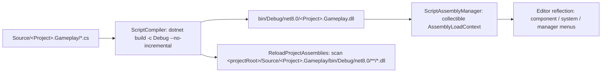

# 06 — Authoring Guide

This is a reference for writing game code against the current engine, not a tutorial. It records the real base classes, constructor and reflection constraints, registration points, editor templates, and YAML authoring surface as they exist in source; aspirational comments in templates are called out where they disagree with the serializer. For runtime consequences see [05-runtime.md](05-runtime.md), for scene/DTO details see [03-projects-and-serialization.md](03-projects-and-serialization.md), and for surprising behaviour see [10-known-issues.md](10-known-issues.md).

**Status:** Partial (components, scripts, systems, manager registration/lifecycle, and editor-driven authoring work with caveats) · Unused/WIP (generated-solution helper only)

## 1. Where game code lives

The real engine is `Engine.Core` under `Engine/`; the `Engine.Gameplay/` folder in this repository is only a placeholder containing one empty `testSystem` (`Engine.Gameplay/testSystem.cs:10-22`). Actual game code for a user project is expected in a **generated gameplay project** at `Source/<ProjectName>.Gameplay/<ProjectName>.Gameplay.csproj`, created by `SolutionGenerator.GenerateUserSolution` (`Editor/Utilities/SolutionGenerator.cs:10-44`). That project targets `net8.0`, references `Engine.Core.csproj`, and compiles the project's asset `.cs` files:

```xml
<ItemGroup>
  <ProjectReference Include="{relativeEngineCore}" />
</ItemGroup>

<!-- Include Content/Assets files so they show up under the project hierarchy in Visual Studio -->
<ItemGroup>
  <Compile Include="{relativeAssetsPath}\**\*.cs" />
</ItemGroup>
```
— `Editor/Utilities/SolutionGenerator.cs:33-40`

The generator also writes a master `.sln` containing `Engine.Core`, `Engine.Content`, the local gameplay project, and whichever platform projects were selected (`Editor/Utilities/SolutionGenerator.cs:83-100`). This is a generation path, **not** the checked-in `Tesseract2D.sln`; see [09-build-and-content.md](09-build-and-content.md).



### Compilation and loading

- `ScriptCompiler.CompileGameplayProjectAsync` derives the project name from the root folder when not supplied, then builds with `build "{csprojPath}" -c Debug --no-incremental` (`Editor/Utilities/ScriptCompiler.cs:21-50`). It reports success only when the exit code is 0 **and** the DLL exists at `Source/<name>.Gameplay/bin/Debug/net8.0/<name>.Gameplay.dll` (`Editor/Utilities/ScriptCompiler.cs:64-74`).
- `ScriptAssemblyManager.LoadGameplayAssembly` reads DLL and optional PDB bytes into memory and loads them through a collectible `AssemblyLoadContext` named `GameplayContext_<Guid>` to avoid file locks (`Editor/Utilities/ScriptAssenblyManager.cs:21-43`). Unloading nulls the current assembly, clears the resolver cache, calls `Unload()`, and forces GC (`Editor/Utilities/ScriptAssenblyManager.cs:92-104`).
- `ScriptAssemblyManager.ReloadProjectAssemblies` is a *separate* static list that scans the canonical `<currentProjectRoot>/Source/<name>.Gameplay/bin/Debug/net8.0` output recursively via `ProjectPaths.GetGameplayOutputDirectory` (`Editor/Utilities/ScriptAssenblyManager.cs:49-63`; `Engine/Runtime/ProjectPaths.cs:29-43`).
- On project load the editor builds and loads the assembly once via `InitializeAndLoadGameplayAssemblyAsync` (`Editor/Form1.cs:970-1005`). A `FileSystemWatcher` on the canonical `Content/Assets` script root, filtered to `*.cs` with `LastWrite | FileName | Size`, triggers throttled rebuilds (1 second) and `CompileAndReloadScriptsAsync` (`Editor/Form1.cs:173-249`).

## 2. Templates

`CodeTemplateGenerator.CreateTemplate` builds the template path as `Editor/Templates/<language>/<type>.tmpl`, substitutes `{ClassName}` with the file-name stem, and writes `<ClassName>.cs` (or `.lua`) to the destination directory (`Editor/Utilities/CodeTemplateGenerator.cs:11-39`). If the template file is missing it writes an **empty file** rather than throwing (`Editor/Utilities/CodeTemplateGenerator.cs:25-35`).

The physical folder is `Editor/Templates/.cs/` (a leading dot), so callers must pass `".cs"` as the language; the project-explorer handler does exactly that (`Editor/Form1.ProjectExplorer.cs:214-241`, especially `:237`). Engine root discovery walks up from `AppDomain.CurrentDomain.BaseDirectory` looking for `Tesseract2D.sln` (`Editor/Utilities/CodeTemplateGenerator.cs:45-59`).

| Menu item (`Editor/Form1.ProjectExplorer.cs:38-56`) | Passed `templateType` (`:93-97`) | Template on disk | Result |
|---|---|---|---|
| New Component → Component | `Component` | `Editor/Templates/.cs/Component.tmpl:1-32` | Working |
| New Component → Data Component | `DataComponent` | `Editor/Templates/.cs/DataComponent.tmpl:1-56` | Working |
| New System | `SystemComponent` (`:95`) | `Editor/Templates/.cs/SystemComponent.tmpl:1-93` | Working |
| New Manager | `Manager` | `Editor/Templates/.cs/Manager.tmpl:1-48` | Working |
| New C# Script | `Script` | `Editor/Templates/.cs/Script.tmpl:1-58` | Working |

The template prose is explanatory rather than normative. `Component.tmpl:21-23` and `DataComponent.tmpl:36-38` claim that *private backing fields* are serialized — the actual serializer reflects **public** instance members only (§3). `Manager.tmpl:29-45` claims `Initialize`/`Shutdown`/`Update` are called by the engine; `GameHost` now calls those hooks for active registered managers, while the template's "whenever the manager is enabled" wording is imprecise and `IsPersistent` remains unused. The Lua menu block is commented out in the editor (`Editor/Form1.ProjectExplorer.cs:58-71`), so Lua authoring is not currently offered.

## 3. Components

Components derive from `Engine.Core.ECS.GameComponent` (`Engine/ECS/GameComponent.cs:13`). They are data containers by convention; the template explicitly discourages putting behaviour in them (`Editor/Templates/.cs/Component.tmpl:16-18`). A minimal real template shape:

```csharp
public class {ClassName} : GameComponent
{

    // gameObject is an accessible field to find the parent object of the component. 
    // parent is an accessible field to find the parent game object of the attached gameObject. 

    //use [Browsable(false)] to hide things from the inspector. 
}
```
— `Editor/Templates/.cs/Component.tmpl:9-25` (excerpt)

`gameObject` is the lowercase back-reference to the owning `GameObject`; `Parent` forwards to `gameObject.Parent` (`Engine/ECS/GameComponent.cs:18-42`). Extending an existing engine component instead of `GameComponent` is supported by the templates (`Editor/Templates/.cs/Component.tmpl:27-28`).

### Constructor and member rules

- **Public parameterless constructor required.** Both generic attachment (`AddComponent<T>() where T : GameComponent, new()` at `Engine/ECS/GameObject.cs:213-228`) and deserialization (`Activator.CreateInstance(compType)` at `Engine/Serialization/GameObjectSerializer.cs:60`) create components this way. A component with only parameterized constructors will compile but fail at authoring time.
- Only **public instance fields and public read/write properties** are exported. The serializer uses `BindingFlags.Public | BindingFlags.Instance`, skips properties that cannot read *or* write, and additionally skips members literally named `gameObject` or `Parent` (`Engine/Serialization/ComponentSerializer.cs:15,40-67`). Private backing fields are **not** serialized, regardless of the template comments.
- Attribute semantics differ by consumer:

| Attribute | Effect | Source |
|---|---|---|
| `[Ignore]` | Hidden from `ComponentSerializer`; detected by attribute *type-name string* `"IgnoreAttribute"`, not by interface | `Engine/Serialization/ComponentSerializer.cs:17-27,42,57` |
| `[Browsable(false)]` | Hidden from the WinForms inspector only | `Editor/Templates/.cs/Component.tmpl:25`; `Engine/ECS/GameComponent.cs:18,24,44` |
| `[DatabaseIgnore]` | Hidden from the DatabaseViewer grid only | `Engine/ECS/Components/DataComponent.cs:32-43`; `Engine/Collections/DatabaseIgnoreAttribute.cs:13` |

- `GameComponent.isEnabled` defaults to `false` on the class and fires `OnEnabled()`/`OnDisabled()` only when the value changes (`Engine/ECS/GameComponent.cs:16`, `:46-76`). Both `AddComponent(GameComponent)` and `AddComponent<T>()` set it to `true` on attachment (`Engine/ECS/GameObject.cs:213-250`).

## 4. Systems

Systems derive from `Engine.Core.ECS.GameSystem`, override the abstract `RequiredComponents` query and `Update(HashSet<GameObject>, float)`, and may override `Render(HashSet<GameObject>, SpriteBatch)` for draw-time work (`Engine/ECS/GameSystem.cs:14-43`). `IsEnabled` and `UsedInEditor` default to `true`/`false` respectively, `UpdatePolicy` defaults to `FrameUpdate` (`Engine/ECS/GameSystem.cs:16-23`).

A real built-in setup in a constructor:

```csharp
RequiredComponents = Query.Has<SpriteComponent>().And<TransformComponent>().Not<UIElementComponent>();
UsedInEditor = true;
UpdatePolicy = SystemUpdatePolicy.FrameUpdate;
```
— `Engine/ECS/Systems/SpriteRenderSystem.cs:32-39`

The template also documents nested `Query.Or(...)` usage (`Editor/Templates/.cs/SystemComponent.tmpl:39-55`) and states that `Update` receives only entities matching the query, with delta time corresponding to the chosen policy (`Editor/Templates/.cs/SystemComponent.tmpl:66-70`).

| `SystemUpdatePolicy` | Meaning (from source comments) |
|---|---|
| `FrameUpdate` | Variable time, once per render frame |
| `TickUpdate` | Fixed locked simulation step |
| `FixedUpdate` | Custom interval, every X seconds |
| `EntityUpdate` | Reactive, only when components/entities mutate |
| `Manual` | Only when explicitly invoked |

— `Engine/ECS/SystemUpdatePolicy.cs:9-18`; see also [02-ecs.md](02-ecs.md) for frame-flow details.

Seven built-in systems are created by `SystemsManager`'s constructor — transform, sprite render, physics, script component, UI render, UI layout, UI input (`Engine/ECS/Managers/SystemsManager.cs:43-89`). Custom systems are registered in code with `scene.Systems.AddSystem(instance)`; `AddSystem` rejects duplicate concrete types, assigns `ContextScene`, buckets the system by its *current* `UpdatePolicy`, and pre-fills its entity cache from the scene (`Engine/ECS/Managers/SystemsManager.cs:92-120`). The editor discovers all non-abstract `GameSystem` subclasses in `Engine.Core` plus the loaded gameplay assembly and adds them through the same call (`Editor/Form1.cs:1455-1518`).

## 5. Scripts

A script derives from `Engine.Core.ECS.Components.ScriptComponent` and overrides the four hooks shown in the real template (`Editor/Templates/.cs/Script.tmpl:12-54`):

```csharp
public override void OnEnable() { }
public override void OnDisable() { }
public override void Start() { }
public override void Update() { }
```

`ScriptComponent.IsActive` fires `OnEnable()`/`OnDisable()` (no `d`) in its setter (`Engine/ECS/Components/ScriptComponent.cs:19-33`). `ScriptComponentSystem` queries `Query.Has<ScriptComponent>()`, calls `Start()` once when the GameObject becomes active (tracking `hasStarted`), and calls `Update()` only while both the GameObject and the script are active (`Engine/ECS/Systems/ScriptComponentSystem.cs:19-56`). The template itself warns that scripts combine component and system roles and are not as performant as separate components plus systems (`Editor/Templates/.cs/Script.tmpl:16-20`).

These hooks are **not** the same as `GameComponent.OnEnabled()`/`OnDisabled()` (`Engine/ECS/GameComponent.cs:70-76`); both sets exist with different triggers and spellings. Scripts are components for authoring purposes, so the constructor and public-member rules from §3 still apply.

## 6. Managers

A manager derives from `Engine.Core.Runtime.GameManager` and implements three abstract members (`Engine/Runtime/GameManager.cs:11-37`):

```csharp
public abstract void Initialize();
public abstract void Update(float deltaTime);
public abstract void Shutdown();
```

It exposes `ContextScene`, `IsActive`, and protected-set `IsPersistent` (`Engine/Runtime/GameManager.cs:15-21`). Register with `scene.Managers.AddManager(instance)`; that method rejects a second instance of the same concrete type and otherwise only stores it in a private list (`Engine/ECS/Managers/ManagersManager.cs:23-37`). The editor reflects over `GameManager` subclasses in the core and gameplay assemblies and instantiates them through `Activator.CreateInstance` (`Editor/Form1.cs:1353-1415`).

`GameHost` calls `Initialize()` once before the first update for each active registered manager, calls `Update(deltaTime)` each frame for active managers, and calls `Shutdown()` on scene swap or host shutdown for **all** registered managers (`Engine/Runtime/GameHost.cs:141-155`, `:207-230`). The source comments now name `GameHost`; `IsPersistent` remains unused. `ManagersManager` itself is still only a registry (`Engine/ECS/Managers/ManagersManager.cs:18-65`). See [05-runtime.md](05-runtime.md).

## 7. Data components

`DataComponent` is an abstract `GameComponent` (and `ICloneable`) intended for database rows rather than per-entity state (`Engine/ECS/Components/DataComponent.cs:12-24`):

```csharp
public abstract string DisplayName { get; set; }

[Browsable(false)]
public Guid AssetID { get; set; } = Guid.NewGuid();
```

It also contributes `[DisplayName("Database Reference")] [DatabaseIgnore] Database DatabaseReference` and `[DisplayName("Data Reference")] [DatabaseIgnore] DataComponent? DataReference` inspector fields for linking an instance to a database row (`Engine/ECS/Components/DataComponent.cs:27-46`); `Clone()` is a `MemberwiseClone` (`Engine/ECS/Components/DataComponent.cs:50-53`). The template's prose describes the intended workflow — author a database in the DatabaseViewer, attach the component, then pick the database and data reference in the inspector (`Editor/Templates/.cs/DataComponent.tmpl:17-31`). See [04-databases.md](04-databases.md) for what actually serializes.

## 8. Registration summary

| Kind | Base class | Registration in code | Editor path |
|---|---|---|---|
| Component | `GameComponent` (`Engine/ECS/GameComponent.cs:13`) | `gameObject.AddComponent<T>()` or `AddComponent(instance)` (`Engine/ECS/GameObject.cs:213-250`) | Add Component menu reflects gameplay assembly (`Editor/Form1.cs:2063-2125`) |
| System | `GameSystem` (`Engine/ECS/GameSystem.cs:14`) | `scene.Systems.AddSystem(instance)` (`Engine/ECS/Managers/SystemsManager.cs:92-120`) | Systems tab reflects both assemblies (`Editor/Form1.cs:1455-1518`) |
| Script | `ScriptComponent` (`Engine/ECS/Components/ScriptComponent.cs:11`) | Attach as a component; driven by built-in `ScriptComponentSystem` (`Engine/ECS/Systems/ScriptComponentSystem.cs:19-56`) | Add Component menu |
| Manager | `GameManager` (`Engine/Runtime/GameManager.cs:11`) | `scene.Managers.AddManager(instance)` (`Engine/ECS/Managers/ManagersManager.cs:23-37`) | Managers tab reflects both assemblies (`Editor/Form1.cs:1353-1415`) |
| Data component | `DataComponent` (`Engine/ECS/Components/DataComponent.cs:12`) | Attach as a component, link to a database | DatabaseViewer + inspector; see [04-databases.md](04-databases.md) |

`Activator.CreateInstance` is used by the editor for components, systems and managers (`Editor/Form1.cs:1403,1505,2113`) and by scene deserialization (`Engine/Serialization/SceneSerializer.cs:206,233`) — every authorable type therefore needs a public parameterless constructor.

## 9. YAML authoring

Scene files are written by `SceneSerializer` with YamlDotNet using `NullNamingConvention`, so DTO member names are emitted verbatim (`Engine/Serialization/SceneSerializer.cs:59-68`). Entity components are keyed by *type name* with a dictionary of exported member values (`Engine/Serialization/SceneSerializer.cs:39-57`; `Engine/Serialization/GameObjectSerializer.cs:8-24`). References inside a component use `$ref` maps:

```csharp
// GameObject reference payload
{ "$ref", "GameObject" }, { "Id", go.Id.ToString() }

// Component reference payload
{ "$ref", "Component" }, { "GameObjectId", goId }, { "ComponentType", comp.GetType().Name }
```
— `Engine/Serialization/ComponentSerializer.cs:90-110`

A **schematic** scene in the current DTO shape therefore looks like this (illustrative, not copied from a repo file):

```yaml
SceneName: Example
Id: 4f0f0f00-0000-0000-0000-000000000001
TileMapFiles: []
ActiveMapIndex: 0
Managers:
- MyGame.ScoreManager, MyGame.Gameplay
Systems:
- MyGame.MySystem, MyGame.Gameplay
Entities:
- Name: NPC
  Id: 4f0f0f00-0000-0000-0000-000000000002
  ParentId: 00000000-0000-0000-0000-000000000000
  Tags: []
  Components:
    TransformComponent:
      X: 10
      Y: 20
    MyLinkComponent:
      Target:
        $ref: GameObject
        Id: 4f0f0f00-0000-0000-0000-000000000003
```

`ResolveValue` only understands `$ref` values `GameObject`, `Component` and `GameEvent` (`Engine/Serialization/ComponentSerializer.cs:241-285`), and type resolution goes through the cached, base-constrained `TypeResolver.FindType` (`Engine/Utilities/TypeResolver.cs:12-77`): it tries `Type.GetType`, exact/full names, then case-insensitive short names, and rejects ambiguous matches with a warning. Custom system and manager type names are saved as `AssemblyQualifiedName ?? FullName` (`Engine/Serialization/SceneSerializer.cs:99-123`) and resolved through that same resolver (`Engine/Serialization/SceneSerializer.cs:215`, `:252`); built-in systems are excluded from the scene file (`Engine/Serialization/SceneSerializer.cs:112-121`). Full schema and resolution rules belong to [03-projects-and-serialization.md](03-projects-and-serialization.md).

## 10. Editor workflows

- **Project explorer context menus:** Open, Show in Explorer, New Folder, Add, Rename, Delete, New Prefab, New Font, and a C# submenu with New Component (Component / Data Component), New System, New Manager, New C# Script (`Editor/Form1.ProjectExplorer.cs:18-108`). `createPrefab` is declared but has no click handler assigned in this block (`Editor/Form1.ProjectExplorer.cs:38-39,93-97`).
- **Template creation:** resolves the selected node to a directory, prompts for a class name, calls `CodeTemplateGenerator.CreateTemplate(..., ".cs", templateType, className)`, then refreshes the tree (`Editor/Form1.ProjectExplorer.cs:214-241`).
- **Attach a component:** the Add Component dropdown collects non-abstract `GameComponent` subclasses from core plus gameplay, skips `TransformComponent`, disables already-attached types, and instantiates via `Activator.CreateInstance` before `selectedGo.AddComponent(newComp)` (`Editor/Form1.cs:2063-2125`).
- **Add manager / system:** Managers and Systems tabs populate dropdowns by reflection on both assemblies, disable duplicate types, and instantiate + register through `AddManager`/`AddSystem` (`Editor/Form1.cs:1353-1561`). Core systems are protected from removal at `Editor/Form1.cs:1531-1535`.

## Gotchas / Known Limitations

- Script source has one canonical root, `Content/Assets/**/*.cs`, defined by `ProjectPaths.GetScriptSourceRoot` (`Engine/Runtime/ProjectPaths.cs:12-15`); the generated project, editor watcher, and launcher consume it (`Editor/Utilities/SolutionGenerator.cs:10-41`; `Editor/Form1.cs:173-199`).
- Compiler output has one canonical root, `Source/<name>.Gameplay/bin/Debug/net8.0`, defined by `ProjectPaths.GetGameplayOutputDirectory` (`Engine/Runtime/ProjectPaths.cs:29-43`); `ScriptCompiler`, `ScriptAssemblyManager.ReloadProjectAssemblies`, and launcher assembly loading consume it (`Editor/Utilities/ScriptCompiler.cs:21-77`; `Editor/Utilities/ScriptAssenblyManager.cs:48-89`; `Editor/Tesseract2DLauncher.cs:137-160`).
- The New System menu now passes `"SystemComponent"` and `CodeTemplateGenerator` reads `Editor/Templates/.cs/SystemComponent.tmpl`; its missing-file fallback still writes an empty `.cs` for any unavailable template (`Editor/Form1.ProjectExplorer.cs:95`; `Editor/Utilities/CodeTemplateGenerator.cs:20-35`; `Editor/Templates/.cs/SystemComponent.tmpl:1`).
- Template comments about private backing-field serialization are wrong: the serializer uses `BindingFlags.Public | BindingFlags.Instance` (`Editor/Templates/.cs/Component.tmpl:21-23`; `Editor/Templates/.cs/DataComponent.tmpl:36-38`; `Engine/Serialization/ComponentSerializer.cs:15,40-67`).
- `GameComponent.isEnabled` starts `false` on the class, but both add paths set it to `true` on attachment and ignore unchanged assignments (`Engine/ECS/GameComponent.cs:16`, `:46-64`; `Engine/ECS/GameObject.cs:213-250`).
- `OnEnable`/`OnDisable` on `ScriptComponent` and `OnEnabled`/`OnDisabled` on `GameComponent` are distinct hooks with different triggers (`Engine/ECS/Components/ScriptComponent.cs:19-63`; `Engine/ECS/GameComponent.cs:46-76`).
- `GameHost` initializes/updates only active registered managers, but shuts down every registered manager; `IsPersistent` and additive scene switching are still unused (`Engine/Runtime/GameManager.cs:24-37`; `Engine/Runtime/GameHost.cs:141-155`, `:207-230`).
- `AddSystem` buckets a system by `UpdatePolicy` at registration time and deduplicates exact types; changing the policy later does not move it to another bucket (`Engine/ECS/Managers/SystemsManager.cs:97-106`).
- `$ref` resolution covers only `GameObject`, `Component`, and `GameEvent`; other reference payloads deserialize as null. DTO versions are validated but there is no migration hook (`Engine/Serialization/ComponentSerializer.cs:241-286`; `Engine/Serialization/SerializationVersion.cs:12-22`; [03-projects-and-serialization.md](03-projects-and-serialization.md) §YAML conventions and schemas).
- `SavedGameProjectData/Content/Scenes/HierarchyTest.scene:1-35` is stale JSON using `$type` and a `Children` array, not the YAML DTO described in §9. Do not copy it as a format reference. A portable current-format scene fixture is checked in at `Engine.Tests/TestContent/Fonts/Content/Assets/Scenes/Main.scene:1-8` (`Engine.Tests/TestContent/Fonts/README.md:7-18`); the author's local saved projects remain the end-to-end verification assets — see the [archived verification assets](archive/11-health-todo.md).

## See also

- [00-status-and-scope.md](00-status-and-scope.md) — status matrix and badge meanings
- [01-architecture.md](01-architecture.md) — repository map and naming conventions
- [02-ecs.md](02-ecs.md) — ECS and query semantics
- [03-projects-and-serialization.md](03-projects-and-serialization.md) — scene/YAML schemas and type resolution
- [04-databases.md](04-databases.md) — DataComponent and database authoring
- [05-runtime.md](05-runtime.md) — what actually drives systems/managers
- [07-editor-internals.md](07-editor-internals.md) — editor menus and inspector internals
- [09-build-and-content.md](09-build-and-content.md) — building the generated solution
- [10-known-issues.md](10-known-issues.md) — consolidated quirks
- [14-alpha-todo.md](14-alpha-todo.md) — active Alpha v1 work queue, including new-host tooling
- [11-health-todo.md](11-health-todo.md) — archived hardening pass for authoring, templates, and script paths
- [12-future-roadmap.md](12-future-roadmap.md) — feature scope and deferred work
