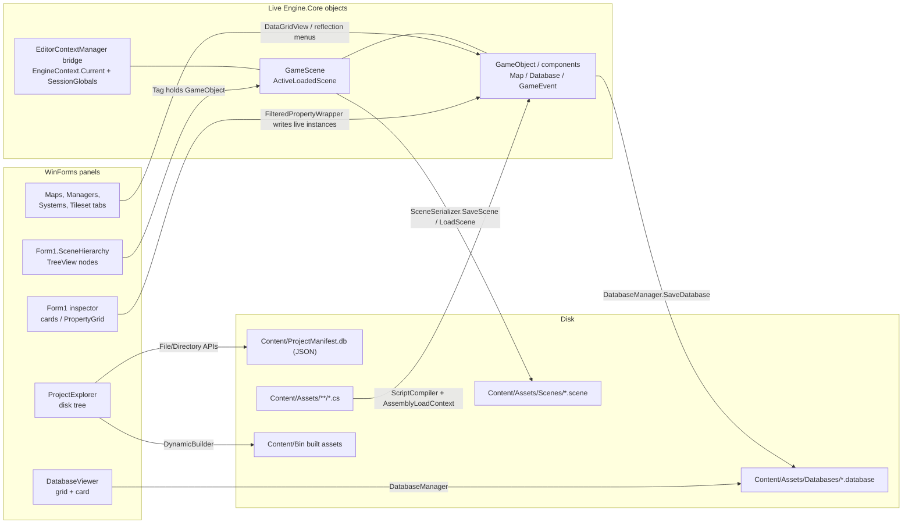

# 07 — Editor Internals (WinForms)

This is a source-level reference for the current Windows editor: how it boots, which WinForms panels own which actions, how it mutates live `Engine.Core` objects, and where those objects cross serializers into disk. It is a record of what exists today, not a proposal for the planned replacement; see [08-react-editor-boundary.md](08-react-editor-boundary.md) for that boundary. The editor is unfinished, so most subsystems are marked `Partial` or `Experimental` below.

**Status:** Partial

## Subsystem map

| Subsystem | What it actually does today | Status | Evidence |
|---|---|---|---|
| Launcher / project bootstrap | Creates project folders, writes a solution, records history, mounts an `EditorContextManager` context, loads DLLs, shows `Form1`, hides launcher | `Partial` | `Editor/Tesseract2DLauncher.cs:29-137` |
| WinForms host | `net8.0-windows`, `UseWindowsForms`, MonoGame.Forms.DX `MGWindowControl` docked in a tab page | `Working` | `Editor/Engine.Editor.csproj:3-26`, `Editor/Form1.Designer.cs:89-96`, `Editor/MGWindowControl.cs:19` |
| Main window panel layout | Hierarchy + tabs (scene maps/managers/systems), properties group, MonoGame viewport tab, project folder tree, console | `Partial` | `Editor/Form1.Designer.cs:58-108`, `Editor/Form1.Designer.cs:996-1073` |
| Scene new/open/save | Creates `.scene`, loads with `SceneSerializer`, saves with `SceneSerializer`, dirty-flag resets | `Partial` | `Editor/Form1.cs:143-160`, `Editor/Form1.cs:541-609`, `Editor/Form1.cs:611-660` |
| Project explorer | Context menus, `.spritefont` template, C# templates, drag/drop moves and OS imports, rename/delete, search | `Partial` | `Editor/Form1.ProjectExplorer.cs:18-113`, `Editor/Form1.ProjectExplorer.cs:115-173`, `Editor/Form1.ProjectExplorer.cs:214-241`, `Editor/Form1.ProjectExplorer.cs:243-596`, `Editor/Form1.ProjectExplorer.cs:597-790`, `Editor/Form1.ProjectExplorer.cs:811-965` |
| Scene hierarchy | Rebuilds tree from serializable entities, duplicate via reflection clone, create/rename/destroy, reparent, sandbox scene, search | `Partial` | `Editor/Form1.SceneHierarchy.cs:63-123`, `Editor/Form1.SceneHierarchy.cs:139-242`, `Editor/Form1.SceneHierarchy.cs:244-345`, `Editor/Form1.SceneHierarchy.cs:361-409`, `Editor/Form1.SceneHierarchy.cs:420-443`, `Editor/Form1.SceneHierarchy.cs:488-586` |
| Viewport + gizmos | Grid, bounds, pivots, transform/collider gizmos, camera pan/zoom, tile paint | `Partial` | `Editor/MGWindowControl.cs:47-169`, `Editor/MGWindow/Services/EditorInputService.cs:150-447`, `Editor/MGWindow/Services/EditorRenderService.cs:20-164`, `Editor/Utilities/GizmoRenderer.cs:9-107` |
| Simulation | Start/pause/stop flags, 60 Hz physics accumulator, scene update/render branching on `PlayState` | `Experimental` | `Editor/MGWindowControl.cs:31-40`, `Editor/MGWindowControl.cs:74-118`, `Editor/MGWindowControl.cs:171-216` |
| Inspector cards | Collapsible `Panel` + `PropertyGrid` cards for GameObject/components; private WinForms internals for splitter and live dropdown filtering | `Experimental` | `Editor/Form1.cs:832-925`, `Editor/ComponentCardFactory.cs:53-199`, `Editor/ComponentCardFactory.cs:201-338` |
| Property metadata layer | `CustomTypeDescriptor`, `TypeConverter`s, cascading clears, inline collection editing | `Partial` | `Editor/FilteredPropertyWrapper.cs:23-187`, `Editor/PropertyWrappers/*.cs` |
| Maps / managers / systems / tiles | DataGridView-bound maps, reflection-driven add menus, tileset metadata and per-tile data components | `Partial` | `Editor/Form1.cs:995-1146`, `Editor/Form1.cs:1315-1351`, `Editor/Form1.cs:1353-1453`, `Editor/Form1.cs:1455-1561`, `Editor/Form1.cs:1563-1812` |
| Pyxel JSON import | Reads Pyxel JSON, flattens layer 0 tiles into a new `Map` | `Stub` | `Editor/Form1.cs:2239-2283` |
| Database editor | Separate `DatabaseViewer` form with grid + card inspector, `.database` load/save, creation dialog | `Partial` | `Editor/DatabaseViewer.cs:24-421`, `Editor/DatabaseDialog.cs:10-58`, `Editor/Form1.cs:2380-2385` |
| Script hot rebuild | `FileSystemWatcher` on canonical `Content/Assets`, throttled `dotnet build`, collectible assembly load, editor refresh | `Experimental` | `Editor/Form1.cs:173-249`, `Editor/Utilities/ScriptCompiler.cs:21-77`, `Editor/Utilities/ScriptAssenblyManager.cs:21-99` |
| Content build | Runs `DynamicBuilder` on a background task during project load | `Partial` | `Editor/Form1.cs:388-420` |
| Theming | Synthwave palette and extension methods exist, but launcher call is commented out | `Unused/WIP` | `Editor/Theming/SynthwaveTheme.cs:7-29`, `Editor/Theming/ControlThemeExtensions.cs:9-11`, `Editor/Tesseract2DLauncher.cs:24` |
| Prefab menu items | "Save as Prefab" / "Add Prefab Object" are created with no handlers | `Stub` | `Editor/Form1.SceneHierarchy.cs:37-47` |

## Boot and hosting

`Application.Run` starts the launcher, not `Form1`; the direct `Form1` launch is still present as a comment (`Editor/Program.cs:10-19`):

```csharp
[STAThread]
static void Main()
{
    
    // To customize application configuration such as set high DPI settings or default font,
    // see https://aka.ms/applicationconfiguration.
    ApplicationConfiguration.Initialize();
    Application.EnableVisualStyles();
    // Application.Run(new Form1());
    Application.Run(new Tesseract2DLauncher());
}
```

The project file is a Windows-only WinForms executable with MonoGame.Forms.DX embedded (`Editor/Engine.Editor.csproj:3-26`):

```xml
<OutputType>WinExe</OutputType>
<TargetFramework>net8.0-windows</TargetFramework>
<Nullable>enable</Nullable>
<UseWindowsForms>true</UseWindowsForms>
```

The launcher's new-project path creates the directory tree via `ProjectDirectoryFactory.CreateNewProject`, generates a solution with `SolutionGenerator.GenerateUserSolution`, records launcher history, and then opens the editor (`Editor/Tesseract2DLauncher.cs:44-59`). `OpenAndLaunchEditor` mounts the context, loads assemblies, shows `Form1`, calls `OnProjectLoaded()`, and hides the launcher (`Editor/Tesseract2DLauncher.cs:121-137`). Opening an existing project validates `Content/ProjectManifest.db` and re-reads it before launch (`Editor/Tesseract2DLauncher.cs:91-119`).

Launcher-time assembly discovery uses `Assembly.LoadFrom` over every DLL under the canonical gameplay output directory returned by `ProjectPaths.GetGameplayOutputDirectory` (`Editor/Tesseract2DLauncher.cs:137-160`; `Engine/Runtime/ProjectPaths.cs:29-43`). The runtime script manager now uses the same output root; see [Hot reload and content](#hot-reload-and-content).

The viewport is `MGWindowControl : MonoGameControl` (`Editor/MGWindowControl.cs:19`). Its `Initialize` creates the shared gizmo texture, builds a `SessionGlobals` with `MonoGameInputSource`, points `Globals.Current` at that session, constructs the editor input/render services, and creates a `GameHost` with an editor-only `EditorFrameRenderer` (`Editor/MGWindowControl.cs:50-79`). In the designer it is docked into `SceneView` alongside the simulation toolstrip (`Editor/Form1.Designer.cs:89-96`, `Editor/Form1.Designer.cs:691-721`). Lines `Editor/Form1.Designer.cs:996-1073` are the designer's field inventory for all of these controls (plus stale extras), not the layout statements themselves.

## Data flow

The panels do not persist their own models. They read and mutate the same in-memory `GameScene` held by `EditorContextManager.ActiveLoadedScene`; serializers and database managers are the disk boundary.



`EditorContextManager` now lives in the editor assembly and forwards to `EngineContext.Current` (`Editor/Services/EditorContextManager.cs:10-17`); core uses injected `IEngineContext`/`SessionGlobals` (`Engine/Runtime/EngineContext.cs:13-41`, `Engine/Runtime/SessionGlobals.cs:11-41`). Static shims remain for frozen WinForms callers. See [01-architecture.md](01-architecture.md).

## Functional map of the main window

| Area | Control(s) | Primary code |
|---|---|---|
| Hierarchy | `SceneHierarchyTreeView`, hierarchy toolstrip, scene name box | `Editor/Form1.Designer.cs:58-67`, `Editor/Form1.SceneHierarchy.cs:20-61` |
| Scene tabs | `MapTabPage` containing hierarchy / managers / systems / map tabs | `Editor/Form1.Designer.cs:59-83`, `Editor/Form1.cs:987-993` |
| Properties | `PropertiesWindow`, `InspectorFlowPanel`, add/remove component buttons | `Editor/Form1.Designer.cs:84-88`, `Editor/Form1.cs:2063-2154` |
| Viewport | `SceneView` tab, `mgWindowControl`, simulation buttons | `Editor/Form1.Designer.cs:89-96`, `Editor/MGWindowControl.cs:171-216` |
| Project + console | `ProjectFolderTreeView`, `ConsoleTextBox`, search bars | `Editor/Form1.Designer.cs:97-108`, `Editor/Form1.cs:662-709`, `Editor/Form1.cs:2319-2353` |

`Form1` wires all of this in its constructor: log subscription, theme call on the tree handle, explorer icons, menu initialization, static bridges, title, toolstrip events, and scene-management tabs (`Editor/Form1.cs:115-135`). `RefreshEditor()` re-paints hierarchy, project tree, inspector, maps, managers, and systems together (`Editor/Form1.cs:301-309`).

## Scene, hierarchy, and project explorer

Scene creation writes a new `GameScene` immediately, then loads it back from disk (`Editor/Form1.cs:143-160`). Opening uses `SceneSerializer.LoadScene`, calls `resetContextSceneInManagers()`, and attaches entity-created/removed handlers that rebuild the tree (`Editor/Form1.cs:541-609`, `Editor/Form1.cs:778-830`). Saving derives the path from `SceneName` and clears the dirty flag without going through the `NeedsToBeSaved` setter (`Editor/Form1.cs:611-648`).

The hierarchy is rebuilt from the engine's own serializable entity list, so the tree is a view, not the model (`Editor/Form1.SceneHierarchy.cs:63-123`):

```csharp
// Grab all entities currently tracked in the active scene
var allEntities = activeScene.Entities.GetSerializableEntities().ToList();

// Pass 1: Instantly generate a visual TreeNode wrapper for every single object
Dictionary<Guid, TreeNode> nodeMap = new Dictionary<Guid, TreeNode>();
foreach(GameObject go in allEntities)
{
    TreeNode visualNode = new TreeNode(go.Name)
    {
        Tag = go,
        ImageKey = "GameObjectIcon",
        SelectedImageKey = "GameObjectIcon"
    };
    nodeMap[go.Id] = visualNode;
}
```

Parent links come from `go.Parent`, expanded node state is captured/restored by `GameObject.Id`, and selection is restored by ID (`Editor/Form1.SceneHierarchy.cs:97-120`). Duplicate is a reflection deep clone over public properties/fields with `Id`/`GameObject`/`Parent` skipped, then a new GUID and `(Copy)` suffix (`Editor/Form1.SceneHierarchy.cs:139-242`). Drag/drop calls `SetParent(null)` or `SetParent(targetGo)` with a descendant guard (`Editor/Form1.SceneHierarchy.cs:361-409`). The fallback sandbox scene spawns a camera, player with a child weapon, and a floor (`Editor/Form1.SceneHierarchy.cs:420-443`).

The project explorer is disk-backed: each `TreeNode.Tag` is a path string, the tree is rebuilt by crawling directories (skipping `Library` and `Temp`), and native shell icons are cached in an `ImageList` (`Editor/Form1.ProjectExplorer.cs:597-790`). Internal drags perform `File.Move`/`Directory.Move`; OS drops perform copies; both refresh the tree afterwards (`Editor/Form1.ProjectExplorer.cs:429-579`). Context-menu actions include import, new folder, rename, delete, `.spritefont` creation, and C# templates from `Editor/Templates/.cs/` (`Editor/Form1.ProjectExplorer.cs:18-113`, `Editor/Form1.ProjectExplorer.cs:115-173`, `Editor/Form1.ProjectExplorer.cs:214-241`, `Editor/Form1.ProjectExplorer.cs:811-953`).

## Viewport, input, and simulation

`MGWindowControl.Update` reads the live scene from `EditorContextManager`, attaches it to the shared `GameHost` when it changes, publishes `PlayState`, feeds the input service the selected GameObject and component, then calls `_host.Update(clampedDelta, ...)` (`Editor/MGWindowControl.cs:80-118`). The callback runs a fixed 60 Hz physics accumulator only while playing:

```csharp
_host.Update(clampedDelta, () =>
{
    _inputService.Update(deltaTime);

    if(EditorContextManager.PlayState)
    {
        _physicsAccumulator += clampedDelta;
        while(_physicsAccumulator >= TargetTickTime)
        {
            _host.TickUpdate(TargetTickTime);
            _physicsAccumulator -= TargetTickTime;
        }
    }
    else
    {
        _physicsAccumulator = 0.0f;
    }
});
```

`Draw` calls `_host.Render()`; the editor-only `EditorFrameRenderer` renders grid/bounds and gizmos only when not playing, then delegates scene/system/UI rendering to the shared renderer path (`Editor/MGWindowControl.cs:120-129`, `:269-289`). `EditorRenderService` draws pivots, collider outlines (box/circle/polygon), grid lines, and transform size/scale handles using `GizmoRenderer`'s 1×1 pixel texture (`Editor/MGWindow/Services/EditorRenderService.cs:20-164`, `Editor/Utilities/GizmoRenderer.cs:9-107`).

`EditorInputService` maps keys `1`–`4` to `Translate`, `Scale`, `Size`, and `TilePaint`; focusing a collider card overrides the mode to the matching collider gizmo (`Editor/MGWindow/Services/EditorInputService.cs:150-207`). Camera pan/zoom uses right-click+WASD, arrow keys, `+`/`-`, wheel, and `F` to focus (`Editor/MGWindow/Services/EditorInputService.cs:208-271`, `Editor/MGWindow/Services/EditorInputService.cs:454-477`). Mouse-down hit-tests handles and starts drags (`Editor/MGWindow/Services/EditorInputService.cs:273-447`); mouse-move writes directly to `TransformComponent`/collider properties and invokes `OnTransformModified`/`OnColliderModified` so the inspector grid refreshes (`Editor/MGWindow/Services/EditorInputService.cs:479-618`, `Editor/MGWindowControl.cs:63-72`). Tile painting resolves the active map cell and stores the custom value of `EditorContextManager.SelectedTileIndex` (`Editor/MGWindow/Services/EditorInputService.cs:620-642`).

Simulation start compiles/reloads scripts, saves the scene, and starts the MonoGame loop; stop resets simulation state, cleanup runtime entities, then reloads the saved `.scene` from disk via `LoadCleanScene()` (`Editor/Form1.cs:2156-2237`, `Editor/MGWindowControl.cs:171-216`).

## Inspector machinery

`RebuildInspectorPanel` reuses a `FlowLayoutPanel` inside `PropertiesWindow`, clears selection, creates a GameObject card plus one card per live component, then hooks every `PropertyGrid.PropertyValueChanged` to set `NeedsToBeSaved` (`Editor/Form1.cs:832-925`, `Editor/Form1.cs:275-294`). A second, independent build path exists in the hierarchy's `AfterSelect` handler; see [Gotchas](#gotchas--known-limitations).

`ComponentCardFactory.CreateCard` wraps the live instance in `FilteredPropertyWrapper`, computes a grid height from the property count, builds a collapsible header, and configures dropdown filtering (`Editor/ComponentCardFactory.cs:53-199`). Card expansion is held in a `ConditionalWeakTable` keyed by the component instance (`Editor/ComponentCardFactory.cs:16-22`, `Editor/ComponentCardFactory.cs:162-179`).

Dropdown behavior reaches into private WinForms internals (`Editor/ComponentCardFactory.cs:201-338`):

```csharp
object? gridView = propGrid.GetType()
    .GetField("gridView", BindingFlags.NonPublic | BindingFlags.Instance)
    ?.GetValue(propGrid);

// Splitter alignment
MethodInfo? moveSplitterMethod = gridView.GetType()
    .GetMethod("MoveSplitterTo", BindingFlags.NonPublic | BindingFlags.Instance);
```

It also reads private `edit` and `dropDownHolder` fields to install live list filtering and keyboard handling (`Editor/ComponentCardFactory.cs:230-337`).

`FilteredPropertyWrapper` is the actual schema/filter layer. It drops read-only and non-browsable properties, hides arbitrary class-typed properties unless they are approved engine objects or collections, and returns descriptors with custom converters (`Editor/FilteredPropertyWrapper.cs:23-73`, `Editor/FilteredPropertyWrapper.cs:81-133`). `SetValue` converts strings through the chosen converter, writes via reflection, clears `DataReference` when `DatabaseReference` changes, and refreshes `TypeDescriptor` (`Editor/FilteredPropertyWrapper.cs:144-187`).

| Wrapper / converter | Role | Evidence |
|---|---|---|
| `GameObjectReferenceConverter` | Dropdown over `Entities.GetSerializableEntities()`, exact then partial name match | `Editor/PropertyWrappers/GameObjectReferenceConverter.cs:13-109` |
| `ComponentReferenceConverter` | Dropdown over components on live scene entities, filtered by property type | `Editor/PropertyWrappers/ComponentReferenceConverter.cs:13-143` |
| `DatabaseReferenceConverter` | Databases from `ActiveLoadedScene.Database`, type-matched to target component | `Editor/PropertyWrappers/DatabaseReferenceConverter.cs:14-107` |
| `DatabaseReferenceDropdownConverter` | Entries from the target `DatabaseReference`; class name now matches its file | `Editor/PropertyWrappers/DatabaseReferenceDropdownConverter.cs:14-96` |
| `DataComponentReferenceConverter` | All `DataComponent` entries in the active scene's databases | `Editor/PropertyWrappers/DataComponentReferenceConverter.cs:13-90` |
| `SpriteFontReferenceConverter` | Recursively scans `*.spritefont`, strips extension | `Editor/PropertyWrappers/SpriteFontReferenceConverter.cs:13-94` |
| `EngineObjectReferenceConverter` | Suppresses expansion, renders a clean string | `Editor/PropertyWrappers/EngineObjectReferenceConverter.cs:10-37` |
| `GameEventConverter` + `GameEventPropertyDescriptor` | Expands target object / component / method and clears downstream fields when upstream changes | `Editor/PropertyWrappers/GameEventConverter.cs:13-38`, `Editor/PropertyWrappers/GameEventPropertyDescriptor.cs:65-97` |
| `GameEventTypeConverter` | Strict component dropdown; class name now matches its file | `Editor/PropertyWrappers/GameEventTypeConverter.cs:13-49` |
| `GameEventMethodConverter` | Public, declared-only, `void`, zero-parameter methods on the target component | `Editor/PropertyWrappers/GameEventMethodConverter.cs:14-59` |
| `InlineCollectionConverter`, `CollectionSizeDescriptor`, `CollectionIndexDescriptor` | Expands an `IList`; `Size` recreates arrays via `Array.CreateInstance` and assigns back through the parent descriptor; index rows write into the list | `Editor/PropertyWrappers/InlineCollectionConverter.cs:12-44`, `Editor/PropertyWrappers/CollectionSizeDescriptor.cs:32-75`, `Editor/PropertyWrappers/CollectionIndexDescriptor.cs:20-71` |

**Why a metadata layer is required for any non-WinForms UI:** these converters and descriptors are not decoration—they encode which properties are editable, where dropdown choices come from (live scene, databases, disk fonts), how strings become engine references, which dependent fields must be cleared, and how array/list resizing is written back. Replacing `PropertyGrid` without replacing this layer would silently lose filtering, reference selection, cascade resets, and collection editing. This document only records the existing behavior; the replacement boundary is [08-react-editor-boundary.md](08-react-editor-boundary.md).

## Managers, systems, maps, tiles, and databases

`Form1` initializes four editor tabs (`Editor/Form1.cs:987-993`):

- **Maps:** `MapGridDataView` binds directly to `scene.SceneMaps`; cell edits set `NeedsToBeSaved`, resolve database references, and refresh the tileset panel (`Editor/Form1.cs:995-1146`, `Editor/Form1.cs:1170-1257`). Add/remove enforce at least one map (`Editor/Form1.cs:1315-1351`).
- **Managers:** add menu scans `typeof(GameManager).Assembly` plus the current script assembly, instantiates via `Activator.CreateInstance`, sets `ContextScene`, and registers (`Editor/Form1.cs:1353-1453`).
- **Systems:** same reflection pattern for `GameSystem`; removal is blocked for seven built-ins (`Editor/Form1.cs:1455-1561`, especially `:1531-1535`).
- **Tiles:** the tileset tab is built in code with a `PictureBox`, custom-value `NumericUpDown`, database and data-component dropdowns; selections write `map.TileProperties`, `map.TileIndexDataDictionary`, and rebuild the tile data grid (`Editor/Form1.cs:1563-1812`, `Editor/Form1.cs:1979-2061`).

`DatabaseViewer` is a separate form opened from the Tools menu after a static assembly reload (`Editor/Form1.cs:2380-2385`). It loads all databases from `EditorContextManager.DatabasePath`, binds a reflected `BindingList<T>` to the grid, hides `[DatabaseIgnore]` columns, builds enum combos, and renders the selected row through the same `ComponentCardFactory` (`Editor/DatabaseViewer.cs:24-271`). Save writes `{DatabasePath}/{Name}.database` through `DatabaseManager`; new-database creation uses `DatabaseDialog` to pick a `DataComponent` subtype (`Editor/DatabaseViewer.cs:273-388`, `Editor/DatabaseDialog.cs:10-58`). Pyxel import is the only map-import path and reads layer 0 only (`Editor/Form1.cs:2239-2283`).

See [04-databases.md](04-databases.md) for the database asset model and [03-projects-and-serialization.md](03-projects-and-serialization.md) for the file formats themselves.

## Hot reload and content

On project load, the editor compiles the gameplay project once and loads the result (`Editor/Form1.cs:316-346`, `Editor/Form1.cs:970-1005`). `ScriptCompiler` resolves the `.csproj` and output DLL through `ProjectPaths` and shells out to `dotnet build "<csprojPath>" -c Debug --no-incremental` (`Editor/Utilities/ScriptCompiler.cs:21-77`; `Engine/Runtime/ProjectPaths.cs:22-43`).

A `FileSystemWatcher` watches the canonical `Content/Assets` script root for `*.cs`, throttles rebuilds to one second, and calls `CompileAndReloadScriptsAsync()` on the UI thread (`Editor/Form1.cs:173-199`). On success it loads the assembly, reloads the project assembly list, updates the progress text, and calls `RefreshEditor()`; there is no visible step that rehydrates existing live component instances from the new assembly (`Editor/Form1.cs:216-260`).

Two assembly-loading paths coexist:

1. Launcher: `Assembly.LoadFrom(dllPath)` into the default context (`Editor/Tesseract2DLauncher.cs:139-162`).
2. Script manager: `LoadGameplayAssembly` unloads the previous collectible `AssemblyLoadContext` and loads DLL+PDB bytes from `MemoryStream` (`Editor/Utilities/ScriptAssenblyManager.cs:21-43`, `:87-99`). Its static `ReloadProjectAssemblies` instead calls `Assembly.Load(byte[])` over all `bin` DLLs (`Editor/Utilities/ScriptAssenblyManager.cs:45-84`). The source file name is misspelled `ScriptAssenblyManager.cs`; that spelling is part of the API surface today.

Content is built in the background with `DynamicBuilder`, writing to `Content/Bin` for `TargetPlatform.DesktopGL` (`Editor/Form1.cs:388-420`). That is the checked-in MGCB path; the author's experimental MonoGame dev branch additionally auto-registers new project files in the `.mgcb` list and hot-reloads assets, so editor play tests do not need a project rebuild (`Engine/Utilities/MockGame.cs` exists for that loader). See [09-build-and-content.md §4.4](09-build-and-content.md). Project manifests are JSON despite the `.db` extension (`Engine/Serialization/ProjectManifest.cs:27-38`, `Editor/Tesseract2DLauncher.cs:347-361`). Build and path issues are collected in [09-build-and-content.md](09-build-and-content.md).

## State inventory

| State | Owner | Persistence | Evidence |
|---|---|---|---|
| Project root/name/manifest, `PlayState`, `SelectedTileIndex`, `ActiveLoadedScene` | `EditorContextManager` bridge over `EngineContext.Current` (static, editor assembly) | Not serialized by the editor; scene content is serialized separately | `Editor/Services/EditorContextManager.cs:10-27`; `Engine/Runtime/EngineContext.cs:46-64` |
| Input manager, editor camera, viewport | `SessionGlobals` owned by `MGWindowControl`; `Globals.Current` shim for older callers | No | `Engine/Runtime/SessionGlobals.cs:11-41`; `Editor/MGWindowControl.cs:54-58`; `Engine/Runtime/Globals.cs:10-43` |
| `ActiveHierarchyTreeView`, `_currentInspectedGameObject`, `ActiveInspectorPanel`, `_needsToBeSaved`, master log | `Form1` static/private fields | No | `Editor/Form1.cs:42-91`, `Editor/Form1.cs:662-670` |
| `SelectedComponentInstance`, `SelectedPropertyName`, card expansion state | `ComponentCardFactory` | No | `Editor/ComponentCardFactory.cs:14-29` |
| Physics accumulator, `SimulationRunning`, `SimulationPaused`, camera | `MGWindowControl` | No | `Editor/MGWindowControl.cs:31-40` |
| Drag state, active axis, initial transforms/collider values, gizmo mode | `EditorInputService` | No | `Editor/MGWindow/Services/EditorInputService.cs:59-83` |
| Expanded tree nodes, search text, console filter, selected tileset index, suppression flags | `Form1` / partial UI fields | No | `Editor/Form1.SceneHierarchy.cs:68-70`, `Editor/Form1.ProjectExplorer.cs:611-653`, `Editor/Form1.cs:2324-2353`, `Editor/Form1.cs:45-56` |

Dirty tracking is inconsistent. These paths visibly set it:

| Action | Evidence |
|---|---|
| Any `PropertyGrid` value change | `Editor/Form1.cs:78-92` |
| Tile paint | `Editor/MGWindow/Services/EditorInputService.cs:634-640` |
| Map grid cell change | `Editor/Form1.cs:1110-1116` |
| Add/remove map, manager, system | `Editor/Form1.cs:1327`, `Editor/Form1.cs:1348`, `Editor/Form1.cs:1427`, `Editor/Form1.cs:1430`, `Editor/Form1.cs:1509`, `Editor/Form1.cs:1538` |
| Tile value / data component / scene name / remove component | `Editor/Form1.cs:1742-1788`, `Editor/Form1.cs:2057-2060`, `Editor/Form1.cs:2360-2366`, `Editor/Form1.cs:2146-2149` |

These paths do **not** visibly set it:

| Action | Evidence |
|---|---|
| Add component via inspector toolstrip | `Editor/Form1.cs:2113-2119` |
| Hierarchy create, duplicate, rename, destroy, reparent | `Editor/Form1.SceneHierarchy.cs:139-242`, `Editor/Form1.SceneHierarchy.cs:244-345`, `Editor/Form1.SceneHierarchy.cs:361-409` |
| Gizmo transform/collider drags (they only refresh the inspector) | `Editor/MGWindow/Services/EditorInputService.cs:499-612`, `Editor/MGWindowControl.cs:63-72` |

The `NeedsToBeSaved` setter itself updates the title and hierarchy caption by dereferencing `EditorContextManager.ActiveLoadedScene.SceneName` without a null guard (`Editor/Form1.cs:78-92`).

## Boundary facts for any future editor

These are facts a replacement has to account for; no design is implied here.

- The model is live `Engine.Core` objects exposed through the static editor bridge; the panels are views over them (`Editor/Services/EditorContextManager.cs:10-27`, `Editor/Form1.SceneHierarchy.cs:63-123`). New backend code should inject `IEngineContext`/`SessionGlobals` instead of using that bridge.
- Inspector editing is a metadata problem, not just a rendering problem: filtering, converters, cascading clears, and collection resizing all live in `Editor/FilteredPropertyWrapper.cs` and `Editor/PropertyWrappers/` (`Editor/FilteredPropertyWrapper.cs:23-187`).
- Viewport interaction is owned by MonoGame input/camera code, not WinForms; gizmo mode is driven by keyboard and by which component card has focus (`Editor/MGWindow/Services/EditorInputService.cs:150-207`).
- The serializers are the disk boundary; the dirty flag is a separate, currently inconsistent UI concern (`Editor/Form1.cs:631-662`, `Editor/Form1.cs:78-92`).
- Simulation start/stop mutates the scene and reloads from disk; it is not a pure “preview mode” (`Editor/Form1.cs:2156-2237`).
- Theming code exists but is not applied, and several designer/menu fields are unused or handler-less (`Editor/Tesseract2DLauncher.cs:24`, `Editor/Form1.SceneHierarchy.cs:37-47`).

## Gotchas / Known Limitations

- The editor is Windows-only (`net8.0-windows`, `UseWindowsForms`), and the `MonoGame.Forms.DX` package is a hard dependency (`Editor/Engine.Editor.csproj:3-26`).
- The launcher and script manager load user assemblies by two different mechanisms, so type identity can diverge between launcher-loaded and collectible-context assemblies (`Editor/Tesseract2DLauncher.cs:139-162`, `Editor/Utilities/ScriptAssenblyManager.cs:21-84`).
- `ScriptAssenblyManager.cs` is misspelled on disk; keep the spelling when referencing it (`Editor/Utilities/ScriptAssenblyManager.cs:9-21`).
- The inspector reaches into private `PropertyGrid` fields (`gridView`, `edit`, `dropDownHolder`) and invokes private `MoveSplitterTo`; a WinForms version change can break it silently (`Editor/ComponentCardFactory.cs:201-338`).
- There are two inspector build paths: `RebuildInspectorPanel` writes a new `FlowLayoutPanel` into `ActiveInspectorPanel`/`PropertiesWindow`, while hierarchy selection clears and rebuilds the designer's `InspectorFlowPanel` child (`Editor/Form1.cs:832-925`, `Editor/Form1.SceneHierarchy.cs:549-586`, `Editor/Form1.Designer.cs:639-650`). Selection state can be cleared mid-flight by `ComponentCardFactory.ClearSelection()` (`Editor/Form1.cs:884-890`).
- `selectedTileIndex` is mirrored into `EditorContextManager.SelectedTileIndex`, which forwards to `EngineContext.Current`; both are UI/session state and neither is part of the scene serializer path shown here (`Editor/Form1.cs:1994-1996`, `Editor/Services/EditorContextManager.cs:23-27`, `Engine/Runtime/EngineContext.cs:58-61`).
- Dirty tracking misses component add and most hierarchy edits, so closing/reloading can appear to lose work (`Editor/Form1.cs:2113-2119`, `Editor/Form1.SceneHierarchy.cs:139-345`).
- `SaveScene()` writes `_needsToBeSaved = false` directly rather than using the property setter, so title/caption refresh behavior differs from other dirty changes (`Editor/Form1.cs:642`).
- Stopping simulation reloads the saved `.scene` from disk; unsaved-but-intended changes made during simulation are discarded (`Editor/Form1.cs:2194-2237`).
- WinForms script rebuilds recompile and reload assemblies but do not visibly rebuild already-instantiated gameplay components; `RefreshEditor()` only refreshes UI (`Editor/Form1.cs:216-260`). The shared host now reports `ReloadRequired` and requires `scene.reload` instead, but WinForms is not wired to that event (`Engine/Runtime/GameHost.cs:101-134`).
- The watcher now watches the canonical `Content/Assets/**/*.cs` root and compiler output/launcher scanning use the canonical `Source/<name>.Gameplay/bin/Debug/net8.0` root (`Engine/Runtime/ProjectPaths.cs:12-43`; `Editor/Form1.cs:173-199`). Live watcher triggering was not exercised in the headless verification session.
- `ProjectManifest.db` is JSON, not a database (`Engine/Serialization/ProjectManifest.cs:27-38`).
- The theme palette and `ApplySynthwaveTheme` extension exist but are not applied from the launcher (`Editor/Theming/SynthwaveTheme.cs:7-29`, `Editor/Theming/ControlThemeExtensions.cs:11`, `Editor/Tesseract2DLauncher.cs:24`).
- Several designer/menu items are stale or inert: `mgWindowControl1` is declared but not instantiated in the shown `InitializeComponent`, and prefab menu items have no click handlers (`Editor/Form1.Designer.cs:1024-1033`, `Editor/Form1.SceneHierarchy.cs:37-47`).
- `DatabaseViewer.EnsureProjectAssembliesLoaded()` contains an extra `Assembly.LoadFrom` scan that is not called by the visible setup path (`Editor/DatabaseViewer.cs:390-420`, `Editor/DatabaseViewer.cs:34-45`).
- Pyxel import is `Stub`-level: only layer 0, no tileset/database binding, and no dirty flag is set (`Editor/Form1.cs:2239-2283`).

## See also

- [00-status-and-scope.md](00-status-and-scope.md)
- [01-architecture.md](01-architecture.md)
- [02-ecs.md](02-ecs.md)
- [03-projects-and-serialization.md](03-projects-and-serialization.md)
- [04-databases.md](04-databases.md)
- [05-runtime.md](05-runtime.md)
- [06-authoring-guide.md](06-authoring-guide.md)
- [08-react-editor-boundary.md](08-react-editor-boundary.md)
- [09-build-and-content.md](09-build-and-content.md)
- [10-known-issues.md](10-known-issues.md)
- [14-alpha-todo.md](14-alpha-todo.md) — active Alpha v1 work queue
- [11-health-todo.md](11-health-todo.md) — archived hardening pass
- [12-future-roadmap.md](12-future-roadmap.md) — React/Photino feature scope
