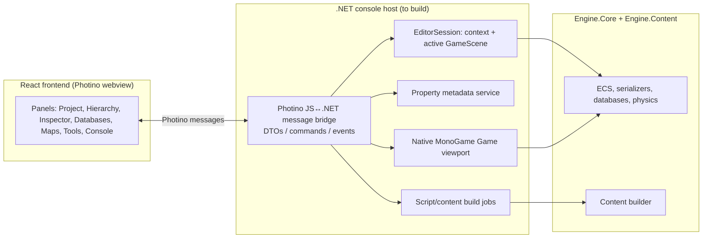
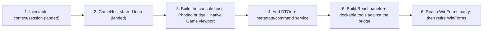

# 08 — React Editor Boundary

This document describes what a non-WinForms editor needs from the engine. It is a design/reference document: the API described here **does not exist yet**. Today the WinForms UI mutates live `Engine.Core` objects in-process. The chosen replacement is a **.NET console application hosting a Photino webview for React and a native MonoGame `Game` viewport**, communicating through Photino's JS↔.NET message bridge.

**Status:** `Stub` — no editor API exists. This document specifies the boundary to build; see [12-future-roadmap.md Phase 5](12-future-roadmap.md) for the chosen hosting model.

## 1. Why a browser cannot simply replace the WinForms UI

The current editor is not a thin client:

- It hosts a MonoGame viewport through `MonoGame.Forms.DX` (`Editor/MGWindowControl.cs:19`).
- It compiles gameplay C# with `dotnet build` (`Editor/Utilities/ScriptCompiler.cs:21-77`).
- It loads assemblies with `Assembly.LoadFrom` and a collectible `AssemblyLoadContext` (`Editor/Tesseract2DLauncher.cs:139-162`, `Editor/Utilities/ScriptAssenblyManager.cs:21-84`).
- It builds MonoGame content (`Editor/Form1.cs:388-420`).
- It reads/writes the local filesystem (projects, scenes, databases, assets).
- It reflects over live engine objects for the inspector (`Editor/FilteredPropertyWrapper.cs`, `Editor/PropertyWrappers/*`).

All of that requires a **local backend process** with filesystem and .NET runtime access. A React frontend can own panels, trees, forms, and a WebGL viewport — but it needs a service that owns the engine session.



The existing `Engine.Web` and `Engine.Multiplatform.Blazor.GL` projects are **game runtime hosts** (KNI + Blazor WebAssembly), not editor backends. A repository-wide search found no `WebApplication`, controllers, SignalR hubs, or WebSocket endpoints. The planned transport is not HTTP at all — it is Photino's message bridge inside the new console host.

## 2. What the backend must own

| Responsibility | Current owner | Notes |
|---|---|---|
| Project context | `EngineContext` / `IEngineContext` (`Engine/Runtime/EngineContext.cs:13-41`); WinForms bridges through `Editor/Services/EditorContextManager.cs:10-27` | Injectable per session; static bridge remains for frozen WinForms code |
| Active scene | `EngineContext.ActiveScene` (`Engine/Runtime/EngineContext.cs:61`) + WinForms `EditorContextManager.ActiveLoadedScene` | New backend should use the injected context as the single source of truth |
| Selection | `Form1.cs:60-70`, `ComponentCardFactory.cs:14-29` | Must be explicit state, not static UI fields |
| Dirty state | `Form1.NeedsToBeSaved` set from many places (`Form1.cs:78-92`, `:1110-1116`, `EditorInputService.cs:634-640`) | Centralize into command-level transactions; deferred to Phase 5 |
| Play state | `EngineContext.PlayState` (`Engine/Runtime/EngineContext.cs:58`) | Per-session injectable state |
| Script build/reload | `ScriptCompiler`, `ScriptAssenblyManager`, `Form1.cs:173-249`, `:970-1005` | Long-running jobs with status events |
| Content build | `Form1.cs:388-420` + `DynamicBuilder` | Long-running job |
| Simulation loop | `GameHost` (`Engine/Runtime/GameHost.cs:141-177`) with editor/Desktop renderers | Already host-owned and proven headlessly; new host supplies its own renderer/input |
| Type discovery | Reflection over core + gameplay assemblies (`Form1.cs:1353-1561`, `:2063-2125`, `DatabaseViewer.cs:329-388`) | Must stay backend-side |

## 3. DTO boundary rules

1. **Never send raw engine objects to React.** No `GameObject`, `GameComponent`, `Database`, `PropertyGrid`, or WinForms control instances.
2. **Flatten every reference to a stable token:**
   - GameObject → `Id` (Guid)
   - Component → owning GameObject `Id` + component type name
   - Database → name/ID/type; row → `AssetID`
   - GameEvent → target GameObject ID + component type name + method name
3. **Preserve the distinction between live identity and serialized format.** Serialization stores `$ref` dictionaries (`ComponentSerializer.cs:90-123`); DTOs should expose IDs plus display labels.
4. **Make property editing metadata-driven** (§4), because the WinForms inspector's semantics are more than "get value / set value".
5. **Expose long operations as commands with job/status events**, not blocking calls.

### Representative DTOs

```text
ProjectSummaryDto     { projectName, projectRoot, manifestPath, targetPlatforms, isLoaded }
ProjectStateDto       { project, activeScene, dirty, playState, selectedTileIndex,
                        availableComponentTypes, availableManagerTypes,
                        availableSystemTypes, availableDataComponentTypes,
                        fontChoices, databaseChoices }
SceneSummaryDto       { id, name, scenePath, activeMapIndex, mapNames }
SceneTreeDto          { roots: EntityNodeDto[] }
EntityNodeDto         { id, name, isActive, parentId, childIds, componentTypeNames }
ComponentDto          { ownerEntityId, typeName, displayName, properties: PropertyValueDto[] }
PropertyValueDto      { name, displayName, category, typeName, kind, value, readOnly, browsable,
                        allowedValues?: ReferenceChoiceDto[], elementType?: string,
                        count?: number,
                        referenceKind?: "entity"|"component"|"database"|"dataComponent"|
                                        "spriteFont"|"gameEventMethod"|"none" }
ReferenceChoiceDto    { id, displayName, detail, valueToken }
InspectorSelectionDto { selectedEntityId, selectedComponentTypeName, selectedProperty }
MapDto                { mapName, isEnabled, layerOrder, width, height, tileSize,
                        tileDatabaseName, tileSetPath, gridValues, tileDataBindings }
DatabaseSummaryDto    { name, databaseType, id }
DatabaseSchemaDto     { databaseType, columns, componentType }
DatabaseRowDto        { assetId, displayName, values }
ProjectFileNodeDto    { path, name, isDirectory, children, iconKind }
LogEntryDto           { id, timestamp, severity, message }
BuildResultDto        { success, outputLog, assemblyPath? }
SimulationStateDto    { running, paused, playState }
ViewportStateDto      { cameraPosition, cameraZoom, gizmoMode, selectedAxis,
                        selectedEntityId, selectedComponentTypeName, activeMapIndex }
```

## 4. The metadata-driven inspector

The WinForms inspector is a `PropertyGrid` wrapped by `FilteredPropertyWrapper` (`Editor/FilteredPropertyWrapper.cs:23-187`) plus roughly fifteen converters/descriptors in `Editor/PropertyWrappers/`. A React inspector needs an equivalent **schema** returned by the backend:

| Current mechanism | Metadata equivalent |
|---|---|
| `FilteredPropertyWrapper.cs:34-69` skips read-only/non-browsable and hides arbitrary class types unless approved | `readOnly`, `browsable`, `kind` flags on `PropertyValueDto` |
| `FilteredPropertyWrapper.cs:93-130` picks converters by name/type | `referenceKind` + `allowedValues` |
| `GameObjectReferenceConverter.cs:20-39` lists scene entities | choices with GameObject IDs |
| `ComponentReferenceConverter.cs:20-50` filters by assignability, displays `"Owner -> Component"` | choices with typed tokens |
| `DatabaseReferenceConverter` / `DatabaseReferenceDropdownConverter` / `DataComponentReferenceConverter` | database/row choices filtered by type |
| `GameEventConverter` + `GameEventPropertyDescriptor.cs:15-178` expands `GameEvent` into target object → component → method | nested property group with cascading choices |
| `InlineCollectionConverter` + `CollectionSizeDescriptor.cs:32-51` + `CollectionIndexDescriptor.cs:13-79` | `kind: collection`, `count`, `elementType`; resizing recreates arrays |
| `GameEventTypeConverter.cs` / `GameEventMethodConverter.cs` | method choices filtered to public, zero-arg, `void` |

**Side effects must be replicated backend-side:**

- Changing `DatabaseReference` clears `DataReference` (`FilteredPropertyWrapper.cs:174-179`).
- Changing a GameEvent target object clears component and method (`GameEventPropertyDescriptor.cs:79-87`).
- Changing collection size recreates arrays/lists (`CollectionSizeDescriptor.cs:32-51`).
- `ComponentSerializer` silently drops unsupported value types (`ComponentSerializer.cs:72-139`) — the metadata service should reject them up front.

There are currently **two** inspector-building paths (`Form1.cs:832-925` and `Form1.SceneHierarchy.cs:549-586`), and `ComponentCardFactory.cs:201-338` reflects into private `PropertyGrid` fields. A backend metadata service would eliminate both problems.

## 5. Command and event surface (proposed)

Commands wrap existing editor logic — see the cited implementations in [07-editor-internals.md](07-editor-internals.md).

| Area | Commands |
|---|---|
| Project | `project.create`, `project.open`, `project.close` |
| Scene | `scene.new`, `scene.load`, `scene.save`, `scene.rename` |
| Hierarchy | `entity.create`, `entity.rename`, `entity.duplicate`, `entity.destroy`, `entity.reparent`, `entity.select` |
| Components | `component.add`, `component.remove`, `component.property.set` |
| Maps / tiles | `map.add`, `map.remove`, `map.select`, `map.update`, `map.tile.paint`, `map.tile.setDataComponent` |
| Managers / systems | `manager.add/remove`, `system.add/remove` |
| Databases | `database.select`, `database.row.add/update/remove`, `database.save`, `database.create` |
| Scripts / content | `scripts.build`, `scripts.hotReload`, `scripts.watch.start/stop`, `content.build` |
| Simulation | `simulation.start/pause/stop`, `simulation.reloadCleanScene` |
| Project files | `files.list`, `files.createFolder`, `files.rename`, `files.delete`, `files.move`, `files.import`, `files.open`, `files.reveal` |
| Templates | `template.create`, `font.create` |
| Viewport | `viewport.setGizmoMode`, `viewport.focusSelected`, `viewport.camera.pan/zoom`, `viewport.selectAt` |
| Tools | `tools.open` (dockable tilemap / animation / particle surfaces) |

Events pushed to the frontend:

```text
ProjectOpened, ProjectClosed, DirtyStateChanged, SceneLoaded, SceneSaved,
EntityCreated/Removed/Renamed/Reparented, SelectionChanged,
ComponentAdded/Removed, PropertyChanged, InspectorMetadataInvalidated,
MapChanged, TilePainted, DatabaseSelectionChanged, DatabaseRowsChanged,
LogAdded, BuildStarted/BuildCompleted, ContentBuildCompleted,
SimulationStateChanged, ViewportStateChanged, ProjectTreeChanged, CommandFailed
```

Every command should be transactional: on success, emit the specific change event plus `DirtyStateChanged`; on failure, `CommandFailed` with a readable error for the console panel.

## 6. Viewport strategies

The viewport is the hardest part. `MGWindowControl` is a WinForms `MonoGameControl` with gizmo input coupled to inspector selection (`EditorInputService.cs:150-271`, `:273-447`; `MGWindowControl.cs:128-155`, `:229-252`).

| Option | Description | Trade-off |
|---|---|---|
| **A. Native viewport host + backend** | Keep a small MonoGame host process/window; React sends commands via backend | Preserves existing rendering/gizmos; not truly embedded in the browser |
| **B. Port viewport to WebGL/canvas** | Reimplement grid, sprite, collider, transform gizmo, tile painting in TS | True web editor; significant work; must mirror `Camera2D`, `UISpace`, sorting |
| **C. Server-side frame streaming** | Render headlessly, stream frames | High complexity/latency; not recommended |

**Option A is the chosen Alpha approach** ([12-future-roadmap.md Phase 5](12-future-roadmap.md)): a native `Game`-derived viewport window alongside the Photino UI window, with React panels talking to the console host over the message bridge. Option B is not on the Alpha roadmap. The native viewport must preserve `UsedInEditor` play-mode gating and `Camera2D` (`Engine/Utilities/Camera2D.cs:14-48`) semantics; see [12-future-roadmap.md §3.6](12-future-roadmap.md). This host may also be able to replace `MockGame` as the content builder's `Game` reference, but that is a validation task, not an assumption.

## 7. Decoupling prerequisites in `Engine.Core`

These changes to the engine are needed regardless of which frontend is used:

1. **Landed:** replace `EditorContextManager` in core with an injectable context. `IEngineContext`/`EngineContext` live in core and core no longer declares `EditorContextManager` (`Engine/Runtime/EngineContext.cs:13-41`; `Editor/Services/EditorContextManager.cs:10-17`).
2. **Landed:** database loading is explicit via `GameScene.Database` and `SceneSerializer.LoadScene(..., database: ...)` (`Engine/ECS/GameScene.cs:62-83`; `Engine/Serialization/SceneSerializer.cs:147-169`).
3. **Landed:** runtime entity ownership uses explicit `isRuntimeCreated` (`Engine/ECS/GameScene.cs:153-172`).
4. **Landed:** `GameHost` owns the frame loop and has been exercised without WinForms (`Engine/Runtime/GameHost.cs:141-177`); the new backend supplies its own `IFrameRenderer`/`IInputSource`.
5. **Landed:** `SessionGlobals` carries per-session input/camera/viewport; `Globals` is a compatibility shim (`Engine/Runtime/SessionGlobals.cs:11-41`).
6. **Still open:** content path conventions disagree between editor content build output, `Content.RootDirectory`, and `AssetManager` (`Editor/Form1.cs:335-336`, `:403`; `Engine/Utilities/AssetManager.cs:108-123`) — see [09-build-and-content.md](09-build-and-content.md). Gameplay script/output paths are now canonical (`Engine/Runtime/ProjectPaths.cs:10-43`).

## 8. Suggested migration sequence



This supersedes the earlier "wrap WinForms first" idea. WinForms is being deprecated, not kept as a peer, so there is deliberately **no cross-process edit sync** — see [12-future-roadmap.md §1](12-future-roadmap.md). Steps 1–4 are prerequisites; step 5 replaces panels incrementally; step 6 retires WinForms.

## 9. Non-goals for the first React iteration

- Do not try to replace script compilation, assembly loading, or content building in the browser.
- Do not send live engine objects over the wire.
- Do not attempt a WebGL viewport before the command/event contract is stable.
- Do not preserve WinForms' inconsistent dirty tracking — replace it with explicit transactions.
- Do not build live cross-process sync with WinForms; it is being deprecated, not maintained as a peer editor.

## Gotchas / Known Limitations

- No editor API, DTOs, commands, or events exist today — everything in §3–§5 is a proposal.
- The two Blazor projects are game hosts; they provide no reusable editor service.
- `ProjectManifest.db` is JSON despite its extension (`Engine/Serialization/ProjectManifest.cs:27-38`).
- Type discovery requires loading gameplay assemblies; it cannot move to the browser.
- `ComponentSerializer` cannot represent arbitrary nested objects (`ComponentSerializer.cs:72-139`), so inspector schemas must stay within supported value kinds.
- Dirty state is currently set inconsistently (see §2), so a naively exposed `save` command would lose changes.
- `GameEvent` naming differs between editor converters (short vs full type names) though runtime accepts both (`Engine/Runtime/GameEvent.cs:52-54`) — the DTO contract should standardize on one.

## See also

- [01-architecture.md](01-architecture.md) — the intended separation and current leaks
- [07-editor-internals.md](07-editor-internals.md) — what the WinForms editor actually does
- [05-runtime.md](05-runtime.md) — the loop that must move out of the host
- [10-known-issues.md](10-known-issues.md) — issues that affect any new frontend
- [14-alpha-todo.md](14-alpha-todo.md) — active Alpha v1 work queue, including Phase 5 host foundation
- [11-health-todo.md](11-health-todo.md) — archived hardening pass, especially P2 decoupling
- [12-future-roadmap.md](12-future-roadmap.md) — chosen Photino/React host scope
