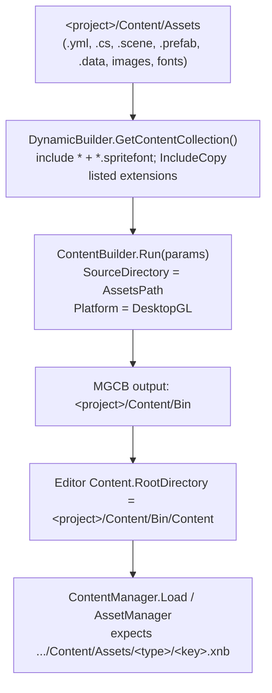
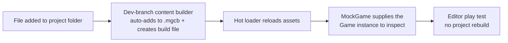

# 09 — Build & Content

This is a reference for the repository's solutions, target frameworks, build prerequisites, commands, and the MonoGame content pipeline as actually configured. It deliberately separates the working MonoGame/editor path from template hosts and isolated KNI experiments; see [00-status-and-scope.md](00-status-and-scope.md) for the status matrix and [01-architecture.md](01-architecture.md) for the dependency picture.

**Status:** Partial (editor, core, content builder, Desktop boot/CI) · Stub (iOS/Android hosts and `Engine.Gameplay`) · Experimental (Web, Multiplatform) · Unused/WIP (GISM, `BuildContent.targets`)

## 1. Solutions

| Solution | Contents | Status / evidence |
|---|---|---|
| `Tesseract2D.sln` | 9 projects: `Engine.Editor`, `Engine.Core`, `Engine.Content`, `Engine.Desktop`, `Engine.Web`, `Engine.Ios`, `Engine.Android`, `Engine.Gameplay`, and `Engine.Tests` | Main solution; project list at `Tesseract2D.sln:6-23`. `Engine.Multiplatform` and `GISM` are **not** in it. |
| `Editor/Editor.sln` | Single `Engine.Editor` project | Points at `Engine.Editor.csproj` with the same project GUID as the main solution (`Editor/Editor.sln:6`; `Tesseract2D.sln:6`). |
| `Engine.Web/Engine.Web.sln` | Single `Engine.Web` project | Project GUID now matches the main solution's `{5C8FC5D5-...}` (`Engine.Web/Engine.Web.sln:6`; `Tesseract2D.sln:14`); the stray `d17.14` token was removed from `VisualStudioVersion` (`:4`). |
| `Engine.Multiplatform/Engine.Multiplatform.sln` | Shared game project plus Android/Oculus/WinForms/SDL2/Blazor platform projects | Separate KNI/nkast experiment, not consumed by the main stack (`Engine.Multiplatform/Engine.Multiplatform.sln:6-18`). |

The generated per-game solutions are a different path: `SolutionGenerator` writes `<Project>.sln` with `Engine.Core`, `Engine.Content`, the generated gameplay project, and selected platform projects (`Editor/Utilities/SolutionGenerator.cs:46-100`).

## 2. Projects and frameworks

| Project | Framework / output | Key dependencies | Notes / evidence |
|---|---|---|---|
| `Engine.Core` | `net8.0`, class library | MonoGame.Framework.DesktopGL `3.8.4.1`, MonoGame.Content.Builder.Task `3.8.4.1`, Aether.Physics2D.MG + Diagnostics.MG `2.2.0`, NLua `1.7.9`, Tommy `3.1.2`, YamlDotNet `18.1.0` | `Engine/Engine.Core.csproj:3-17`. Despite the "standalone engine" goal, core is coupled to **DesktopGL**. |
| `Engine.Editor` | `net8.0-windows`, `WinExe`, WinForms | MonoGame.Forms.DX `3.2.1`, NLua, Tommy, YamlDotNet | References `Engine.Content` and `Engine.Core` (`Editor/Engine.Editor.csproj:3-27`). Windows-only. |
| `Engine.Content` | `net8.0`, `Exe` (`AppendTargetFrameworkToOutputPath=false`) | MonoGame.Framework.Content.Pipeline `3.8.5-preview.*` plus native/tool packages; references `Engine.Core` | `Engine.Content/Engine.Content.csproj:2-27`. This is the content builder. |
| `Engine.Desktop` | `net8.0`, `WinExe` | MonoGame.Framework.DesktopGL `3.8.*`, Content.Builder.Task | References `Engine.Gameplay` and `Engine.Core`; `Game1` now boots `GameHost` with MonoGame renderer/input and optional scene-path environment variables, but is not manifest/content-driven (`Engine.Desktop/Engine.Desktop.csproj:2-31`; `Engine.Desktop/Game1.cs:34-92`). |
| `Engine.Web` | `net8.0`, Blazor WebAssembly | nkast/KNI `4.2.9001` packages, `nkast.Kni.Platform.Blazor.GL` `4.2.9001.2` | **No `Engine.Core` reference** (`Engine.Web/Engine.Web.csproj:1-51`). |
| `Engine.Ios` | `net9.0-ios`, `Exe` | MonoGame.Framework.iOS `3.8.*` | References `Engine.Gameplay` + `Engine.Core`; codesign key configured (`Engine.Ios/Engine.Ios.csproj:3-15`). |
| `Engine.Android` | `net9.0-android`, `Exe` | MonoGame.Framework.Android `3.8.*` | References `Engine.Gameplay` + `Engine.Core` (`Engine.Android/Engine.Android.csproj:3-17`). |
| `Engine.Gameplay` | `net8.0`, class library | References `Engine.Core` only | Placeholder: only `testSystem.cs`, an empty `GameSystem` subclass (`Engine.Gameplay/Engine.Gameplay.csproj:3-10`; `Engine.Gameplay/testSystem.cs:10-22`). |
| `Engine.Multiplatform.Game` | `net8.0`, library, `AssemblyName=QueryTestGame` | nkast/KNI `4.2.9001` | No `Engine.Core` reference; source is a single template game file (`Engine.Multiplatform/Engine.Multiplatform.Game/Engine.Multiplatform.Game.csproj:3-28`). |

**There is no FNA anywhere in this repository.** The Web and Multiplatform trees use KNI/nkast (`Engine.Web.csproj:32-43`, `Engine.Multiplatform.Game.csproj:15-25`); the rest uses MonoGame 3.8.x. This matches the summary in `README.md:50` and `docs/00-status-and-scope.md:51`.

`GISM/` is an abandoned custom-markup experiment with its own `GISM.csproj` and parser/serializer sources (`GISM/GISM.csproj`, `GISM/Core/Parser/GISMParser.cs`); it is absent from the main solution project list (`Tesseract2D.sln:6-23`). Do not build or extend it.

## 3. Prerequisites and commands

Verified requirements from the project files and repository guidance:

- **.NET 8 SDK** for `Engine.Core`, `Engine.Content`, `Engine.Editor`, `Engine.Desktop`, `Engine.Web`, `Engine.Gameplay`, and Multiplatform's shared game.
- **.NET 9 SDK plus iOS/Android workloads** for `Engine.Ios` / `Engine.Android`; their nested `global.json:1-7` files pin `9.0.100` with `rollForward: latestFeature`. Run mobile builds from those directories so the nested pin applies (for example, `cd Engine.Ios; dotnet build Engine.Ios.csproj`).
- **Windows SDK / WinForms** for the editor (`net8.0-windows`, `UseWindowsForms=true` at `Editor/Engine.Editor.csproj:5-8`).
- **CI and build script:** `scripts/build.ps1:23-50` builds `Engine.Core`, `Engine.Content`, `Engine.Editor`, and `Engine.Desktop`, then runs `Engine.Tests` with a TRX logger (`:41-49`) into `artifacts/test-results` (`:20-21,45-46`). `.github/workflows/ci.yml:7-29` runs that script on `windows-latest`, installs the SDK pinned by the root `global.json` (`:14-17`), and uploads the TRX file (`:23-29`). Mobile, Web, Multiplatform, and GISM are excluded by the script's explicit project list (`:23-28`).
- **SDK pin:** the repo-root `global.json:1-7` pins `8.0.428` with `rollForward: latestFeature`, so `dotnet --version` there resolves to 8.x; `.NET 9 SDK` is intentionally not installed in the verification environment, so the nested mobile pins report "compatible SDK not found" locally. Verify changes by running `./scripts/build.ps1` and, where relevant, launching the editor and checking its log (`AGENTS.md`).

```powershell
# Maintained DesktopGL targets plus tests, with TRX output (PowerShell)
./scripts/build.ps1

# Editor (the most complete host)
dotnet run --project Editor/Engine.Editor.csproj

# Individual projects rather than the whole solution on Windows
dotnet build Engine/Engine.Core.csproj -c Debug
dotnet build Engine.Content/Engine.Content.csproj -c Debug
dotnet build Editor/Engine.Editor.csproj -c Debug
dotnet build Engine.Desktop/Engine.Desktop.csproj -c Debug

# Web host experiment (KNI/Blazor)
dotnet run --project Engine.Web/Engine.Web.csproj

# Isolated KNI multiplatform experiment
dotnet build Engine.Multiplatform/Engine.Multiplatform.sln -c Debug
```

These commands follow the project/solution layout above; `./scripts/build.ps1` now scripts and CI-verifies the four maintained builds and the test suite. `dotnet build Tesseract2D.sln -c Debug` is still expected to fail on Windows without the .NET 9 mobile workloads and is deliberately excluded from both script and workflow.

## 4. Content pipeline

### 4.1 Static builder

`Engine.Content/Builder/Builder.cs` defines default parameters as a top-level statement — `Mode = Builder`, `WorkingDirectory = $"{AppContext.BaseDirectory}../../../"`, `SourceDirectory = "Engine.Content/Assets"`, `Platform = TargetPlatform.DesktopGL` — and forwards any CLI arguments to `builder.Run(args)` instead (`Engine.Content/Builder/Builder.cs:14-33`). Its `GetContentCollection()` is documentation-only scaffolding with commented examples (`Engine.Content/Builder/Builder.cs:38-50`).

### 4.2 Dynamic builder used by the editor

`DynamicBuilder` is what the editor actually runs. It keeps an unused `_targetAssetFolder` field initialized by `Initialize(string)` and a second, unused default-parameter block with the same hardcoded paths (`Engine.Content/Builder/DynamicBuilder.cs:13-27`). Its collection includes a broad `WildcardRule("*")`, a duplicate `WildcardRule("")`, and `*.spritefont`, then copy-includes only these extensions (`Engine.Content/Builder/DynamicBuilder.cs:29-56`):

```csharp
content.IncludeCopy<WildcardRule>("*.yml");
content.IncludeCopy<WildcardRule>("*.cs");
content.IncludeCopy<WildcardRule>("*.scene");
content.IncludeCopy<WildcardRule>("*.prefab");
content.IncludeCopy<WildcardRule>("*.data");
```
— `Engine.Content/Builder/DynamicBuilder.cs:43-54`

`*.database` is **not** in that list, and `*.lua` is explicitly commented out (`Engine.Content/Builder/DynamicBuilder.cs:48`). `EngineContentLogger` bridges pipeline `LogLevel` values to `Engine.Core.Utilities.Log` (`Engine.Content/Builder/EngineContentLogger.cs:11-25`).

### 4.3 Editor invocation and path flow

On scene load the editor calls `RunContentBuilder()` at `Editor/Form1.cs:357`; the method constructs a `DynamicBuilder`, attaches `EngineContentLogger`, and sets `WorkingDirectory` and `SourceDirectory` to `EditorContextManager.AssetsPath`, `OutputDirectory` to `Path.Combine(EditorContextManager.ContentPath, "Bin")`, and platform `DesktopGL` (`Editor/Form1.cs:388-420`). The editor-side `EditorContextManager` forwards these to `EngineContext.Current`, where `ContentPath = <root>/Content`, `BinPath = <root>/Content/Bin`, and `AssetsPath = <root>/Content/Assets` (`Editor/Services/EditorContextManager.cs:10-27`; `Engine/Runtime/EngineContext.cs:65-76`). The editor then points the MonoGame content manager at `Path.Combine(BinPath, "Content")` (`Editor/Form1.cs:335-336`), while `AssetManager.GetAbsolutePhysicalPath` builds `<BinPath>/Content/Assets/<subfolder>/<key>.xnb` (`Engine/Utilities/AssetManager.cs:105-121`).



`BuildContent.targets` is **not imported anywhere** (repository-wide search found no reference), and it still contains unreplaced template tokens `___SafeGameName___` in its content path, command path, and project reference (`Engine.Content/BuildContent.targets:1-10`). `Engine.Desktop.csproj` defines its own `BuildContent` target that writes `ContentOutPut` but passes `$(ContentOutput)` into `-o` (spelling mismatch), and uses `-s Assets` even though there is no `Assets` folder in that project (`Engine.Desktop/Engine.Desktop.csproj:33-40`). All checked-in MGCB manifests are effectively empty: iOS (`Engine.Ios/Content/Content.mgcb:13`), Android (`Engine.Android/Content/Content.mgcb:14`), and Multiplatform (`Engine.Multiplatform/Engine.MultiplatformContent/Engine.MultiplatformContent.mgcb:14`).

### 4.4 Experimental dev-branch hot content pipeline (author's actual setup)

**Status:** `Experimental` — depends on an out-of-tree MonoGame dev branch; not reproducible from the checked-in package references.

The MonoGame content pipeline described in §4.1–§4.3 is what the repository contains, but it is **not the whole story** for the author's workflow. According to the project author, the specific experimental MonoGame dev branch and pipeline setup in use provides two behaviours beyond stock MGCB:

1. **Automatic MGCB registration.** Whenever a file is added to the game's project folder, the content builder automatically adds it to the `.mgcb` list and creates its appropriate build file. Manual bookkeeping of new assets is therefore not part of the intended workflow.
2. **Hot asset reload without a rebuild.** Assets are reloaded in place when testing inside the editor, so running a game does not require rebuilding the project. The content builder requires a `Game` instance reference even though that instance's state and folder are unrelated to the assets it reloads — `Engine/Utilities/MockGame.cs` exists only to satisfy that requirement and performs no work of its own; the editor's live MonoGame.Forms instance was tried first but was not accepted as a substitute (see [05-runtime.md](05-runtime.md)).



Consequences for reading this repository:

- The explicit `IncludeCopy` wildcards in `DynamicBuilder` (§4.2) are the **checked-in** copy configuration; the dev branch's auto-registration is not visible in source and may supersede parts of it. Do not assume the wildcard list is the only thing governing which assets get built.
- The gotchas about stale `BuildContent.targets` tokens, the `ContentOutPut` typo, and empty `.mgcb` manifests describe the **checked-in** configuration. They may be irrelevant to the author's dev-branch setup, which does not appear in any project file here.
- The dev branch was adopted roughly five months before this documentation was written and may since have been fixed upstream. Verify against the actual MonoGame build in use before relying on any of this.
- There are **no in-repo call sites for `MockGame`** because its consumer is the external hot loader. It is not dead code — see [10-known-issues.md](10-known-issues.md).

## Gotchas / Known Limitations

- `Engine.Core` references `MonoGame.Framework.DesktopGL` directly (`Engine/Engine.Core.csproj:13`), undercutting the "engine knows nothing about a platform host" goal described in [01-architecture.md](01-architecture.md).
- A repository-wide search finds no FNA package or code; do not describe Web/Multiplatform as FNA builds. They are KNI/nkast `4.2.9001` (`Engine.Web.csproj:32-43`; `Engine.Multiplatform.Game.csproj:15-25`).
- `dotnet build Tesseract2D.sln -c Debug` is not a clean one-command build on Windows without .NET 9 iOS/Android workloads; the mobile projects are in the main solution (`Tesseract2D.sln:16-18`).
- `Editor/Editor.sln:6` now points at `Engine.Editor.csproj` and uses the main solution's editor project GUID; `dotnet sln Editor/Editor.sln list` resolves the real project.
- `Engine.Web/Engine.Web.sln:6` now uses the same Web project GUID as `Tesseract2D.sln:14`; `dotnet sln Engine.Web/Engine.Web.sln list` resolves the real project.
- CI is limited to the four maintained DesktopGL targets (`scripts/build.ps1:23-39`; `.github/workflows/ci.yml:7-21`). The whole solution, mobile targets, Web, Multiplatform, and GISM are not automatically verified. The SDK is pinned by `global.json` (see §3).
- The editor sets the content output directory to `Content/Bin` (`Editor/Form1.cs:403`) but sets `Content.RootDirectory` to `Content/Bin/Content` (`Editor/Form1.cs:335-336`) and `AssetManager` expects `Content/Bin/Content/Assets/...` (`Engine/Utilities/AssetManager.cs:115-121`). Asset-loading failures are often path mismatches; see [10-known-issues.md](10-known-issues.md).
- `DynamicBuilder` includes `*` and `""` wildcards twice and never uses `_targetAssetFolder` or its second default parameter block (`Engine.Content/Builder/DynamicBuilder.cs:13-36`).
- `.database` assets are not copy-included by the content builder, despite `.data` being included (`Engine.Content/Builder/DynamicBuilder.cs:43-55`); see [04-databases.md](04-databases.md).
- `BuildContent.targets` is dead configuration with unreplaced `___SafeGameName___` tokens and no import site (`Engine.Content/BuildContent.targets:6-9`), and Desktop's `ContentOutPut`/`$(ContentOutput)` typo plus missing `-s Assets` target make its custom `BuildContent` target unreliable (`Engine.Desktop/Engine.Desktop.csproj:33-40`).
- `Engine.Gameplay`, iOS, and Android hosts remain template-level stubs (`Engine.Gameplay/testSystem.cs:10-22`). Desktop now boots `GameHost` and can load a scene path from the environment (`Engine.Desktop/Game1.cs:34-92`), but it is not yet a manifest/content-driven playable game.

## See also

- [00-status-and-scope.md](00-status-and-scope.md) — status matrix and badge meanings
- [01-architecture.md](01-architecture.md) — repository map and framework stacks
- [03-projects-and-serialization.md](03-projects-and-serialization.md) — project layout and asset files
- [05-runtime.md](05-runtime.md) — what the hosts actually boot
- [06-authoring-guide.md](06-authoring-guide.md) — generated gameplay project and script compilation
- [07-editor-internals.md](07-editor-internals.md) — editor startup and content build call site
- [10-known-issues.md](10-known-issues.md) — consolidated path/build issues
- [14-alpha-todo.md](14-alpha-todo.md) — active Phase 8 content gate, including former P3-6
- [11-health-todo.md](11-health-todo.md) — archived hardening pass
- [12-future-roadmap.md](12-future-roadmap.md) — dev-branch/content scope decisions
