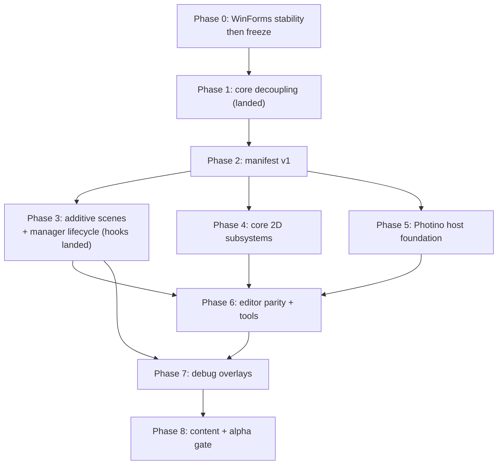

# 12 — Future Roadmap: Alpha v1.0 and Beyond

This is the **feature roadmap**. The hardening pass is closed and archived in [11-health-todo.md](11-health-todo.md); active Alpha v1 work is queued in [14-alpha-todo.md](14-alpha-todo.md). This document assumes the P0 and P1 hardening items are done.

**Status:** Planning / recommendation with landed prerequisites — roadmap Phase 1 (injectable context, explicit database loading, creation flag, per-session globals), the shared host loop, canonical script paths, CI/build script, and hot-reload policy are implemented. The remaining work is tracked in [14-alpha-todo.md](14-alpha-todo.md); everything else remains a verified gap or an explicit author goal. Source-derived claims are anchored with repo-root-relative paths; author-stated intent is labelled as such.

## 1. Scope boundaries

These are decisions, not discoveries. They bound what Alpha means.

| Boundary     | Decision                                              | Rationale                                                                                                                                                                                                           |
| ------------ | ----------------------------------------------------- | ------------------------------------------------------------------------------------------------------------------------------------------------------------------------------------------------------------------- |
| Dimension    | **2D only**                                           | The engine is being built for 2D development. 3D is explicitly after full release, not Alpha or Beta.                                                                                                               |
| Platform     | **DesktopGL only at Alpha**                           | Mobile hosts need .NET 9 workloads and are template stubs; Web/Multiplatform are isolated KNI experiments with no `Engine.Core` reference (`00-status-and-scope.md` §3).                                            |
| Editor       | **WinForms stabilized, then frozen**                  | WinForms reaches a "decent stable state" in Phase 0, then is deprecated. The Photino/React host is the successor.                                                                                                   |
| Sync         | **No cross-process edit sync**                        | WinForms is legacy, not a peer. The React host owns its own session; reloading a project shows external changes.                                                                                                    |
| Content      | **The author's dev-branch pipeline is authoritative** | Auto-registers new files into the `.mgcb` list and hot-reloads assets; see [09-build-and-content.md §4.4](09-build-and-content.md). Do not spend Alpha time repairing checked-in config that workflow does not use. |
| Localization | **No new feature**                                    | The database system was designed for it; see §3.                                                                                                                                                                    |
| Lua          | **Aspirational beyond v1**                            | NLua is referenced (`09-build-and-content.md` §1) but the authoring menu is commented out (`06-authoring-guide.md`). Not needed even for full release.                                                              |
| Networking   | **Full release**                                      | Interesting, but not an Alpha or Beta concern.                                                                                                                                                                      |

## 2. Alpha v1.0 exit criteria

Alpha is not done until all of these pass.

| ID  | Criterion                                                                                                                                                                                                                                               |
| --- | ------------------------------------------------------------------------------------------------------------------------------------------------------------------------------------------------------------------------------------------------------- |
| A1  | A project can be created, opened, edited, saved, and run end to end without hand-editing files.                                                                                                                                                         |
| A2  | A built DesktopGL game launches outside the editor with scenes, databases, and content loaded.                                                                                                                                                          |
| A3  | Additive scene switching works: named scenes, explicit activate/deactivate/unload, multiple active scenes rendering in a defined order.                                                                                                                 |
| A4  | `ProjectManifest.db` holds real config — quality tiers, graphics-backend selector, editor preferences, scene list + startup scene, content roots + platform — and is read by both editor and runtime. Existing `{}` manifests still load with defaults. |
| A5  | Adding an asset needs no manual `.mgcb` bookkeeping.                                                                                                                                                                                                    |
| A6  | An editor backend contract exists: .NET console host, Photino webview, JS↔.NET message bridge, and DTO/command/event surface.                                                                                                                           |
| A7  | All P0 and P1 hardening items are closed; the checklist is archived in [11-health-todo.md](11-health-todo.md).                                                                                                                                         |
| A8  | Portable sample content is checked in and the docs match source.                                                                                                                                                                                        |
| A9  | The React host has full WinForms capability parity, including `GameEvent` wiring, input action mapping, dockable tools (tilemap,database viewer/editor, basic animation/particle), and the six debug overlays in §4 Phase 7.                            |

## 3. Design rationales and hard-won constraints

These are the things source analysis cannot recover. Read them before proposing an alternative design.

### 3.1 Databases were designed for localization and mass data authoring

According to the project author, the database system has two original goals:

1. **Localization** — store all dialogue and displayed names in databases, then swap the active database per language. This is why databases are first-class data assets rather than an afterthought.
2. **Mass-producing data-driven objects** — a `SwordComponent` holds a `SwordDataComponent` reference by ID/name, so 100 swords are 100 table rows rather than 100 authored assets. This is the intended analogue of Unity ScriptableObjects.

See [04-databases.md](04-databases.md) for the implementation. **Do not propose a separate localization subsystem.**

### 3.2 UI must live in the engine's own scene world

The author tried both **Gum** (with an embedded Gum editor) and **Avalonia**, and abandoned both for the same reason: each owns its own world, and the engine/editor could not exchange actions or events with that world without a brittle bridge. Getting Gum-layer actions to touch engine game data was "an absolute nightmare."

The current UI is therefore a set of ECS components, following Unity's old UI approach. It is acknowledged as user-unfriendly and complicated, but it has the critical property: **UI components live in the same scene as gameplay data**.

The UI rework must preserve that rule while pursuing three goals:

- **A.** As user-friendly as possible.
- **B.** A genuinely good UI editor.
- **C.** Directly connectable to data in the game scene or world.

### 3.3 Tools are a first-class concern

The author is "really big on tools" — this is why the editor was started in WinForms, where tool creation was familiar. Tools should be **dockable surfaces** in the React host, not detached utilities. The existing basic tilemap editor is the prototype for that pattern.

### 3.4 Modding mostly works already

Custom systems and managers are discovered from the game project folder, and scenes/databases are YAML. Therefore:

- Custom systems/managers written by anyone can be dropped into a project and used.
- Any game built with the engine can be opened in the engine and edited.
- What is missing is **convention and distribution**, not mechanism: a dedicated mod folder that is auto-discovered with no setup, and later an API for third-party tools.

### 3.5 `GameEvent` wiring already works

`GameEvent` is a field that can be added to any component. The editor's property-wrapper layer resolves the target object → attached component → property/event to listen to. This is real, working WinForms behaviour, and the "crazy magic" in `Editor/PropertyWrappers/` is load-bearing. Porting it to React is parity work, not new design.

### 3.6 The editor is a live game instance

`MonoGame.Forms` runs a live game; scene objects are added at runtime and serialized on save. Pressing *play* removes the block in the update loop that gates systems. `GameSystem.UsedInEditor` defaults to `false` (`Engine/ECS/GameSystem.cs:18`), so systems like Transform opt in to running outside play mode while physics runs only in play mode. The React host's native viewport must preserve this model.

### 3.7 Manager lifecycle is partially landed in a working area

Custom `GameManager` subclasses are registered by the editor (`Editor/Form1.cs:1381-1431`, `AddManager` call at `:1426`). `GameHost` calls `Initialize` and `Update` for active registered managers, but calls `Shutdown` for every registered manager (`Engine/Runtime/GameHost.cs:141-155`, `:207-230`). The `SceneManager` activation API is implemented (`Engine/Runtime/SceneManager.cs:34-102`, `:123-131`) but still has no host call site; `GameHost` loads/attaches one scene directly (`Engine/Runtime/GameHost.cs:69-99`). What does **not** work: `GameManager.IsPersistent`, serialized `SceneManager.LoadScene`/`PreLoadScene`, and additive scene switching. See [10-known-issues.md](10-known-issues.md).

### 3.8 `MockGame` may be replaceable, but must be validated

A native `Game`-derived viewport host is plausibly what the experimental content builder needs, unlike the `MonoGame.Forms` control that was rejected. Treat replacing `MockGame` as a validation task in Phase 5, not an assumption. See [05-runtime.md](05-runtime.md).

## 4. Alpha phases

| Phase | Name                    | Scope                                                                                                                                                                                                                                                                                                                                                                     |
| ----- | ----------------------- | ------------------------------------------------------------------------------------------------------------------------------------------------------------------------------------------------------------------------------------------------------------------------------------------------------------------------------------------------------------------------- |
| 0     | WinForms stability      | Health P0 + critical P1, SDK pin, sample content → then freeze WinForms                                                                                                                                                                                                                                                                                                   |
| 1     | Core decoupling         | **Landed:** injectable context, explicit database loading, explicit creation flag, per-session globals, shared host loop (`Engine/Runtime/EngineContext.cs`, `SessionGlobals.cs`, `GameHost.cs`)                                                                                                                                                                                                                                                                       |
| 2     | Project config v1       | Manifest schema with versioning: quality tiers + backend selector, editor preferences, scene list + startup scene, content roots + target platform; readers in editor and runtime                                                                                                                                                                                         |
| 3     | Scene + manager runtime | Additive named scene set with activate/deactivate/unload; custom `GameManager` lifecycle wiring; serialized `SceneManager` TODOs                                                                                                                                                                                                                                 |
| 4     | Core 2D subsystems      | Audio · animation · particles · prefabs · runtime camera                                                                                                                                                                                                                                                                                                                  |
| 5     | New host foundation     | .NET console app, Photino webview, React/Vite build, native MonoGame viewport, JS↔.NET command/event bridge, session model; command/dirty transactions (former P2-6); decide platform-stub retirement (former P3-5); validate `MockGame` replacement                                                                                                                        |
| 6     | Editor parity + tools   | Hierarchy/inspector/undo-redo · viewport gizmos, selection, `UsedInEditor` play-mode gating, entity inspection · `GameEvent` wiring parity · metadata-driven property schema (former P2-7) · input action mapper · tilemap parity + auto-tiling · sprite sheet slicer · basic animation and particle tools · assets browser · CSV↔database round-trip · mod folder convention · UI usability fixes and scene-data binding |
| 7     | Debug overlays          | FPS + frame/system timings · physics debug draw · entity/scene stats · log console · grid/tile info · camera bounds + quality-tier readout                                                                                                                                                                                                                                |
| 8     | Content + alpha gate    | **Partly landed:** dev-branch pipeline documented, DesktopGL build script/CI added; validate content drift (former P3-6) against that pipeline; end-to-end acceptance run still open                                                                                                                                                                                     |

Phases 3–4 and 5–6 are independent after Phase 2 and can overlap.

### Phase 2 detail: manifest v1 fields

| Section            | Contents                                                                                                                                                                  |
| ------------------ | ------------------------------------------------------------------------------------------------------------------------------------------------------------------------- |
| Rendering          | Quality tier enum + graphics-backend selector. Backend-agnostic so adding Vulkan later is a config value, not a schema migration. DesktopGL only is implemented at Alpha. |
| Editor preferences | Per-project editor tuning: grid defaults, gizmo settings, panel state.                                                                                                    |
| Scenes             | Registered scene list + startup scene. Pairs with Phase 3.                                                                                                                |
| Content            | Content roots, asset/source/output paths, target platform. Supersedes hardcoded `EditorContextManager` values.                                                            |

A version field is part of this phase; T1 records a migration-hook decision and implements it only if Alpha acceptance requires it (see [14-alpha-todo.md T1](14-alpha-todo.md)). All three saved test projects currently have `{}` manifests, so defaults must work.

### Phase 7 detail: debug overlays

| Overlay                      | Note                                                                                 |
| ---------------------------- | ------------------------------------------------------------------------------------ |
| FPS + frame/system timings   | No profiling exists today.                                                           |
| Physics debug draw           | `Aether.Physics2D.Diagnostics.MG` is already a dependency; likely the cheapest item. |
| Entity/scene stats           | Counts per active scene; valuable with additive scenes.                              |
| Runtime log console          | On-screen view of `Log` output.                                                      |
| Grid/tile info               | Cursor tile coordinates, active map, layer order.                                    |
| Camera bounds + quality tier | Viewport bounds and active rendering tier.                                           |

**Entity inspection is not a debug overlay.** It is a native viewport capability in Phase 6, alongside selection and gizmos.

## 5. Dependency diagram

The critical path is **Phase 2 → Phase 5 → Phase 6 → Phase 8**; Phase 1 is landed. `EngineContext`/`SessionGlobals` are now the gateway contract: the standalone game host exists, while the new editor host still needs the command/inspector layers from Phases 5–6.

## 6. Post-Alpha tiers

### Beta

- Pathfinding helpers and a pathfinding visualizer
- Random-number and noise generators (with preview tooling)
- Save-game state: global variables owned by `GameManager`, serialized alongside modified scenes — depends on the Phase 3 lifecycle wiring
- Graphics-backend abstraction
- **Full UI rework and polished UI editor**
- **Modding tool API** for third-party dockable tools
- Fuller animation and particle tools
- **Audio tool**: piano roll in the spirit of FL Studio, chiptune creation with a 5-band synth
- Pixel art editor (draw, palette, onion skin)
- Palette swap / recolor tool
- Sprite atlas packer
- Bitmap font generator
- Sound effect editor (trim, loop points, pitch)
- Curve / tween editor
- Dialogue / quest tree editor, with database-backed strings
- Localization workflow tool (side-by-side languages, pseudo-localization, CSV export)
- YAML diff / merge helper
- Hot reload manager panel

### Full release

- Networking
- UI layout editor
- Visual scripting / node graph — the natural successor to the abandoned Lua idea
- State machine / behaviour tree editor
- Build and deploy profiles
- Audio mixer / bus routing
- Shader / 2D effect editor
- 2D lighting editor
- Replay / recording tool for bug reports
- Custom content processor authoring
- Plugin / tool extension manager
- Packaged mod distribution

### After full release

- 3D toolchain and 3D tooling
- Multi-user collaborative editing
- AI-assisted sprite/tile generation
- Procedural level generation
- Cloud asset sync / publishing
- Cutscene / timeline editor
- Skeletal 2D animation

### Aspirational beyond v1

- Lua scripting

### Explicitly not needed

- A separate localization system — databases already cover it (§3.1)

## 7. Relationship to the archived health roadmap

[11-health-todo.md](11-health-todo.md) is now an archive index for the closed hardening pass; the full historical checklist is at [archive/11-health-todo.md](archive/11-health-todo.md). Active Alpha work is tracked in [14-alpha-todo.md](14-alpha-todo.md). The remaining health items were carried forward as follows:

- **P2-6 (commands/dirty)** is assigned to the new console host, not as a deep WinForms refactor. It is now Phase 5 work in [14-alpha-todo.md](14-alpha-todo.md).
- **P2-7 (inspector metadata)** becomes a backend property-schema service in Phase 6, not a port of the WinForms `PropertyGrid` internals.
- **P3-4 (WinForms dirty tracking)** was dropped as a standalone item because WinForms is deprecated.
- **P3-5 (platform stubs)** is a Phase 5 decision and Phase 8 cleanup item: retire stubs from the main solution surface or leave them explicitly template-level and excluded from Alpha acceptance/CI.
- **P3-6 (content drift)** is Phase 8 validation against the author's dev-branch pipeline, not blind repair of stale checked-in config.
- **P1-10's deferred collision-callback signature** is a Phase 4 decision; implementation detail remains in [13-refactor-todo.md](13-refactor-todo.md).
- **P3-3** landed as an engine host policy, not rehydration: assembly swaps report `ReloadRequired`, and `scene.reload` reloads from disk (`Engine/Runtime/GameHost.cs:101-134`). Frozen WinForms is not wired to that event, and scenes attached without a file path cannot be reloaded.

## See also

- [00-status-and-scope.md](00-status-and-scope.md) — what exists today
- [10-known-issues.md](10-known-issues.md) — the catalogue this roadmap works through
- [14-alpha-todo.md](14-alpha-todo.md) — active Alpha v1 work queue
- [11-health-todo.md](11-health-todo.md) — archived hardening pass
- [08-react-editor-boundary.md](08-react-editor-boundary.md) — the proposed editor API surface
- [04-databases.md](04-databases.md) — the localization/data-authoring backbone
- [13-refactor-todo.md](13-refactor-todo.md) — candidate refactors to reconsider before Alpha v1
