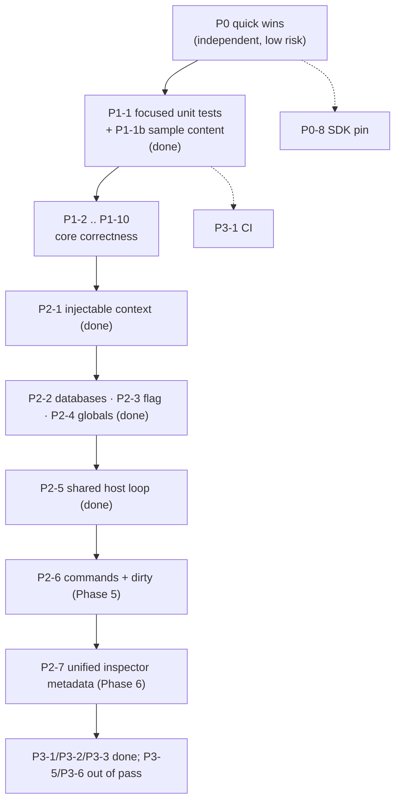

# 11 — Engine Health TODO

A prioritized, dependency-ordered list of work to bring the **current** engine into better health. This is a *hardening* list, not a feature list — new capabilities belong in [12-future-roadmap.md](../12-future-roadmap.md). Every item traces back to a verified issue in [10-known-issues.md](../10-known-issues.md) or a gap in [00-status-and-scope.md](../00-status-and-scope.md).

The roadmap changes how a few of these items should be executed: WinForms is frozen after Phase 0 of that roadmap, so command/dirty and inspector-metadata work lands in the new console host rather than as deep WinForms refactors (see §7 of [12-future-roadmap.md](../12-future-roadmap.md)).

**Status:** P0-1 through P0-10 completed; P1-1 through P1-10 completed; P2-1 through P2-5 and P3-1 through P3-3 completed. P2-6/P2-7 are deferred to roadmap Phase 5/6; P3-5/P3-6 remain out of the current pass. P1-10 callback signature work is deferred to [13-refactor-todo.md](../13-refactor-todo.md).

## How to use this list

| Column | Meaning |
|---|---|
| Priority | `P0` quick win, low risk · `P1` core correctness · `P2` architectural decoupling · `P3` infrastructure |
| Effort | `S` under an hour · `M` a few hours · `L` a day or more |
| Verify | How to confirm the fix actually landed |

**Guiding principles, in order:**

1. **Do not break the author's working editor workflow.** Several "bugs" in the checked-in configuration may be irrelevant to the experimental MonoGame dev-branch content pipeline ([09-build-and-content.md §4.4](../09-build-and-content.md)). Confirm before touching content paths, `.mgcb` handling, or `MockGame`.
2. **Fix observable bugs before abstract design.** A wrong path or unguarded parse hurts more today than an inelegant interface.
3. **Add fast feedback early without displacing what already works.** Manual integration testing via the author's saved editor projects remains the primary end-to-end path. P1-1 added *targeted* unit tests, and P3-1 added CI for the four maintained targets plus 71 xUnit facts (`scripts/build.ps1:23-50`, `.github/workflows/ci.yml:7-29`).
4. **Decouple deliberately.** `EditorContextManager` has been replaced in core by injectable `IEngineContext`/`SessionGlobals`; the concrete bridge lives in `Editor/Services/EditorContextManager.cs:10-17`.
5. **One concern per change.** Many of these issues interact; bundle them only when they share a root cause.

## Existing verification assets

The author's primary integration test is **not in this repository**: open the WinForms editor, load one of three saved projects, and exercise the loaded scene. They live at `D:\GameDevelopment\TestFolderEngine\TestProject\` on the author's machine. Despite the names, all three are fully valid current-format projects.

| Project | What it actually covers |
|---|---|
| `AnotherUITest` | Largest scene (494-line `Content/Assets/Scenes/Main.scene`). UI-heavy: `UICanvasComponent.ChildElements` with `$ref: Component` entries, plus `LayoutComponent`, `ListBoxComponent`, `LabelComponent`, `UIImageComponent`, `SpriteComponent`. `Scripts/Tester.cs` and `Banana.cs`; two `.spritefont` assets. |
| `Fonts` | 446-line scene **plus the only real tile map** (`Main_TestMap.yaml`, 25×19, `TileDatabaseName: tiledb`, `TilesetPath: Assets/Textures/tilesettest2.png`) **plus the only populated database** (`tiledb.database`: four `TileDataComponent` entries — water/stone/grass/air — each with an `AssetID`). Scripts include `ListboxPopulater.cs` (a `ScriptComponent` using `OnEnable`/`OnDisable`/`Start`/`Update`) and `tiletest.cs` (a `DataComponent`). |
| `UITest` | 204-line scene with `PanelComponent`, `UIImageComponent`, and a user script attached **by short name** (`onhover:`) — useful for resolver tests. Its `tilredb.database` is a valid but empty database (`DataEntries: {}`). |

P1-1b now adds a portable subset of the `Fonts` project at `Engine.Tests/TestContent/Fonts/`: the current-format scene, map, populated database, short-name script, and a populated manifest (`Engine.Tests/TestContent/Fonts/README.md:7-18`). Binaries, build output, `ProjectConfig.json`, and the original `{}` manifest are deliberately excluded (`Engine.Tests/TestContent/Fonts/README.md:20-24`). The test project copies that tree to the output directory (`Engine.Tests/Engine.Tests.csproj:24-26`) and loads it relative to `AppContext.BaseDirectory` (`Engine.Tests/TestInfrastructure.cs:60-79`).

Observations that matter for this roadmap:

- All three source `Content/ProjectManifest.db` files are literally `{}`. This confirms P0-2 **in practice**, and means P0-1's non-default manifest values are not exercised by those projects. P1-1b now exercises a populated manifest in the checked-in fixture (`Engine.Tests/TestContent/Fonts/Content/ProjectManifest.db`).
- Each project also has a `Content/Bin/Content/` copy of its scene, i.e. **committed build output**. Those copies mirror the source scenes, which is direct evidence that the content pipeline produces real files. Do not edit the `Bin` copies by hand.
- `ProjectConfig.json` uses a singular `TargetPlatform` field while the `ProjectManifest` DTO uses plural `TargetPlatforms`. These are **separate files** — do not conflate them when fixing P0-1/P0-2.
- Because these projects are machine-local, agents cannot rely on them being present. P1-1b's portable fixture at `Engine.Tests/TestContent/Fonts/` removes that dependency for serializer tests; the saved projects remain the integration check.

---

## P0 — Quick wins

Low risk, low effort, each independently shippable. Good first tasks.

| ID | Item | Why / source | Verify | Effort |
|---|---|---|---|---|
| P0-1 | Fix the launcher's double-appended manifest path **(Done)** | `LoadManifest` now takes the full manifest path (`Editor/Tesseract2DLauncher.cs:347-361`); call sites at `:113` and `:331` pass `<root>/Content/ProjectManifest.db` directly. The launcher also prefers the manifest's `ProjectName` for history (`:115`). | Verified by building `Editor/Engine.Editor.csproj` and calling `LoadManifest` against a manifest with non-default `ProjectName`/`TargetPlatforms`; both values were returned | S |
| P0-2 | Call `CreateInitialManifest` from project creation **(Done)** | `ProjectDirectoryFactory.CreateNewProject` now calls `ProjectManifest.CreateInitialManifest` (`Engine/Serialization/ProjectDirectoryFactory.cs:22`, `:72-74`); the launcher passes `options.SelectedPlatforms` (`Editor/Tesseract2DLauncher.cs:45`). The author's older saved projects still have `{}` manifests. | Generated a scratch project with platforms `Desktop`/`Web`; `Content/ProjectManifest.db` contained populated JSON with both values | S |
| P0-3 | Fix the New System template lookup **(Done)** | Menu now passes `"SystemComponent"` (`Editor/Form1.ProjectExplorer.cs:95`), matching the only system template file | Generated a sample `VerifySystem.cs` through `CodeTemplateGenerator` (3348 bytes) and compiled it against `Engine.Core` successfully | S |
| P0-4 | Align converter filenames with class names **(Done)** | Classes renamed to `DatabaseReferenceDropdownConverter` (`Editor/PropertyWrappers/DatabaseReferenceDropdownConverter.cs:14`) and `GameEventTypeConverter` (`Editor/PropertyWrappers/GameEventTypeConverter.cs:13`); call sites updated at `Editor/FilteredPropertyWrapper.cs:110` and `Editor/PropertyWrappers/GameEventPropertyDescriptor.cs:33` | `dotnet build Editor/Engine.Editor.csproj` succeeds; every converter class in `Editor/PropertyWrappers/` now has the same name as its file | S |
| P0-5 | Guard `Guid.Parse` calls **(Done)** | `Guid.TryParse` guards scene (`Engine/Serialization/SceneSerializer.cs:150-162`), entity/parent (`Engine/Serialization/GameObjectSerializer.cs:32-54`), and database (`Engine/Serialization/DatabaseSerializer.cs:100-110`) IDs, with warnings and recovery values. Component references are paired to imported entities by index so a recovered entity ID still resolves (`SceneSerializer.cs:312-330`). | Loaded scratch scene/database YAML with malformed scene, entity, parent, and database IDs with no exception. A component `$ref` on a malformed-ID entity resolved to its valid target after `SceneSerializer.LoadScene`. | S |
| P0-6 | Fix `FixedUpdate` accumulator **(Done)** | `SystemsManager.Update` subtracts the interval, passes the fixed interval to systems, caps catch-up at 8 ticks while preserving the sub-interval remainder, and handles non-positive intervals (`Engine/ECS/Managers/SystemsManager.cs:24`, `:171-193`) | A custom 0.1 s system fed 0.06/0.06/0.03/0.03/0.03 s fired twice with 0.10 s deltas and kept a 0.01 s remainder; a 1.25 s frame fired 8 times and kept 0.05 s. The old code fired once. | S |
| P0-7 | Fix `SetNextScene` key/Count mismatch **(Done)** | `LoadFirstScene`, `GetOrderedLoadOrders`, and `SetNextScene` now walk sorted load-order keys (`Engine/Runtime/SceneManager.cs:55-89`); `LoadNextScene` no-ops when there is no successor (`:92-102`) | Registered scenes at sparse keys 20 and 10 in reverse order; `LoadFirstScene` selected key 10, `NextScene` was key 20, and `LoadNextScene` reached it then cleared `NextScene` | S |
| P0-8 | Pin the SDK with `global.json` **(Done)** | Repo-root `global.json:1-7` pins `8.0.428` with `rollForward: latestFeature`; nested `Engine.Ios/global.json:1-7` and `Engine.Android/global.json:1-7` pin `9.0.100` so mobile targets are not forced onto 8.x. CI/build scripts are now present: `scripts/build.ps1:23-50` and `.github/workflows/ci.yml:19-21` (P3-1 is closed). | `dotnet --version` in repo root returned `8.0.428`; `dotnet build Editor/Engine.Editor.csproj` succeeded on that SDK with 0 errors. Mobile pins could not be exercised locally because .NET 9 is not installed; those directories report "compatible SDK not found" | S |
| P0-9 | Correct stale solution metadata **(Done)** | `Editor/Editor.sln:6` now names `Engine.Editor.csproj` with the main solution's GUID (`Tesseract2D.sln:6`); `Engine.Web/Engine.Web.sln:6,14-17` now uses the main Web project GUID (`Tesseract2D.sln:14`) and its malformed `VisualStudioVersion` token was removed (`:4`). No content output paths were changed | `dotnet sln` listed the correct project for both solutions; `dotnet build Editor/Editor.sln` succeeded with 0 errors and `dotnet build Engine.Web/Engine.Web.sln` succeeded with 0 warnings/errors | S |
| P0-10 | Document `MockGame` as a sentinel in code **(Done)** | XML comment at `Engine/Utilities/MockGame.cs:26-29` states it is required by the external dev-branch content builder, has no behaviour, and must not be deleted or wired into | `MockGame.cs:26-45` read back with the comment; `dotnet build Engine/Engine.Core.csproj` succeeded with 0 errors | S |

> Anything touching content output paths should be checked against the dev-branch setup first — see the scope note in [10-known-issues.md §4](../10-known-issues.md). P0-9 only changed solution metadata and did not touch content paths.

> **Manual editor sanity check after the P0 review fixes:** the author relaunched the WinForms editor and loaded the `Fonts` saved project. The gameplay assembly loaded, workspace layout deserialized, two `TileDataComponent` databases plus `Main_TestMap.yaml` and `Main.scene` loaded, and the background content build ended `14 succeeded, 0 failed`. The three `[Content Builder] Importer: Not found` XNB warnings match the pre-change baseline; no new console errors were reported and editor behavior was unchanged.

---

## P1 — Core correctness

These change behaviour. P1-1 through P1-10 are complete, so use `Engine.Tests` as the fast feedback layer. Keep using the saved editor projects from §Existing verification assets as the integration check after each change.

### P1-1 — Add focused unit tests alongside the existing manual workflow (Done)

**Effort `M`.** The author already verifies the engine by opening the editor and loading saved projects containing premade scenes and game objects. That is a genuine integration test of serialization, content, and the viewport together — it is *not* replaced by this item. What it cannot do cheaply is exercise edge cases or give sub-second feedback.

- Added `Engine.Tests/Engine.Tests.csproj` (`net8.0`, xUnit, `Engine.Core` reference) and registered it in `Tesseract2D.sln:22,62-65`. Test content is copied on build at `Engine.Tests/Engine.Tests.csproj:24-26`.
- Coverage: `Query` matching rules (`Engine.Tests/QueryTests.cs:6`), `ComponentSerializer` values and `$ref` payloads (`Engine.Tests/ComponentSerializerTests.cs:9`), `DatabaseSerializer` round-trip (`Engine.Tests/DatabaseSerializerTests.cs:8`), raw map DTO validation (`Engine.Tests/FixtureMapTests.cs:6`) and real-fixture scene/database loads (`Engine.Tests/FixtureSceneTests.cs:9`, `Engine.Tests/FixtureDatabaseTests.cs:7`), malformed IDs/missing fields (`Engine.Tests/MalformedDataTests.cs:7`), manifest defaults (`Engine.Tests/FixtureManifestTests.cs:7`), system cache eviction including polymorphic removal (`Engine.Tests/SystemCacheTests.cs:6`), single-resolver compatibility and ambiguity rejection (`Engine.Tests/TypeResolverTests.cs:10`), and serialized manager/system resolution (`Engine.Tests/SceneSerializerResolverTests.cs:9`), component enable-hook behavior and add ordering (`Engine.Tests/ComponentEnableTests.cs:8-78`), and hierarchy registration/reparenting/removal (`Engine.Tests/HierarchyRegistrationTests.cs:9-97`).
- The P1-1 fixture tests do not construct `GameScene`: they import DTOs through `GameObjectSerializer.ImportGameObject` and resolve `$ref` payloads with `ComponentSerializer.ResolveComponentReferences` (`Engine.Tests/TestInfrastructure.cs:82-111`). P1-2/P1-3 tests construct `GameScene` headlessly.
- Verified with `dotnet build Engine/Engine.Core.csproj`, `dotnet test Engine.Tests/Engine.Tests.csproj` (71 passed after the final review fixes), and `dotnet build Editor/Engine.Editor.csproj`. Tests are headless and need no graphics device or saved project; `GameScene` now accepts injected context, database, and session (`Engine/ECS/GameScene.cs:74-83`; P2-1/P2-2/P2-4). The saved editor projects remain the integration check.

### P1-1b — Check in sanitized reference content (Done)

The checked-in `HierarchyTest.scene` is stale JSON, and the repo previously had no valid current-format database sample ([03-projects-and-serialization.md](../03-projects-and-serialization.md)). The author's real projects supply that reference today, but they live outside the repository and are not portable.

- Added `Engine.Tests/TestContent/Fonts/` with a 7-entity scene, a 25×19 tile map with `TileIndexDataDictionary`, a four-row `TileDataComponent` database, the `ListboxPopulater` short-name script, and a populated `ProjectManifest.db` (`Engine.Tests/TestContent/Fonts/README.md:7-18`).
- Personal paths, binaries, `Content/Bin`, `.spritefont`/`.xnb` files, `ProjectConfig.json`, and the source project's `{}` manifest were excluded (`Engine.Tests/TestContent/Fonts/README.md:20-24`).
- Acceptance met: `FixtureSceneTests` and `FixtureDatabaseTests` exercise real serializer paths, and `FixtureMapTests` validates the raw map DTO fixture, without knowing the author's local disk layout. `TileMapSerializer.LoadMap` remains untested here because it reaches map/database scene context.

### P1-2 — Make system caches evict correctly (Done)

**Effort `M`.** Warm `HashSet<GameObject>` caches were add-only; component removal and deactivation left entities visible to systems ([02-ecs.md §4](../02-ecs.md)).

- `SystemsManager.OnEntityChanged` now derives membership from `entity.isActive && system.RequiredComponents.IsMatched(entity)`, adding matches and evicting non-matches (`Engine/ECS/Managers/SystemsManager.cs:283-317`).
- `EntityManager` republishes `GameObject.ActiveEvent` as `OnEntityActiveChanged` and subscribes only while the entity is registered (`Engine/ECS/Managers/EntityManager.cs:27`, `:45`, `:95`, `:149-155`). `GameScene.InitializeManagerEvents` routes that event to `SystemsManager.OnEntityChanged` (`Engine/ECS/GameScene.cs:80-91`).
- `EntityUpdate` systems fire only on a non-match → match transition, so re-adding a required component triggers another update (`Engine/ECS/Managers/SystemsManager.cs:303-315`).
- Decision: cache membership is gated by `isActive` only. `GameComponent.isEnabled` is a separate component-local flag, documented and tested by P1-4.
- Acceptance met: `Engine.Tests/SystemCacheTests.cs:6` covers component removal, deactivation/reactivation, entity removal, polymorphic removal through a base type, and a second `EntityUpdate` after rematch. `GameObject.RemoveComponent<T>()` now removes the actual stored key instead of `typeof(T)` (`Engine/ECS/GameObject.cs:305-324`).

### P1-3 — Unify the two type resolvers (Done)

**Effort `M`.** The private `SceneSerializer.ResolveType` was uncached and unconstrained while `TypeResolver.FindType` was cached and base-constrained (`03-projects-and-serialization.md` §Type resolution).

- `TypeResolver.FindType` is now the single authority: it tries `Type.GetType` for assembly-qualified names, exact/full names, then case-insensitive short names, and always applies `IsAssignableFrom`. Multiple distinct full-name or short-name matches are treated as ambiguous and rejected (`Engine/Utilities/TypeResolver.cs:12-77`).
- Scene managers and systems now use `TypeResolver.FindType(name, typeof(GameManager))` / `typeof(GameSystem)` (`Engine/Serialization/SceneSerializer.cs:215`, `:252`). The private `SceneSerializer.ResolveType` was removed.
- Unknown or wrong-base names log a warning and are skipped rather than failing scene load (`Engine/Serialization/SceneSerializer.cs:215-279`).
- `TypeResolver.ClearCache()` drops cached `Type` references (`Engine/Utilities/TypeResolver.cs:79-85`); the editor calls it after gameplay assembly load, reload, and unload (`Editor/Utilities/ScriptAssenblyManager.cs:43`, `:88`, `:97`). This is editor → engine only and adds no new engine → editor coupling. `ReloadProjectAssemblies()` still loads each DLL into the default load context on every reload; eliminating that duplication is part of the deferred refactor and is tracked in [10-known-issues.md](../10-known-issues.md).
- Acceptance met: `Engine.Tests/TypeResolverTests.cs:10` covers assembly-qualified/full/short names, wrong-base rejection, ambiguous short names, and cache clearing; `Engine.Tests/SceneSerializerResolverTests.cs:9` covers serialized manager/system names by assembly-qualified and short name plus unknown/wrong-base rejection.

### P1-4 — Resolve the enable-flag split (Done)

**Effort `M`–`L`.** `isEnabled` defaulted to false and generic `AddComponent<T>()` did not enable it while non-generic `AddComponent(GameComponent)` did ([02-ecs.md §3](../02-ecs.md)).

- Decision: `GameComponent.isEnabled` is a **component-local** flag. Both `AddComponent<T>()` and `AddComponent(GameComponent)` now register the component and then set it to `true`, so `OnEnabled()` sees the component attached (`Engine/ECS/GameObject.cs:215-225`, `:238-249`). Rejected non-generic duplicates no longer fire hooks.
- The setter returns when the value is unchanged, so repeated assignments do not re-run `OnEnabled`/`OnDisabled` (`Engine/ECS/GameComponent.cs:46-64`). Non-generic removal still does not disable the component (`Engine/ECS/GameObject.cs:326-337`); that asymmetry remains in [13-refactor-todo.md](../13-refactor-todo.md) §2A and is outside this item's add-path scope.
- `entity.isActive` remains the system cache gate (`Engine/ECS/Managers/SystemsManager.cs:291`); `isEnabled` is deliberately not part of that gate.
- `ScriptComponent.IsActive` and its `OnEnable/OnDisable` hooks remain a separate MonoBehaviour-like subsystem driven by `ScriptComponentSystem`; they are not merged into this contract.
- Acceptance met: `Engine.Tests/ComponentEnableTests.cs:8-78` covers generic and non-generic add, hook firing after registration, duplicate-add suppression, single hook firing, and unchanged assignments.

### P1-5 — Decide the `Has<T>` / `HasComponent<T>` semantic split (Done)

**Effort `M`.** Decision: keep both APIs with their existing semantics.

- `Query.Has<T>()` stays polymorphic via `IsAssignableFrom` over `Components.Values` so systems can match derived user components through a base type (`Engine/ECS/Query.cs:46-55`).
- `GameObject.HasComponent<T>()` stays the exact, O(1) Unity-style helper (`Engine/ECS/GameObject.cs:272-281`); `EntityManager` buckets are also exact-type.
- Component buckets remain a separate exact-type index, not a documented query accelerator. The intended query planner is tracked in [13-refactor-todo.md](../13-refactor-todo.md).
- Acceptance met: `Engine.Tests/QueryTests.cs:9` pins the polymorphic-query versus exact-helper distinction; [02-ecs.md](../02-ecs.md) documents both.

### P1-6 — Serialization versioning and safe failure (Done)

**Effort `L`.** Scene, entity, map, and database DTOs now declare `Version` with a default of `1` (`Engine/Serialization/SceneSerializer.cs:20`, `:43`; `Engine/Serialization/TileMapSerializer.cs:15`; `Engine/Serialization/DatabaseSerializer.cs:16`). Missing `Version` therefore deserializes as current, so the author's legacy saved projects remain loadable without edits.

- `SerializationVersion.Validate` throws `SerializationVersionException` with the format and file path for future versions, and logs a warning for stale versions before loading them under current rules (`Engine/Serialization/SerializationVersion.cs:12-22`, `Engine/Serialization/SerializationVersionException.cs:9`). The map loader rethrows this exception instead of swallowing it in its broad catch (`Engine/Serialization/TileMapSerializer.cs:205-212`).
- Strict mode is opt-in (`LoadScene(path, strict: true)`, `LoadDatabase(path, strict: true)`, `LoadMap(path, activeScene, strict: true)`). It throws on malformed scene/entity/database IDs, unknown manager/system/component/database types, missing tilemaps, missing/invalid database entry `AssetID`s, and map tile rows that cannot bind to a resolved database component; default mode keeps the old recovery-and-warn behavior (`Engine/Serialization/SceneSerializer.cs:143`, `:151-162`, `:186-199`, `:215-279`; `Engine/Serialization/GameObjectSerializer.cs:26-54`, `:85-93`; `Engine/Serialization/TileMapSerializer.cs:106-204`; `Engine/Serialization/DatabaseSerializer.cs:87`, `:100-110`, `:125-133`, `:153-162`).
- Unknown YAML fields are still ignored by YamlDotNet, and there is **no migration hook** yet; version 0 is only tolerated, not transformed (`Engine/Serialization/SceneSerializer.cs:69-72`). A migration hook remains an optional follow-up.
- Acceptance met: `Engine.Tests/SerializationVersionTests.cs:10-245` covers future/stale/missing versions, path-bearing diagnostics, strict malformed IDs/types, and default recovery.

### P1-7 — Fix `AddChild` registration semantics (Done)

**Effort `M`.** `AddChild` used to skip `ParentId`, `ParentChangedEvent`, and scene registration.

- `AddChild` now delegates to `SetParent`, which detaches the old parent, writes `Parent`/`ParentId`, updates `Children`, and fires `ParentChangedEvent` (`Engine/ECS/GameObject.cs:99-110`, `:170-206`).
- An unregistered child whose `ContextScene` is null is registered through `ContextScene.AddGameObject`, so it enters `EntityManager` buckets and system caches (`Engine/ECS/GameObject.cs:104-106`; `Engine/ECS/GameScene.cs:208-212`; `Engine/ECS/Managers/EntityManager.cs:35-62`).
- Descendant cycles and self-parenting are rejected by `AddChild` before mutation (`Engine/ECS/GameObject.cs:78-92`, `:101`). Direct `SetParent` callers remain responsible for cycle avoidance; this acceptance item covers the public `AddChild`/`RemoveChild` path.
- `RemoveChild` now clears `ParentId` and fires `ParentChangedEvent(child, null)` on the child (`Engine/ECS/GameObject.cs:115-124`).
- Acceptance met: `Engine.Tests/HierarchyRegistrationTests.cs:9-97` covers registration, parent metadata/event, reparenting without duplicate registration, direct removal, and cycle rejection.

### P1-8 — Fix map tile-data round-trip (Done)

**Effort `M`.** `SaveMap` previously omitted `TileIndexDataDictionary`; it now exports every tile-data component through `ComponentSerializer.ExportComponent` and adds an explicit `AssetID` string before assigning the dictionary to the DTO (`Engine/Serialization/TileMapSerializer.cs:57-86`). `LoadMap` rebinds against the map's resolved database by `AssetID`/`DisplayName`, assigns `GridFlattened`, and then explicitly rebuilds the derived per-tile grid (`Engine/Serialization/TileMapSerializer.cs:145-200`).

- Acceptance met: `Engine.Tests/MapRoundTripTests.cs:11-152` covers the saved identity map, strict unbound-row failure, and per-tile data-grid rebuild from the final grid.

### P1-9 — Repair scene-manager reset path (Done)

**Effort `M`.** `GameScene.FinalizeInitialization()` is the engine-only canonical "scene is ready" step: it rebinds every manager's `ContextScene`, delegates system context rebinding to `SystemsManager.SetContextScene`, and rebuilds all warm caches (`Engine/ECS/GameScene.cs:126-137`, `Engine/ECS/Managers/SystemsManager.cs:122-150`). `SceneSerializer.LoadScene` calls it before returning (`Engine/Serialization/SceneSerializer.cs:337`), and `resetContextSceneInManagers()` is now a compatibility alias (`Engine/ECS/GameScene.cs:286-289`) rather than a second implementation. No WinForms call-site change is required.

- `InitializeManagers()` is idempotent: managers, event subscriptions, and database loading are created once, then finalize runs on every call (`Engine/ECS/GameScene.cs:66-67`, `:80-113`). The editor hierarchy sandbox's double initialization is harmless.
- Acceptance met: `Engine.Tests/SceneInitializationTests.cs:10-58` checks one `OnEntityCreated` subscription after repeated initialization, correct system contexts and warm caches after construction, and a loaded scene with warm caches plus one subscription.

### P1-10 — Physics sync improvements (Done, one deferred sub-item)

**Effort `L`.** `TransformComponent` and the Aether physics components remain deliberately separate; P1-10 only synchronizes their values through `PhysicsManager.PixelsPerMeter` and small epsilon checks.

- `PhysicsSystem.InitializeEntity` creates each body once at `transform.WorldPosition / PPM` and initializes each `ColliderComponent` once, including one attached after the body's first tick (`Engine/ECS/Systems/PhysicsSystem.cs:75-109`). `Update` calls it for the current cache on every tick, so late spawns join the next simulation step (`:133-137`).
- Before `physicsSpace.Step`, a changed transform is pushed to the Aether body with `SetTransform(transform.WorldPosition / PPM, transform.Rotation)`; position uses a squared-distance epsilon of `1e-6` and rotation `1e-4`, so the post-step physics→transform write does not feed back (`:139-155`). After the step, dynamic/kinematic bodies write pose back to the transform (`:159-172`). `ResetPhysicsTransforms()` uses the same PPM conversion (`:50-68`).
- **Not changed:** collision callbacks still expose the owning `GameObject` only, not the other party/contact payload (`Engine/ECS/ColliderComponent.cs:98-101`, `:138-159`). This API-shape sub-item is deferred to [13-refactor-todo.md](../13-refactor-todo.md). `ColliderComponent.Offset` is still unused.
- Acceptance met for the in-scope sub-items: `Engine.Tests/PhysicsSyncTests.cs:12-105` covers late-spawn body registration, PPM-based transform→body sync without feedback across ticks, two colliders initialized on one body, and a collider added after the first tick.

---

## P2 — Decoupling (prerequisites for any new editor)

Ordered by dependency. This is the React gateway work described in [08-react-editor-boundary.md §7](../08-react-editor-boundary.md). Do not start until P1 is stable and testable.

### P2-1 — Extract editor state from `Engine.Core` (effort `L`) — Closed

`IEngineContext`/`EngineContext` now lives in core with a static compatibility bridge (`Engine/Runtime/EngineContext.cs:13-20`, `:46-63`); the concrete `EditorContextManager` moved to `Editor/Services/EditorContextManager.cs:10-17` and delegates to `EngineContext.Current`. `GameScene`, `AssetManager`, and built-in systems consume injected context/session (`Engine/ECS/GameScene.cs:74-83`; `Engine/Utilities/AssetManager.cs:60`, `:113`; `Engine/ECS/Managers/SystemsManager.cs:88`). Acceptance: `Engine.Core` no longer declares `EditorContextManager` or references an `Editor*` assembly; pinned by `Engine.Tests/ArchitectureTests.cs:9-24`.

### P2-2 — Make database loading explicit (effort `M`, depends on P2-1) — Closed

`GameScene.Database` is injected or locally owned, and `SceneSerializer.LoadScene` forwards a `DatabaseManager` explicitly (`Engine/ECS/GameScene.cs:62-83`; `Engine/Serialization/SceneSerializer.cs:147`, `:169`). `Map.ResolveDatabase` reads only `activeScene.Database` (`Engine/Gameplay/Map.cs:328-344`). Acceptance: a scene loads with no editor project mounted; pinned by database injection and no-global-fallback tests in `Engine.Tests/DatabaseInjectionTests.cs`.

### P2-3 — Replace the implicit `PlayState` creation flag (effort `S`, depends on P2-1) — Closed

`GameScene.CreateEntityInstance`, `Spawn`, and runtime cleanup use explicit `isRuntimeCreated`, not `Context.PlayState` (`Engine/ECS/GameScene.cs:153-172`). Acceptance: runtime-created entity cleanup no longer depends on editor state; pinned by `Engine.Tests/RuntimeEntityFlagTests.cs`.

### P2-4 — Make `Globals` per-session (effort `M`, depends on P2-1) — Closed

`SessionGlobals` owns per-session `InputManager`, `EditorCamera`, `Viewport`, and `IInputSource` (`Engine/Runtime/SessionGlobals.cs:11-41`; `Engine/Runtime/IInputSource.cs`); static `Globals.Current` remains a compatibility shim. Acceptance: two sessions can hold different cameras/input managers without interference; pinned by `Engine.Tests/SessionGlobalsTests.cs`.

### P2-5 — Drive a real standalone frame loop (effort `L`, depends on P2-1–P2-4) — Closed

`GameHost` owns input, manager lifecycle, scene update, fixed tick, and render (`Engine/Runtime/GameHost.cs:141-177`, `:207-230`); it initializes/updates active managers and shuts down all registered managers. DesktopGL and the editor delegate to it (`Engine.Desktop/Game1.cs:44-90`; `Editor/MGWindowControl.cs:64`, `:100-129`), with `IFrameRenderer` separating platform drawing (`Engine/Runtime/IFrameRenderer.cs`). Acceptance: a headless host ran five frames without WinForms, and a second test pins inactive-manager behavior (`Engine.Tests/HeadlessHostTests.cs:9-51`). **Ruling:** manual DesktopGL GUI launch was not possible in this session; builds and headless frames are green, but GUI-only startup/rendering remains unverified.

### P2-6 — Centralize dirty state and commands (effort `L`) — Deferred to Phase 5

Dirty tracking is set from scattered UI paths and missed by component add, most hierarchy edits, and gizmo drags ([07-editor-internals.md State inventory](../07-editor-internals.md)). Define command-level transactions that emit change events and mark dirty once.

- **Implement this in the new console host**, not as a WinForms refactor — WinForms is frozen after roadmap Phase 0. The WinForms quirks remain documented but are not worth fixing.
- Acceptance: every mutation path in the new host goes through a command; the host does not reproduce `SaveScene`'s direct `_needsToBeSaved = false` write.

### P2-7 — Unify the inspector metadata layer (effort `L`, depends on P2-6) — Deferred to Phase 6

Two inspector build paths, plus `PropertyGrid` private reflection and ~15 converters encoding editing semantics ([07-editor-internals.md](../07-editor-internals.md), [08-react-editor-boundary.md §4](../08-react-editor-boundary.md)).

- Extract a backend property-schema service from `FilteredPropertyWrapper` and friends, with special care for `GameEvent` target → component → property/event resolution, which currently works through the wrapper layer.
- Do **not** port the two WinForms inspector paths or the private `PropertyGrid` reflection; the React host consumes the schema service directly.
- Acceptance: the new host's inspector is entirely metadata-driven; no private `PropertyGrid` fields are reflected into.

---

## P3 — Infrastructure and editor polish

### P3-1 — Add CI (effort `M`) — Closed

`scripts/build.ps1:23-50` builds `Engine.Core`, `Engine.Content`, `Engine.Editor`, and `Engine.Desktop`, then runs `Engine.Tests` with TRX output. `.github/workflows/ci.yml:7-29` runs it on `windows-latest` using root `global.json`. Mobile targets, Web, Multiplatform, GISM, and the whole solution are excluded — see [09-build-and-content.md](../09-build-and-content.md) §3.

### P3-2 — Fix script path disagreement (effort `M`) — Closed

`ProjectPaths` defines one source root (`Content/Assets`) and one compiler output root (`Source/<name>.Gameplay/bin/Debug/net8.0`) (`Engine/Runtime/ProjectPaths.cs:12-43`). Generator, watcher, compiler, reload scanner, and launcher all consume it (`Editor/Utilities/SolutionGenerator.cs:10-41`, `Editor/Form1.cs:173-199`, `Editor/Utilities/ScriptCompiler.cs:21-77`, `Editor/Utilities/ScriptAssenblyManager.cs:48-89`, `Editor/Tesseract2DLauncher.cs:140-162`). The author's saved projects were checked before editing; four path facts are pinned by `Engine.Tests/ProjectPathTests.cs`. **Ruling:** live WinForms watcher hot-reload triggering was not exercised; canonical paths and builds are green.

### P3-3 — Hot reload requires a scene reload (effort `L`) — Closed

Policy: assembly reload does **not** rehydrate already-instantiated gameplay components. `NotifyAssemblyReloaded()` moves `GameHost.HotReloadState` to `ReloadRequired` and raises `HotReloadStateChanged` (`Engine/Runtime/GameHost.cs:101-108`, `:55-57`); `scene.reload` through `TryExecuteCommand`/`ReloadScene` reloads the scene file and clears the flag (`:110-134`). Evidence: `Engine.Tests/HotReloadPolicyTests.cs:9-58`. **Ruling:** this is an engine host API only. WinForms is frozen and remains unwired: its rebuild path reloads the assembly and refreshes UI without notifying a host or reloading a scene (`Editor/Form1.cs:216-260`). A scene attached with `AttachScene` has no `_scenePath` and therefore cannot satisfy `scene.reload` (`Engine/Runtime/GameHost.cs:88-99`, `:118-120`).

### P3-5 — Retire or implement platform stubs (effort `M`) — Out of current pass (roadmap Phase 5/6)

Desktop now has a partial boot path via `GameHost`; iOS/Android/Web and `Engine.Gameplay` are still templates ([00-status-and-scope.md](../00-status-and-scope.md)). Either finish/implement boot paths or remove the stubs from `Tesseract2D.sln` so a solution build isn't expected to produce playable games.

### P3-6 — Resolve content configuration drift (effort `M`, do last) — Out of current pass

Stale `BuildContent.targets` tokens, `ContentOutPut` typo, empty `.mgcb` manifests, and path mismatches between builder output and `Content.RootDirectory` ([09-build-and-content.md §4](../09-build-and-content.md)).

- **Explicitly validate against the author's dev-branch pipeline first.** Some of this configuration may be intentionally unused. Prefer deleting dead config over repairing it.

---

## Explicitly leave alone for now

| Item | Reason |
|---|---|
| `MockGame` | External consumer; empty by design. See [05-runtime.md](../05-runtime.md). |
| GISM | Abandoned, not in solution. |
| `Engine.Web` / `Engine.Multiplatform` internals | Isolated KNI experiments with no engine reference; not on the health path. |
| Scene serialization migrate-to-new-format | P1-6 adds versioning first; a format rewrite before that has no safety net. |
| Feature work | Tracked in [12-future-roadmap.md](../12-future-roadmap.md). |
| Upstream MonoGame dev-branch behaviour | External; verify versions before changing content code to compensate. |

---

## Suggested execution order

**If you only do four things:** P0-1/P0-2 (manifest), P1-1/P1-1b (unit tests and portable fixtures), P2-1 (injectable context), and P3-1 (CI). All four are now done; the next foundational work is roadmap Phase 2/5, not more WinForms hardening.

## See also

- [00-status-and-scope.md](../00-status-and-scope.md) — current maturity matrix
- [10-known-issues.md](../10-known-issues.md) — source of most items here
- [08-react-editor-boundary.md](../08-react-editor-boundary.md) — why P2 is sequenced this way
- [09-build-and-content.md](../09-build-and-content.md) — dev-branch caveat and build prerequisites
- [13-refactor-todo.md](../13-refactor-todo.md) — wider pre-Alpha refactor inventory
